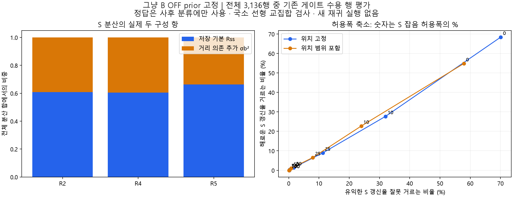

# 선형 S 허용폭 분석

그냥 B OFF prior를 고정한 오프라인 진단. 새 가드나 재귀 실행을 적용하지 않았다. 위치 고정과 위치 불확실성 포함 결과를 구분한다. 비선형 대조에는 위치 고정 결과만 사용한다.

RF 정상: 같은 B tap의 Full–LoS S 차이 ≤0.03. 유익/해로움: 동일 prior의 거리+S 갱신과 거리만 갱신의 Heading 제곱오차 비교. 전체 3,136행 중 기존 게이트 수용 3,125행에서 평가했다. gyro 범위는 과거 RF 영향을 포함하는 EKF prior 공분산으로 계산했으며 독립 gyro-only 검증이 아니다.

|위치 범위 포함|정책|정상 보호/1743|유익한 S 보호/1735|해로운 S 검출/1390|
|---|---|---:|---:|---:|
|False|current|1743|1732|0|
|False|no_extra|1743|1730|5|
|False|no_base|1743|1731|11|
|False|width75|1743|1731|5|
|False|width50|1743|1706|19|
|False|width25|1704|1540|124|
|False|width10|1493|1180|385|
|False|width0|702|519|951|
|True|current|1743|1733|0|
|True|no_extra|1743|1730|2|
|True|no_base|1743|1731|10|
|True|width75|1743|1731|3|
|True|width50|1743|1720|15|
|True|width25|1726|1597|91|
|True|width10|1621|1319|316|
|True|width0|1030|731|762|

[행별 데이터](s_width_sweep_rows.csv) · [궤도별 집계](s_width_sweep_summary.csv) · [분산 구성](s_variance_components.json)