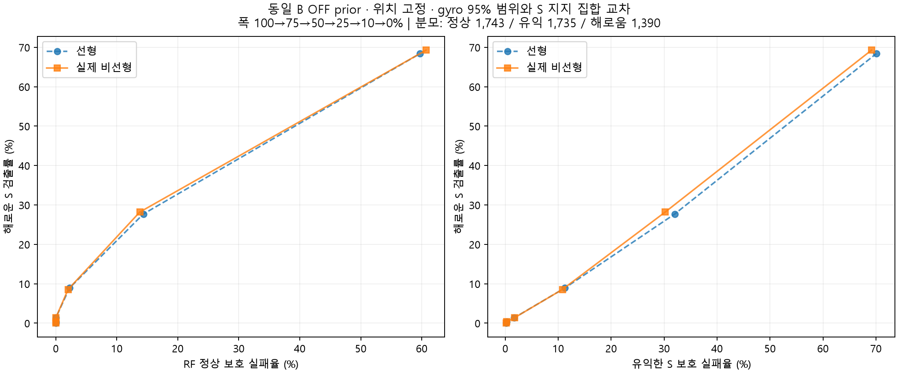
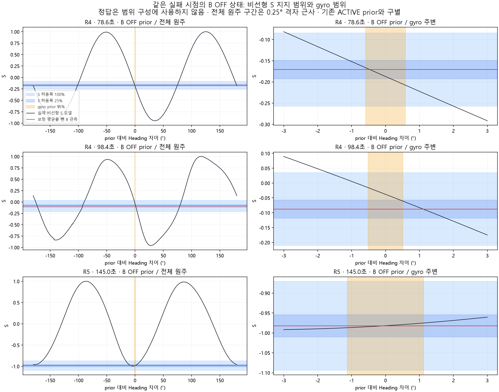

# B 비선형 S–Heading 범위 가능성 검토

결론: 현재 폭에서는 선형과 비선형 판정이 동일하고 해로운 S 검출은 0/1,390이다. 폭 10%에서는 유익한 S 31건 추가 보호·해로운 S 7건 추가 검출이 있지만, 유익한 S 524건을 함께 배제한다. 비선형화 자체가 현재 교차 규칙의 구분 한계를 해결하지 않았다.

실제 SourceFFD의 복소 패턴 보간·스펙트럼·CIR 검출을 다시 평가했다. 단순 Jacobian 역산을 비선형 결과로 부르지 않았다. B OFF prior와 위치·평균 보정·분산은 동일하게 고정했다. 새 가드와 재귀 EKF는 실행하지 않았다.

## 같은 표본 비교

전체 3,136행을 계산하고, 기존 게이트가 수용한 3,125행에서 갱신 손익을 평가했다. 제외된 11행은 P 정상 오경보 11건과 다른 집합이다. 정상은 같은 B tap에서 Full–LoS S 차이 ≤0.03인 1,743행이다. 해로운 S는 동일 prior의 range+S 갱신이 range-only보다 Heading 제곱오차를 키운 1,390행, 유익한 S는 반대인 1,735행이다.

|허용폭|모델|RF 정상 보호|유익한 S 보호|해로운 S 검출|선형과 다른 판정|
|---|---|---:|---:|---:|---:|
|current|linear|1743/1743 (100.00%)|1732/1735 (99.83%)|0/1390 (0.00%)|0|
|current|nonlinear|1743/1743 (100.00%)|1732/1735 (99.83%)|0/1390 (0.00%)|0|
|no_extra|linear|1743/1743 (100.00%)|1730/1735 (99.71%)|5/1390 (0.36%)|0|
|no_extra|nonlinear|1743/1743 (100.00%)|1730/1735 (99.71%)|5/1390 (0.36%)|0|
|no_base|linear|1743/1743 (100.00%)|1731/1735 (99.77%)|11/1390 (0.79%)|0|
|no_base|nonlinear|1743/1743 (100.00%)|1731/1735 (99.77%)|10/1390 (0.72%)|1|
|width75|linear|1743/1743 (100.00%)|1731/1735 (99.77%)|5/1390 (0.36%)|0|
|width75|nonlinear|1743/1743 (100.00%)|1731/1735 (99.77%)|5/1390 (0.36%)|0|
|width50|linear|1743/1743 (100.00%)|1706/1735 (98.33%)|19/1390 (1.37%)|0|
|width50|nonlinear|1743/1743 (100.00%)|1705/1735 (98.27%)|19/1390 (1.37%)|1|
|width25|linear|1704/1743 (97.76%)|1540/1735 (88.76%)|124/1390 (8.92%)|0|
|width25|nonlinear|1708/1743 (97.99%)|1548/1735 (89.22%)|119/1390 (8.56%)|19|
|width10|linear|1493/1743 (85.66%)|1180/1735 (68.01%)|385/1390 (27.70%)|0|
|width10|nonlinear|1503/1743 (86.23%)|1211/1735 (69.80%)|392/1390 (28.20%)|90|
|width0|linear|702/1743 (40.28%)|519/1735 (29.91%)|951/1390 (68.42%)|0|
|width0|nonlinear|685/1743 (39.30%)|535/1735 (30.84%)|963/1390 (69.28%)|162|

## 범위 정의와 해석 한계

G = [ψprior − 1.96√Pψψ, ψprior + 1.96√Pψψ]. 이는 과거 RF 영향을 받은 EKF 운동 prior이며 독립 gyro-only 절대 Heading 범위가 아니다. 현재 데이터만으로 95% 실제 포함률을 보증하지 않는다.

S 지지 집합 = {ψ: |hS(xprior,yprior,ψ) − (SB−μS)| ≤ wS}. wS = 1.96√Rss에 표의 배율을 적용했다. 실제 비선형 함수가 만드는 여러 구간을 하나로 합치지 않고 G와 교차하는지 검사했다. 정답은 이후 손익/정상 라벨에만 사용했다.

위치 고정 선형 결과와 위치 고정 비선형 결과의 대조다. 이전 위치 불확실성 포함 표와 직접 섞으면 안 된다. 위치·Heading 결합 비선형 허용집합은 이번 범위 밖이다.

129개 Heading 격자와 실제 함수 근 찾기/국소 최소화, 판정 민감 행의 513개 격자를 사용했다. 이는 연속 함수의 전역 완전탐색 증명이 아니다. 폭 0은 수치 민감도 끝점이며, 잔차 1e-9 이하 근을 수치적 0으로 처리했다. 대표 원주 그림의 구간 끝점 해상도는 0.25°다.

세 그림은 이전 실패가 논의된 시점의 OFF prior이다. 과거 ACTIVE의 prior·손익 수치를 이 그림에 대입하지 않는다.

## 검증

{
  "routes": [
    {
      "route": "R2",
      "parity": [
        3.552713678800501e-15,
        3.969047313034935e-15
      ],
      "refined": 269,
      "refinement_decision_changes": 0
    },
    {
      "route": "R4",
      "parity": [
        1.7763568394002505e-15,
        6.494804694057166e-15
      ],
      "refined": 289,
      "refinement_decision_changes": 0
    },
    {
      "route": "R5",
      "parity": [
        1.7763568394002505e-15,
        6.661338147750939e-15
      ],
      "refined": 463,
      "refinement_decision_changes": 0
    }
  ],
  "linear_reproduction": "PASS",
  "row_join": "PASS",
  "new_guard": false,
  "new_recursive_run": false
}

입력 SHA, 모델 h/H 전수 일치, 시간/행 연결, 이전 위치 고정 선형 집계 재현을 확인했다. 자기검사이며 독립 감사가 아니다. 새 환경의 검출 성능·재귀 RMSE 개선·정책 채택은 주장하지 않는다.

