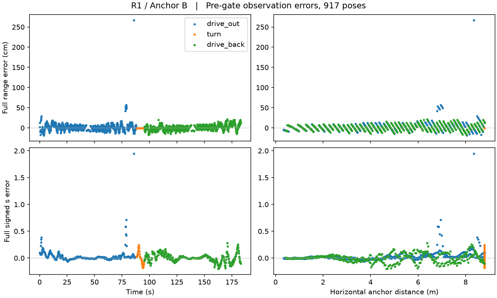
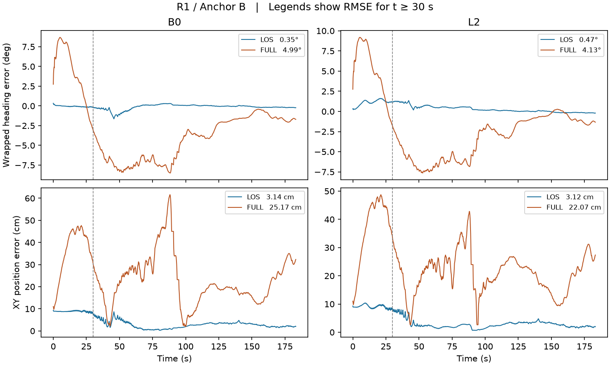

# R1 · Anchor B 보정 전 관측오차와 4상태 EKF 비교

Snowball에서 P1의 917개 LoS·Full 쌍을 재생했다. 257개 주파수 bin의 원래 RF 채널과 검출기를 사용했고, EKF 관측에 평균 보정이나 추가 분산을 적용하지 않았다. P2 검증을 통과한 뒤 B0와 L2 각각에 동일한 초기 상태·제어열·seed로 LoS와 Full을 비교했다. B0의 실제 자이로 바이어스는 0°/s, L2는 0.2°/s다.

## P2 관측오차

모든 pose에서 두 채널의 관측이 유효했다. 참 상태를 사용한 오프라인 예측을 h(GT)로 두면, 각 관측에서 Full − h(GT) = (Full − LoS) + (LoS − h(GT))가 성립했다. 917개 쌍의 최대 절대 잔차는 2.78 × 10⁻¹⁷이었다. 아래는 t ≥ 30초인 767개에서 게이트 적용 전에 계산한 RMS다.

| 오차 | 거리 RMS | signed s RMS |
|---|---:|---:|
| Full − h(GT) | 12.61 cm | 0.105548 |
| Full − LoS | 12.77 cm | 0.105548 |
| LoS − h(GT) | 4.66 cm | 1.99 × 10⁻⁷ |

## P3 4상태 EKF

상태는 x, y, yaw, 자이로 바이어스다. 아래 RMSE에는 업데이트를 거부한 시각의 사후 상태도 포함했다. 각 행의 평가 분모는 767이다.

| 바이어스 | 채널 | Heading RMSE | XY RMSE | 수용 / 거부 |
|---|---|---:|---:|---:|
| B0 | LoS | 0.351° | 3.14 cm | 767 / 0 |
| B0 | Full | 4.993° | 25.17 cm | 742 / 25 |
| L2 | LoS | 0.469° | 3.12 cm | 767 / 0 |
| L2 | Full | 4.133° | 22.07 cm | 745 / 22 |

B0에서 Full의 Heading RMSE는 LoS보다 4.642° 높았고 XY RMSE는 22.03 cm 높았다. L2에서 차이는 각각 3.664°와 18.95 cm였다. 이 비교의 범위는 고정된 R1 경로와 Anchor B, 한 장면 및 한 센서 seed다.

원시 오차와 구간별 통계, EKF 패킷·상태·공분산 기록 및 점수는 [results](results)에 있다. [실행 잠금 기록](REPLAY_LOCK.json)은 P1 원본 manifest와 실행 코드를 SHA-256으로 연결한다. 기존 canary의 HOLD는 그대로 보존했다. 전체 출력의 해시는 [실행 manifest](results/REPLAY_OUTPUT_MANIFEST.json)에 있다. Snowball 원본 경로는 /home/KMS/SIONNA_R1B_CH4_LOCAL_20261103/P2P3_01/results/ 이다.

[독립 사후 감사](INDEPENDENT_POSTRUN_AUDIT.json)에서 계산·기록 정합성이 ACCEPT로 판정됐다. 검토자는 전체 917개 쌍의 관측과 3,668개 EKF 업데이트를 재검산하고, 원시 경로 계수와 지연에서 채널을 복원하는 검사는 8개 pose 표본에 수행했다.
