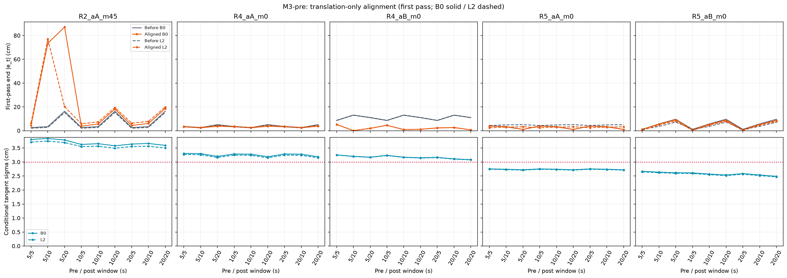
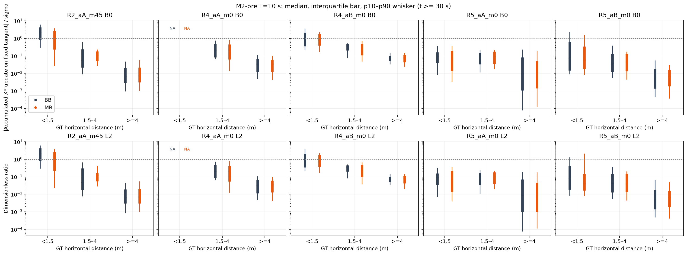
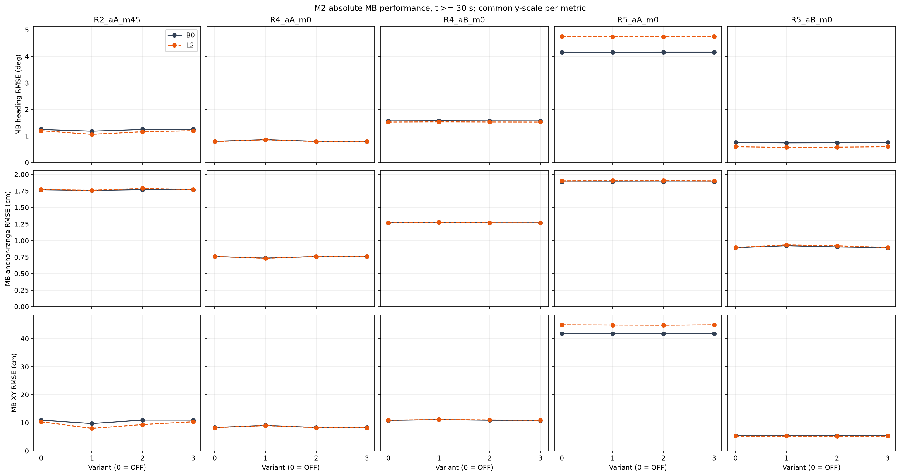
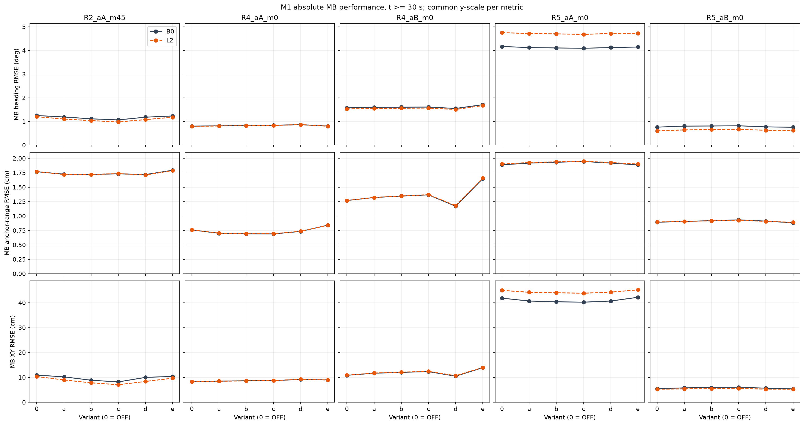
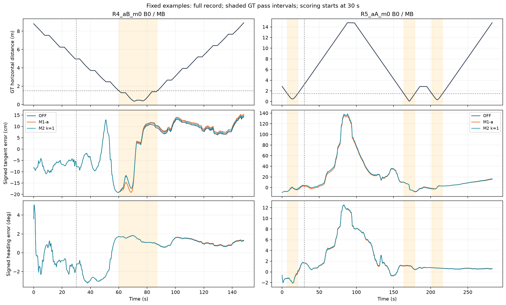

# 앵커 통과 구간의 접선 오차 완화: 세 방법 실행 결과

> **결론: 현재 고정 기준에서는 채택 가능한 방법이 없습니다.** M3-pre는 No-Go로 통합을 실행하지 않았고, M2-pre는 Go였지만 실제 M2 replay는 No-Go였습니다. M1도 모든 강도에서 No-Go입니다.

## 1. 요약

| 방법 | 사전검사 | 실제 실행 | 채택 판정 |
|---|---|---|---|
| M1 접선 range gain 축소 | 별도 gate 없음 | OFF + a–e, 10조건 × BB/MB | No-Go: 모든 변형에서 주 case 성공 0/3 |
| M2 누적 접선 갱신 제한 | Go; T=10초 선택 | OFF + k=1,2,3, 10조건 × BB/MB | No-Go: 모든 k에서 주 case 성공 0/3 |
| M3 구간 정렬 | No-Go; 2D 정렬 360행, 3D 진단 360행 | fixed-lag 통합 미실행 | 공통 창에서 주 case 2/3 + R5 유지 조건 미충족 |

| method | variant | primary_case_pass_count | R4_nonworsening | result |
|---|---|---|---|---|
| M1 | M1-a | 0 | False | NO_GO |
| M1 | M1-b | 0 | False | NO_GO |
| M1 | M1-c | 0 | False | NO_GO |
| M1 | M1-d | 0 | False | NO_GO |
| M1 | M1-e | 0 | False | NO_GO |
| M2 | M2-1 | 0 | False | NO_GO |
| M2 | M2-2 | 0 | True | NO_GO |
| M2 | M2-3 | 0 | True | NO_GO |

기술적 실행 성공과 채택 판정을 구분합니다. B0/L2는 같은 RF의 쌍이며 독립 표본 두 개로 세지 않았습니다. 주 분석은 R2_aA_m45, R4_aA_m0, R4_aB_m0의 세 case 그룹입니다. R4의 두 앵커 조건을 독립 route 두 개로 일반화하지 않습니다.

## 2. 실행과 검산

- 기준 브랜치: `research/ds-x1-x2-results-20261026`, 기준 commit `a6315bbbca54aa9c7d8ae4ab26183d8d94b51ec9`.
- 원문은 `PROTOCOL.md`, 승인한 수정 및 수치 정의는 `DEFINITIONS.md`, M2 개입은 `M2_REPLAY_DEFINITIONS.md`에 고정했습니다.
- M1/M2 OFF 모두 E1의 전체 상태·공분산·h/H/K·혁신·평균·R·mask를 허용차 1e-10 안에서 재현했습니다.
- 저장 trace 독립 검산 3,840개 통과: gain 투영, 상태 갱신, Joseph 공분산, 대칭/PSD, 거리 switch, rolling 정보량·누적량·gamma 및 점수 재현. 입력 해시 255개를 실행 후 재확인했습니다.
- M1/M2 helper는 exit 0으로 자연 종료했으며 process/supervisor/job 부재와 소유 참조 해제를 확인했습니다.
- 최초 pre 계산은 마지막 집계에서 pandas `.T` 참조 오류로 exit 1이었습니다. 원본 코드와 `PRE_FAILURE.json`을 보존하고, `finalize_pre.py`로 저장된 결과만 다시 집계·검산했습니다. 정렬 최적화나 필터를 재실행하지 않았습니다.
- 모든 변경은 새 `azimuth_methods/` 안에 저장합니다. 기존 산출물, Q, 학습 결과, 편파 평균/R 및 A_B는 보존했습니다. M1-e만 사전 정의대로 근거리 Rrr을 4배로 합니다.

## 3. M3-pre: 고정 궤적의 평행이동 정렬

회전을 고정한 2D 평행이동만 Go 판정에 사용했습니다. 단일 앵커 주위 회전은 range를 보존하므로 3DOF는 미식별 진단이며, 유사역행렬로 유한 접선 불확실성을 만들지 않았습니다.

각 패널은 첫 통과의 9개 창 조합입니다. 전·후 오차는 창 끝 시점이 달라지므로 창 사이의 직접 개선 비교보다 동일 창의 전후 비교를 읽어야 합니다. R4_aB는 일부 창에서 오차를 크게 줄이지만 조건부 σ가 3 cm를 넘습니다. 다른 주 case에서도 오차 감소와 불확실성 조건을 동시에 만족하지 못했습니다.

| case | bias | best_reduction | min_sigma_cm |
|---|---|---|---|
| R2_aA_m45 | B0 | -0.1121 | 3.5779 |
| R2_aA_m45 | L2 | -0.2747 | 3.4897 |
| R4_aA_m0 | B0 | 0.2620 | 3.1869 |
| R4_aA_m0 | L2 | 0.1613 | 3.1483 |
| R4_aB_m0 | B0 | 0.9978 | 3.0833 |
| R4_aB_m0 | L2 | 0.9904 | 3.0752 |
| R5_aA_m0 | B0 | 0.0600 | 2.7220 |
| R5_aA_m0 | L2 | 0.4168 | 2.7098 |
| R5_aB_m0 | B0 | 0.2441 | 2.4891 |
| R5_aB_m0 | L2 | 0.9204 | 2.4695 |

| T_pre | T_post | primary_case_pass_count | R5_pass_count | R5_expected_count | R5_all_pass | GO |
|---|---|---|---|---|---|---|
| 5 | 5 | 0 | 1 | 12 | False | False |
| 5 | 10 | 0 | 0 | 12 | False | False |
| 5 | 20 | 0 | 0 | 12 | False | False |
| 10 | 5 | 0 | 1 | 12 | False | False |
| 10 | 10 | 0 | 0 | 12 | False | False |
| 10 | 20 | 0 | 0 | 12 | False | False |
| 20 | 5 | 0 | 1 | 12 | False | False |
| 20 | 10 | 0 | 0 | 12 | False | False |
| 20 | 20 | 0 | 0 | 12 | False | False |

R5 결과는 모든 통과·B0/L2를 포함한 원표에서 보존합니다. 9개 공통 창 조합 중 어느 것도 R5의 12개 pass×bias 셀 모두를 만족하지 못했습니다. 따라서 fixed-lag 통합 gate를 닫았습니다. **이는 이 고정 궤적 평행이동 진단의 실패이며 모든 윈도우 추정 방법의 불가능성을 뜻하지 않습니다.**

## 4. M2-pre와 M2 replay

순간 range 접선 감도는 0이므로 창 끝 추정 접선축을 세계좌표에 고정하고 2D 정보행렬 역행렬을 투영했습니다. 이 값은 동역학과 시간상관을 생략한 상수 평행이동 surrogate입니다. 엄밀한 혁신 검정통계로 해석하지 않습니다.

| T | primary_case_pass_count | contrast_strength | GO |
|---|---|---|---|
| 5 | 1 | 5.6491 | False |
| 10 | 2 | 7.6507 | True |
| 20 | 2 | 4.0711 | True |

T=10초에서 R2_aA_m45와 R4_aB_m0의 MB near 중앙값이 mid·far의 두 배를 넘었습니다(B0/L2 모두). R4_aA는 t≥30초 near 표본 부족으로 NA입니다. 신호의 **상대 대비가 크다는 것과 |S|/σ가 k를 실제로 넘는 것은 다릅니다.**

M2는 range와 편파 gain의 XY 접선 성분을 함께 제한하고 ψ/b_g 행은 유지했습니다. 이전 누적량이 이미 경계 밖인 경우 되돌리는 갱신을 허용합니다. 창과 축이 움직이므로 어느 γ∈[0,1]로도 경계 안에 넣을 수 없는 packet도 있습니다. 이때는 |S|를 최소화하는 끝값을 사용했으며 `infeasible_accepted`로 기록했습니다. 이 방법은 모든 시점에 경계를 강제하는 hard constraint가 아닙니다.

| case | bias | n_accepted | active_accepted | active_scoring | infeasible_accepted |
|---|---|---|---|---|---|
| R2_aA_m45 | B0 | 940 | 41 | 32 | 63 |
| R2_aA_m45 | L2 | 940 | 57 | 32 | 71 |
| R4_aA_m0 | B0 | 718 | 8 | 0 | 6 |
| R4_aA_m0 | L2 | 718 | 7 | 0 | 2 |
| R4_aB_m0 | B0 | 726 | 28 | 28 | 58 |
| R4_aB_m0 | L2 | 726 | 29 | 29 | 57 |
| R5_aA_m0 | B0 | 1349 | 2 | 0 | 18 |
| R5_aA_m0 | L2 | 1350 | 16 | 0 | 28 |
| R5_aB_m0 | B0 | 1384 | 20 | 20 | 25 |
| R5_aB_m0 | L2 | 1384 | 24 | 24 | 28 |

k=2·3은 여러 조건에서 전혀 작동하지 않아 OFF와 같습니다. k=1은 R2 MB Heading을 일부 개선하지만 주 기준을 만족하지 못하고 R4_aA를 악화시켰습니다. R4_aA의 k=1 개입은 전부 30초 이전이며, 그 영향이 이후 평가 구간에 남습니다. R5_aA에서도 scoring 중 새 개입은 0회입니다. 사전 대비만으로 재귀 필터에서의 효과를 보장할 수 없었습니다.

## 5. M1: range gain의 접선 성분 축소

a: λ=0.5,D=1.5m; b: λ=0.25,D=1.5m; c: λ=0,D=1.5m; d: λ=0.5,D=2.5m; e: D=1.5m에서 Rrr×4. 모든 switch는 자기 prior 추정 거리입니다.

R2_aA_m45에서는 b/c가 MB Heading 손상 gap의 절반 이상을 회복하고 거리 개선을 유지합니다. 그러나 같은 방법을 BB에 적용하면 Heading RMSE가 10% 넘게 악화하여 기준⑤를 통과하지 못합니다. R4_aA에서는 모든 M1 변형이 Heading RMSE를 악화시킵니다. R4_aB에서는 d만 Heading을 조금 줄이지만 목표 회복량과 사후 접선 오차 감소를 충족하지 못합니다. Rrr 전체를 키운 대조 e도 해법이 아니었습니다.

| case | bias | variant | heading_rmse_deg | range_rmse_cm | xy_rmse_m |
|---|---|---|---|---|---|
| R2_aA_m45 | B0 | M1-0 | 1.2495 | 1.7688 | 0.1094 |
| R2_aA_m45 | L2 | M1-0 | 1.2021 | 1.7724 | 0.1036 |
| R4_aA_m0 | B0 | M1-0 | 0.8006 | 0.7600 | 0.0833 |
| R4_aA_m0 | L2 | M1-0 | 0.7915 | 0.7606 | 0.0828 |
| R4_aB_m0 | B0 | M1-0 | 1.5742 | 1.2704 | 0.1086 |
| R4_aB_m0 | L2 | M1-0 | 1.5276 | 1.2696 | 0.1090 |
| R5_aA_m0 | B0 | M1-0 | 4.1659 | 1.8885 | 0.4183 |
| R5_aA_m0 | L2 | M1-0 | 4.7525 | 1.9034 | 0.4495 |
| R5_aB_m0 | B0 | M1-0 | 0.7588 | 0.8928 | 0.0546 |
| R5_aB_m0 | L2 | M1-0 | 0.5996 | 0.8968 | 0.0527 |
| R2_aA_m45 | B0 | M1-a | 1.1884 | 1.7267 | 0.1024 |
| R2_aA_m45 | B0 | M1-b | 1.1103 | 1.7217 | 0.0888 |
| R2_aA_m45 | B0 | M1-c | 1.0647 | 1.7330 | 0.0821 |
| R2_aA_m45 | B0 | M1-d | 1.1800 | 1.7198 | 0.1003 |
| R2_aA_m45 | B0 | M1-e | 1.2312 | 1.7948 | 0.1042 |
| R2_aA_m45 | L2 | M1-a | 1.1000 | 1.7196 | 0.0900 |
| R2_aA_m45 | L2 | M1-b | 1.0350 | 1.7210 | 0.0785 |
| R2_aA_m45 | L2 | M1-c | 0.9782 | 1.7362 | 0.0708 |
| R2_aA_m45 | L2 | M1-d | 1.0772 | 1.7120 | 0.0840 |
| R2_aA_m45 | L2 | M1-e | 1.1778 | 1.7893 | 0.0969 |
| R4_aA_m0 | B0 | M1-a | 0.8157 | 0.7009 | 0.0852 |
| R4_aA_m0 | B0 | M1-b | 0.8278 | 0.6922 | 0.0867 |
| R4_aA_m0 | B0 | M1-c | 0.8383 | 0.6905 | 0.0877 |
| R4_aA_m0 | B0 | M1-d | 0.8628 | 0.7337 | 0.0917 |
| R4_aA_m0 | B0 | M1-e | 0.8051 | 0.8419 | 0.0901 |
| R4_aA_m0 | L2 | M1-a | 0.8099 | 0.7040 | 0.0851 |
| R4_aA_m0 | L2 | M1-b | 0.8167 | 0.6943 | 0.0861 |
| R4_aA_m0 | L2 | M1-c | 0.8300 | 0.6929 | 0.0875 |
| R4_aA_m0 | L2 | M1-d | 0.8673 | 0.7371 | 0.0926 |
| R4_aA_m0 | L2 | M1-e | 0.7977 | 0.8407 | 0.0898 |
| R4_aB_m0 | B0 | M1-a | 1.5921 | 1.3217 | 0.1169 |
| R4_aB_m0 | B0 | M1-b | 1.6022 | 1.3465 | 0.1205 |
| R4_aB_m0 | B0 | M1-c | 1.6075 | 1.3674 | 0.1234 |
| R4_aB_m0 | B0 | M1-d | 1.5485 | 1.1707 | 0.1051 |
| R4_aB_m0 | B0 | M1-e | 1.7084 | 1.6507 | 0.1393 |
| R4_aB_m0 | L2 | M1-a | 1.5487 | 1.3222 | 0.1176 |
| R4_aB_m0 | L2 | M1-b | 1.5573 | 1.3479 | 0.1213 |
| R4_aB_m0 | L2 | M1-c | 1.5659 | 1.3707 | 0.1244 |
| R4_aB_m0 | L2 | M1-d | 1.5068 | 1.1803 | 0.1069 |
| R4_aB_m0 | L2 | M1-e | 1.6709 | 1.6603 | 0.1403 |
| R5_aA_m0 | B0 | M1-a | 4.1208 | 1.9186 | 0.4068 |
| R5_aA_m0 | B0 | M1-b | 4.1043 | 1.9333 | 0.4037 |
| R5_aA_m0 | B0 | M1-c | 4.0906 | 1.9457 | 0.4022 |
| R5_aA_m0 | B0 | M1-d | 4.1214 | 1.9195 | 0.4068 |
| R5_aA_m0 | B0 | M1-e | 4.1440 | 1.8871 | 0.4218 |
| R5_aA_m0 | L2 | M1-a | 4.7120 | 1.9274 | 0.4418 |
| R5_aA_m0 | L2 | M1-b | 4.6980 | 1.9400 | 0.4398 |
| R5_aA_m0 | L2 | M1-c | 4.6783 | 1.9508 | 0.4382 |
| R5_aA_m0 | L2 | M1-d | 4.7156 | 1.9280 | 0.4423 |
| R5_aA_m0 | L2 | M1-e | 4.7231 | 1.9010 | 0.4516 |
| R5_aB_m0 | B0 | M1-a | 0.8020 | 0.9073 | 0.0582 |
| R5_aB_m0 | B0 | M1-b | 0.8077 | 0.9202 | 0.0596 |
| R5_aB_m0 | B0 | M1-c | 0.8166 | 0.9338 | 0.0607 |
| R5_aB_m0 | B0 | M1-d | 0.7694 | 0.9125 | 0.0569 |
| R5_aB_m0 | B0 | M1-e | 0.7549 | 0.8832 | 0.0541 |
| R5_aB_m0 | L2 | M1-a | 0.6423 | 0.9077 | 0.0543 |
| R5_aB_m0 | L2 | M1-b | 0.6547 | 0.9176 | 0.0550 |
| R5_aB_m0 | L2 | M1-c | 0.6653 | 0.9277 | 0.0557 |
| R5_aB_m0 | L2 | M1-d | 0.6273 | 0.9078 | 0.0532 |
| R5_aB_m0 | L2 | M1-e | 0.6188 | 0.8913 | 0.0528 |

### 기준별 판정

① Heading 회복, ② range 개선 80% 유지, ③ post mean(|e_t|)와 mean(|β̃|) 감소, ④ XY/Heading NEES 악화≤10%, ⑤ BB Heading 악화≤10%. false는 고정 기준 미충족이며 통계적 유의성 판정이 아닙니다.

| variant | case | bias | criterion1 | criterion2 | criterion3 | criterion4 | criterion5 |
|---|---|---|---|---|---|---|---|
| M1-a | R2_aA_m45 | B0 | False | True | True | True | False |
| M1-a | R2_aA_m45 | L2 | False | True | True | True | True |
| M1-a | R4_aA_m0 | B0 | False | True | False | True | True |
| M1-a | R4_aA_m0 | L2 | False | True | False | True | True |
| M1-a | R4_aB_m0 | B0 | False | True | False | True | True |
| M1-a | R4_aB_m0 | L2 | False | True | False | True | True |
| M1-b | R2_aA_m45 | B0 | True | True | True | True | False |
| M1-b | R2_aA_m45 | L2 | True | True | True | True | False |
| M1-b | R4_aA_m0 | B0 | False | True | False | True | True |
| M1-b | R4_aA_m0 | L2 | False | True | False | True | True |
| M1-b | R4_aB_m0 | B0 | False | True | False | False | True |
| M1-b | R4_aB_m0 | L2 | False | True | False | False | True |
| M1-c | R2_aA_m45 | B0 | True | True | True | True | False |
| M1-c | R2_aA_m45 | L2 | True | True | True | True | False |
| M1-c | R4_aA_m0 | B0 | False | True | False | True | True |
| M1-c | R4_aA_m0 | L2 | False | True | False | True | True |
| M1-c | R4_aB_m0 | B0 | False | True | False | False | True |
| M1-c | R4_aB_m0 | L2 | False | True | False | False | True |
| M1-d | R2_aA_m45 | B0 | False | True | True | True | False |
| M1-d | R2_aA_m45 | L2 | True | True | True | True | True |
| M1-d | R4_aA_m0 | B0 | False | True | True | False | False |
| M1-d | R4_aA_m0 | L2 | False | True | True | False | False |
| M1-d | R4_aB_m0 | B0 | False | True | False | True | True |
| M1-d | R4_aB_m0 | L2 | False | True | False | True | True |
| M1-e | R2_aA_m45 | B0 | False | True | True | True | True |
| M1-e | R2_aA_m45 | L2 | False | True | True | True | True |
| M1-e | R4_aA_m0 | B0 | False | True | True | True | True |
| M1-e | R4_aA_m0 | L2 | False | True | False | True | True |
| M1-e | R4_aB_m0 | B0 | False | False | False | False | False |
| M1-e | R4_aB_m0 | L2 | False | False | False | False | False |

| variant | case | bias | criterion1 | criterion2 | criterion3 | criterion4 | criterion5 |
|---|---|---|---|---|---|---|---|
| M2-1 | R2_aA_m45 | B0 | False | True | True | True | True |
| M2-1 | R2_aA_m45 | L2 | True | True | True | True | True |
| M2-1 | R4_aA_m0 | B0 | False | True | True | True | True |
| M2-1 | R4_aA_m0 | L2 | False | True | True | True | True |
| M2-1 | R4_aB_m0 | B0 | False | True | False | True | True |
| M2-1 | R4_aB_m0 | L2 | False | True | False | True | True |
| M2-2 | R2_aA_m45 | B0 | False | True | False | True | True |
| M2-2 | R2_aA_m45 | L2 | False | True | True | True | True |
| M2-2 | R4_aA_m0 | B0 | False | True | False | True | True |
| M2-2 | R4_aA_m0 | L2 | False | True | False | True | True |
| M2-2 | R4_aB_m0 | B0 | False | True | False | True | True |
| M2-2 | R4_aB_m0 | L2 | False | True | False | True | True |
| M2-3 | R2_aA_m45 | B0 | False | True | False | True | True |
| M2-3 | R2_aA_m45 | L2 | False | True | False | True | True |
| M2-3 | R4_aA_m0 | B0 | False | True | False | True | True |
| M2-3 | R4_aA_m0 | L2 | False | True | False | True | True |
| M2-3 | R4_aB_m0 | B0 | False | True | False | True | True |
| M2-3 | R4_aB_m0 | L2 | False | True | False | True | True |

## 6. 통과 시계열과 R5 재노출

고정 사례 R4_aB B0와 R5_aA B0에 OFF, M1-a, M2 k=1을 겹쳤습니다. 결과가 가장 좋아 보이는 변형을 골라 그린 그림이 아닙니다. 주황 구간은 GT 통과, 수직 점선은 평가 시작 30초입니다. R5에서는 세 차례 통과를 모두 표시했습니다.

R5의 pass별 post 통계는 `ALL_PASS_METRICS.csv`, 기준별 판정은 `M1_ROBUSTNESS.csv`와 `M2_ROBUSTNESS.csv`에 있습니다. 전역 Heading 점수는 pass별 점수로 바꾸지 않았으며, ③만 각 pass의 post 창에서 평가합니다. 아래는 OFF/M1-a/M2-k1의 MB post mean(|e_t|)입니다.

| case | bias | pass_id | variant | valid_post | post_length_s | mean_abs_et_cm | mean_abs_beta_deg |
|---|---|---|---|---|---|---|---|
| R5_aA_m0 | B0 | 1 | M1-0 | True | 30.0000 | 2.2415 | 0.3433 |
| R5_aA_m0 | B0 | 2 | M1-0 | True | 23.0000 | 2.5889 | 0.7156 |
| R5_aA_m0 | B0 | 3 | M1-0 | True | 30.0000 | 4.8568 | 0.6528 |
| R5_aA_m0 | L2 | 1 | M1-0 | True | 30.0000 | 4.6519 | 0.6182 |
| R5_aA_m0 | L2 | 2 | M1-0 | True | 23.0000 | 2.7820 | 0.7662 |
| R5_aA_m0 | L2 | 3 | M1-0 | True | 30.0000 | 5.4668 | 0.7404 |
| R5_aB_m0 | B0 | 1 | M1-0 | True | 30.0000 | 5.6875 | 0.6968 |
| R5_aB_m0 | B0 | 2 | M1-0 | True | 30.0000 | 3.3620 | 0.5433 |
| R5_aB_m0 | B0 | 3 | M1-0 | True | 30.0000 | 6.6670 | 0.9147 |
| R5_aB_m0 | L2 | 1 | M1-0 | True | 30.0000 | 3.7273 | 0.4140 |
| R5_aB_m0 | L2 | 2 | M1-0 | True | 30.0000 | 3.3063 | 0.5351 |
| R5_aB_m0 | L2 | 3 | M1-0 | True | 30.0000 | 6.5544 | 0.8970 |
| R5_aA_m0 | B0 | 1 | M1-a | True | 30.0000 | 1.6162 | 0.2810 |
| R5_aA_m0 | B0 | 2 | M1-a | True | 23.0000 | 2.1225 | 0.5875 |
| R5_aA_m0 | B0 | 3 | M1-a | True | 30.0000 | 4.8519 | 0.6606 |
| R5_aA_m0 | L2 | 1 | M1-a | True | 30.0000 | 3.6122 | 0.4645 |
| R5_aA_m0 | L2 | 2 | M1-a | True | 23.0000 | 2.3082 | 0.6447 |
| R5_aA_m0 | L2 | 3 | M1-a | True | 30.0000 | 5.5737 | 0.7677 |
| R5_aB_m0 | B0 | 1 | M1-a | True | 30.0000 | 6.8062 | 0.8328 |
| R5_aB_m0 | B0 | 2 | M1-a | True | 30.0000 | 3.4327 | 0.5549 |
| R5_aB_m0 | B0 | 3 | M1-a | True | 30.0000 | 6.8721 | 0.9419 |
| R5_aB_m0 | L2 | 1 | M1-a | True | 30.0000 | 4.4537 | 0.4798 |
| R5_aB_m0 | L2 | 2 | M1-a | True | 30.0000 | 3.3265 | 0.5378 |
| R5_aB_m0 | L2 | 3 | M1-a | True | 30.0000 | 6.4642 | 0.8802 |
| R5_aA_m0 | B0 | 1 | M2-1 | True | 30.0000 | 2.2642 | 0.3473 |
| R5_aA_m0 | B0 | 2 | M2-1 | True | 23.0000 | 2.5805 | 0.7133 |
| R5_aA_m0 | B0 | 3 | M2-1 | True | 30.0000 | 4.8123 | 0.6467 |
| R5_aA_m0 | L2 | 1 | M2-1 | True | 30.0000 | 5.0608 | 0.7033 |
| R5_aA_m0 | L2 | 2 | M2-1 | True | 23.0000 | 2.7515 | 0.7586 |
| R5_aA_m0 | L2 | 3 | M2-1 | True | 30.0000 | 5.3045 | 0.7182 |
| R5_aB_m0 | B0 | 1 | M2-1 | True | 30.0000 | 4.5529 | 0.4977 |
| R5_aB_m0 | B0 | 2 | M2-1 | True | 30.0000 | 3.2051 | 0.5170 |
| R5_aB_m0 | B0 | 3 | M2-1 | True | 30.0000 | 6.7430 | 0.9238 |
| R5_aB_m0 | L2 | 1 | M2-1 | True | 30.0000 | 3.7762 | 0.5629 |
| R5_aB_m0 | L2 | 2 | M2-1 | True | 30.0000 | 3.0742 | 0.4963 |
| R5_aB_m0 | L2 | 3 | M2-1 | True | 30.0000 | 6.3357 | 0.8615 |

## 7. 해석 한계와 다음 단계

- 이번 결과는 고정 A_B, 기존 시뮬레이션 RF와 주행 궤적의 탐색적 비교입니다. 자연 gate나 독립 데이터의 성능으로 일반화하지 않습니다.
- T와 창 선택은 같은 trace를 보고 한 것이므로 독립 검증이 아닙니다. B0/L2를 독립 반복으로 세지 않습니다.
- M3의 상대 posterior 궤적에는 이미 편파·Heading 정보가 포함됩니다. 정렬 Fisher는 궤적 모양이 정확하다는 조건부 불확실성이며, 순수 range-only 전역 관측성을 증명하지 않습니다.
- M2의 제한은 동역학에 의한 접선 이동 전체가 아니라 측정 갱신의 누적량에만 작용합니다. 또한 gain의 직접 ψ행을 바꾸지 않습니다.
- 현 기준을 완화하거나 새 R/Q/Heading prior로 추가 실험하지 않았습니다. **세 방법 모두 현 설정에서 채택 보류**로 닫습니다. 다음 실험을 정한다면 R2의 MB 개선과 BB 손상의 차이, 초기 통과의 누적 제한 작동 시점, 고정 궤적 가정의 한계를 먼저 검토할 근거가 있습니다.

## 산출물 안내

`CHECKS.json`은 검산 묶음, `INPUT_LOCK.json`/`M1_INPUT_LOCK.json`/`M2_INPUT_LOCK.json`은 입력 고정, `OUTPUT_SHA256.json`은 최종 산출물 해시입니다. 원본 trace는 M1_OFF/M1_SWEEP/M2_OFF/M2_SWEEP 폴더에 있습니다. 소스 실행 순서는 prechecks.py → finalize_pre.py → run_m1.py → run_m2.py → analyze_results.py → render_report.py입니다. prechecks.py의 마지막 집계 오류는 위에 명시한 그대로 보존되어 있어, 기존 저장 결과를 finalize_pre.py로 마무리합니다.
