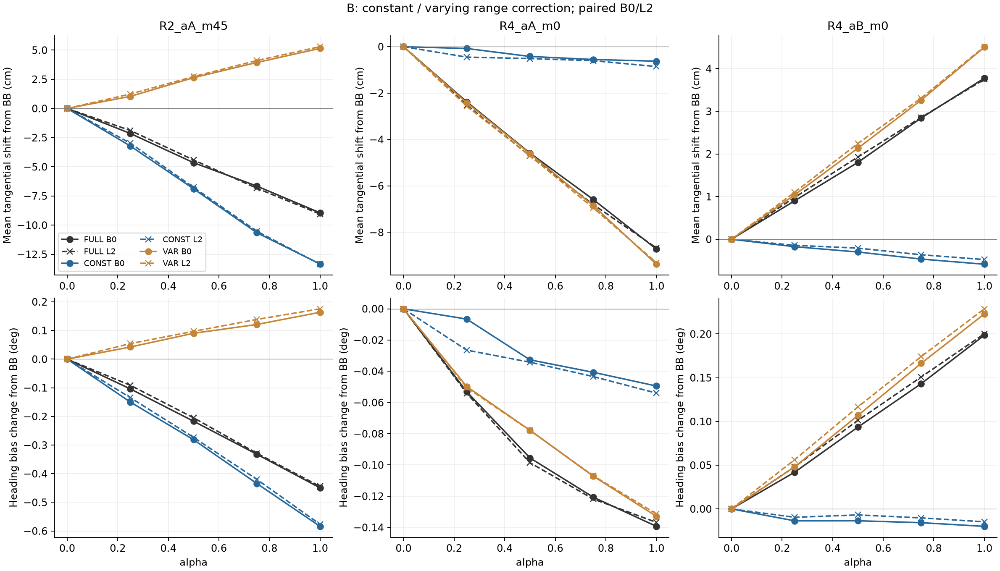
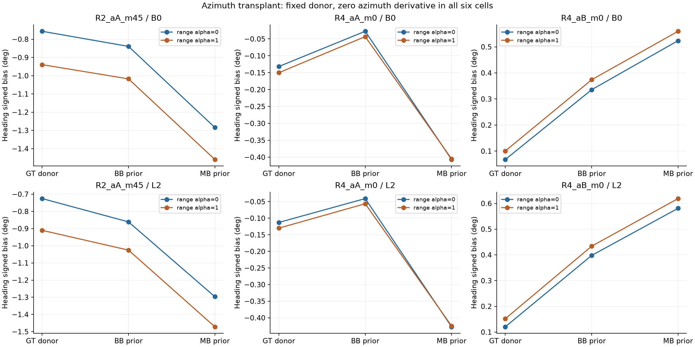
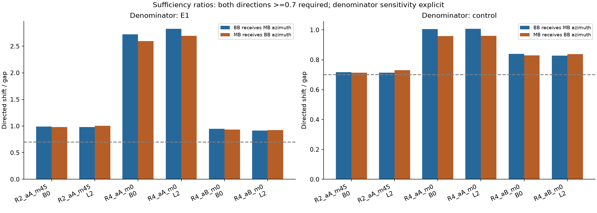

# 주 분석 6조건: B 성분 분리와 방위각 이식

**주 분석 6조건의 지정된 검증을 완료로 닫는다. 검증 완료와 가설 지지는 구분한다.**

적용 범위는 R2_aA_m45, R4_aA_m0, R4_aB_m0의 B0/L2 쌍이다. B0/L2를 독립 반복으로 세지 않는다. GT·다른 Arm의 frozen prior를 이용한 오프라인 개입으로, 배포 가능한 알고리즘이나 통계적 유의성을 주장하지 않는다.

## 결과 요약

방위각 이식은 주 분석 6조건 모두에서 양방향 0.7 기준을 충족했다. E1 분모와 동일한 방위각 미분 규칙을 적용한 대조군 분모 사이에 판정 불일치는 없었다. 단, 같은 미분 규칙이라는 뜻이지 전체 Jacobian의 수치가 같다는 뜻은 아니다.

| 경로 | 이식 양방향 비율 범위: 대조군 gap 기준 | CONST 접선 이동 / FULL 접선 이동 |
| --- | --- | --- |
| R2_aA_m45 | 71.29–73.09% | -13.35~-13.33 cm / -9.05~-8.94 cm |
| R4_aA_m0 | 95.81–100.67% | -0.86~-0.62 cm / -8.72~-8.67 cm |
| R4_aB_m0 | 82.82–83.89% | -0.59~-0.48 cm / 3.75~3.78 cm |

R2_m45는 상수 성분이 접선 이동을 크게 만들고 변동 성분이 일부 상쇄한다. R4 두 경로는 상수 성분만으로 FULL의 접선 이동을 재현하지 못한다. R4_aA의 Heading 성분 몫은 상호작용 30% 초과로 해석에서 제외한다.

R4_aA의 E1 gap 기준 이식 비율은 약 2.6–2.8로 과대 재현된다. 동일 미분 규칙의 대조군 gap에서는 약 0.96–1.01이다. 따라서 E1 수치와 정확히 같아졌다고 표현하지 않는다.

[실행 전 정의](PROTOCOL.md) · [조건별 완료 상태](PRIMARY_CLOSURE.csv)

## 1. B: 상수·변동 보정 성분

각 case × bias의 자기 BASE 수용 집합에서 c를 계산했다. B0/L2 c 동일성은 검산에서 제거했고, mean(v|A_B)=0 및 alpha0/1 대조 재현은 유지했다. B0/L2 차이와 mask 차이는 기술값으로 남겼다.

| case | c_B0 | c_L2 | difference_m | mask_differences |
| --- | --- | --- | --- | --- |
| R2_aA_m0 | -0.012177 | -0.012452 | -0.000275 | 8 |
| R2_aB_m0 | -0.016470 | -0.016470 | 0.000000 | 0 |
| R2_aA_m45 | 0.026438 | 0.026438 | 0.000000 | 0 |
| R4_aA_m0 | 0.010502 | 0.010502 | 0.000000 | 0 |
| R4_aB_m0 | 0.006295 | 0.006295 | 0.000000 | 0 |
| R5_aA_m0 | -0.021121 | -0.020951 | 0.000170 | 1 |
| R5_aB_m0 | -0.025969 | -0.025969 | 0.000000 | 0 |

상수 c는 range 평균 보정에 더해지는 값이다. 관측 innovation에서는 z−h−mu이므로 양의 c는 보정된 range를 줄인다.

### Heading bias 변화에서 각 성분이 차지하는 몫(기술)

| case | bias | delta_FULL | delta_CONST | delta_VAR | s_const | s_var | I_bias_normalized | description |
| --- | --- | --- | --- | --- | --- | --- | --- | --- |
| R2_aA_m45 | B0 | -0.449348 | -0.583859 | 0.163598 | 1.299346 | -0.364078 | 0.064732 | 상수 성분의 기술적 몫 ≥0.7 |
| R2_aA_m45 | L2 | -0.444245 | -0.576598 | 0.175641 | 1.297928 | -0.395370 | 0.097442 | 상수 성분의 기술적 몫 ≥0.7 |
| R4_aA_m0 | B0 | -0.139315 | -0.049445 | -0.132874 | 0.354915 | 0.953771 | 0.308686 | 비가산/작은 분모: 몫 해석 제외 |
| R4_aA_m0 | L2 | -0.136755 | -0.053964 | -0.131307 | 0.394605 | 0.960159 | 0.354765 | 비가산/작은 분모: 몫 해석 제외 |
| R4_aB_m0 | B0 | 0.198599 | -0.019976 | 0.222938 | -0.100583 | 1.122554 | 0.021970 | 변동 성분의 기술적 몫 ≥0.7 |
| R4_aB_m0 | L2 | 0.200264 | -0.014776 | 0.228786 | -0.073781 | 1.142425 | 0.068644 | 변동 성분의 기술적 몫 ≥0.7 |

분모가 작거나 정규화 상호작용>0.3이면 몫을 해석하지 않는다. 음의 몫/1보다 큰 몫은 상쇄 또는 넘침을 나타낼 수 있으며 숨기지 않는다.

### 상수 성분이 만드는 접선 이동

아래 값은 GT 접선축에서 CONST/VAR/FULL 위치와 E1 BB 위치의 차이를 투영한 평균 signed 이동이다. 궤적 전체가 같은 벡터만큼 평행 이동한다는 뜻은 아니다. 예상한 4–9cm 범위에 맞춰 값을 선택하지 않았다.

| case | bias | arm | delta_tangential_cm | FULL_tangential_cm | tangential_fraction | delta_beta_deg | delta_phi_deg | delta_radial_cm |
| --- | --- | --- | --- | --- | --- | --- | --- | --- |
| R2_aA_m45 | B0 | CONST | -13.329215 | -8.943018 | 1.490460 | -1.366669 | 0.782810 | -2.161785 |
| R2_aA_m45 | B0 | VAR | 5.146927 | -8.943018 | -0.575525 | 0.413218 | -0.249620 | -0.331417 |
| R2_aA_m45 | B0 | FULL | -8.943018 | -8.943018 | 1.000000 | -1.054143 | 0.604795 | -2.377848 |
| R2_aA_m45 | L2 | CONST | -13.350432 | -9.051046 | 1.475015 | -1.371406 | 0.794808 | -2.157664 |
| R2_aA_m45 | L2 | VAR | 5.294198 | -9.051046 | -0.584927 | 0.424552 | -0.248911 | -0.334511 |
| R2_aA_m45 | L2 | FULL | -9.051046 | -9.051046 | 1.000000 | -1.065373 | 0.621128 | -2.371572 |
| R4_aA_m0 | B0 | CONST | -0.624662 | -8.723154 | 0.071610 | -0.069332 | 0.019887 | -0.704507 |
| R4_aA_m0 | B0 | VAR | -9.374449 | -8.723154 | 1.074663 | -1.047908 | 0.915034 | 0.455539 |
| R4_aA_m0 | B0 | FULL | -8.723154 | -8.723154 | 1.000000 | -0.971826 | 0.832511 | -0.232243 |
| R4_aA_m0 | L2 | CONST | -0.855864 | -8.672049 | 0.098692 | -0.091907 | 0.037942 | -0.705880 |
| R4_aA_m0 | L2 | VAR | -9.309975 | -8.672049 | 1.073561 | -1.038254 | 0.906947 | 0.450656 |
| R4_aA_m0 | L2 | FULL | -8.672049 | -8.672049 | 1.000000 | -0.963701 | 0.826946 | -0.236023 |
| R4_aB_m0 | B0 | CONST | -0.586016 | 3.776535 | -0.155173 | -0.176496 | 0.156520 | -0.386380 |
| R4_aB_m0 | B0 | VAR | 4.504190 | 3.776535 | 1.192678 | 1.158837 | -0.935900 | -0.159780 |
| R4_aB_m0 | B0 | FULL | 3.776535 | 3.776535 | 1.000000 | 0.937578 | -0.738979 | -0.534574 |
| R4_aB_m0 | L2 | CONST | -0.476347 | 3.748896 | -0.127063 | -0.157837 | 0.143062 | -0.378084 |
| R4_aB_m0 | L2 | VAR | 4.514870 | 3.748896 | 1.204320 | 1.151992 | -0.923206 | -0.159322 |
| R4_aB_m0 | L2 | FULL | 3.748896 | 3.748896 | 1.000000 | 0.922464 | -0.722201 | -0.533504 |

[Arm×alpha 전체 beta/phi/접선/반경 bias 표](ALL_DECOMPOSITION.md) · [전체 수치](B_ALL_ARMS_DECOMPOSITION.csv) · [직접 투영 검산](B_MOVEMENT_CHECKS.json)

## 2. 방위각 이식: 충분성

각 packet에서 E1 BB 또는 MB의 **prior 위치**로 방위각을 정했다. 두 안테나는 동일한 방향 벡터를 사용하고, 수신 Arm의 앙각·거리·Heading은 유지했다. 모든 셀에서 donor 방위각 미분은 0이다. GT 두 셀은 기존 CUT_AZ를 재사용했으며, 신규 replay는 6조건×4셀=24개다.

동일 Jacobian 조건의 자기 donor 대조군은 자연 갱신 E1과 다를 수 있다. 따라서 G_E1 및 G_control과 두 방향 비율을 모두 보고한다. 두 분모가 다른 판정을 내면 충분성 결론에 그 차이를 명시한다.

| case | bias | G_E1 | G_control | forward_deg | backward_deg | forward_ratio_E1 | backward_ratio_E1 | forward_ratio_control | backward_ratio_control | sufficiency_E1 | sufficiency_control |
| --- | --- | --- | --- | --- | --- | --- | --- | --- | --- | --- | --- |
| R2_aA_m45 | B0 | -0.449348 | -0.619995 | -0.444527 | -0.442015 | 0.989271 | 0.983680 | 0.716985 | 0.712933 | True | True |
| R2_aA_m45 | L2 | -0.444245 | -0.610638 | -0.435377 | -0.446344 | 0.980038 | 1.004724 | 0.712988 | 0.730947 | True | True |
| R4_aA_m0 | B0 | -0.139315 | -0.377428 | -0.379488 | -0.361603 | 2.723957 | 2.595579 | 1.005457 | 0.958070 | True | True |
| R4_aA_m0 | L2 | -0.136755 | -0.383827 | -0.386404 | -0.368257 | 2.825511 | 2.692819 | 1.006713 | 0.959435 | True | True |
| R4_aB_m0 | B0 | 0.198599 | 0.224147 | 0.188040 | 0.185869 | 0.946835 | 0.935901 | 0.838914 | 0.829227 | True | True |
| R4_aB_m0 | L2 | 0.200264 | 0.220889 | 0.182946 | 0.185051 | 0.913528 | 0.924035 | 0.828229 | 0.837755 | True | True |

### E1과 대조군의 차이

| case | bias | E1_BB | control_BB | BB_control_minus_E1 | E1_MB | control_MB | MB_control_minus_E1 |
| --- | --- | --- | --- | --- | --- | --- | --- |
| R2_aA_m45 | B0 | -0.636269 | -0.839371 | -0.203102 | -1.085618 | -1.459366 | -0.373748 |
| R2_aA_m45 | L2 | -0.587655 | -0.861202 | -0.273548 | -1.031900 | -1.471840 | -0.439940 |
| R4_aA_m0 | B0 | -0.053774 | -0.027375 | 0.026398 | -0.193088 | -0.404803 | -0.211715 |
| R4_aA_m0 | L2 | -0.031444 | -0.040803 | -0.009359 | -0.168199 | -0.424630 | -0.256431 |
| R4_aB_m0 | B0 | 0.223152 | 0.335636 | 0.112484 | 0.421751 | 0.559783 | 0.138032 |
| R4_aB_m0 | L2 | 0.278811 | 0.397914 | 0.119103 | 0.479075 | 0.618803 | 0.139728 |

### 조건별 결론

- R2_aA_m45/B0: 검증 완료. 두 분모 기준 모두 양방향 충분성 지지. 필요성 f_magnitude=0.718072.
- R2_aA_m45/L2: 검증 완료. 두 분모 기준 모두 양방향 충분성 지지. 필요성 f_magnitude=0.726183.
- R4_aA_m0/B0: 검증 완료. 두 분모 기준 모두 양방향 충분성 지지. 필요성 f_magnitude=0.941586.
- R4_aA_m0/L2: 검증 완료. 두 분모 기준 모두 양방향 충분성 지지. 필요성 f_magnitude=0.938502.
- R4_aB_m0/B0: 검증 완료. 두 분모 기준 모두 양방향 충분성 지지. 필요성 f_magnitude=0.977895.
- R4_aB_m0/L2: 검증 완료. 두 분모 기준 모두 양방향 충분성 지지. 필요성 f_magnitude=0.982617.

이식은 방위각 경로를 통한 개입의 충분성을 진단한다. 다른 경로의 부재나 유일 원인, 실환경 일반화를 증명하지 않는다.

## 3. 별도 트랙 및 범위 종료

- R2_aA_m0, R2_aB_m0, R5_aB_m0: 현재 위치→편파 차단만으로 설명되지 않음. 별도 트랙으로 이관하며 이번 주 분석 결론을 보류하는 조건으로 삼지 않는다.
- 첫 질문: 같은 R2에서 마운트에 따라 기전이 갈리는 이유는 무엇인가? 이번 작업에서는 추가 replay를 실행하지 않았다.
- R5_aA_m0: 기존 gate 진단 트랙. 이번 주 분석 6조건에 포함하지 않는다.
- B는 기존 정의의 14조건 전체를 계산했지만 충분성 검정과 완료 선언의 적용 범위는 주 분석 6조건으로 한정한다.

## 4. 검산과 보존

- B: mean(v|A_B)≤1e-12m, CONST/VAR alpha0 및 FULL alpha1의 E1 trace 재현≤1e-10.
- GT donor provider의 h/H를 기존 CUT_AZ 전 시점에서≤1e-12로 검산했다.
- 공분산 대칭/PSD 및 거절 시 상태 불변 검산을 유지했다.
- 원본 frozen 결과는 수정하지 않았고, 별도 결과 폴더에 저장했다.
- 추적된 Python bytecode는 다음 패키지에서 제외한다. 원래 실행 manifest의 캐시 항목은 명시적 제외 기록으로 설명한다.
