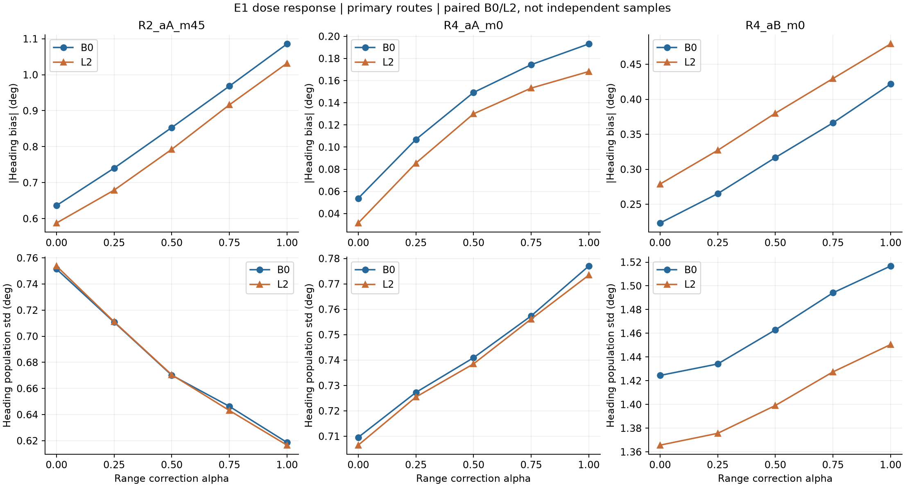
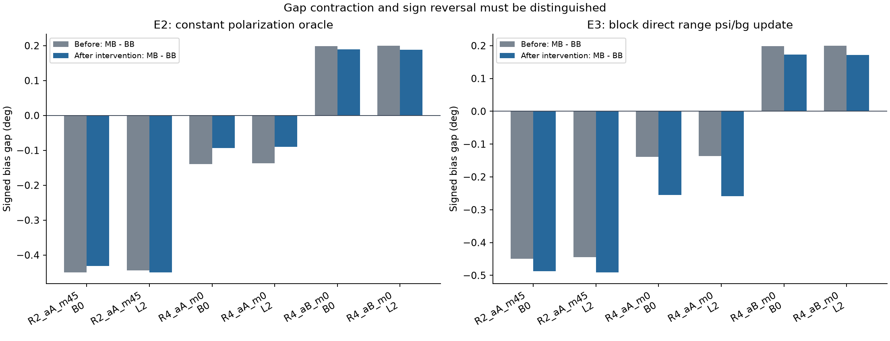
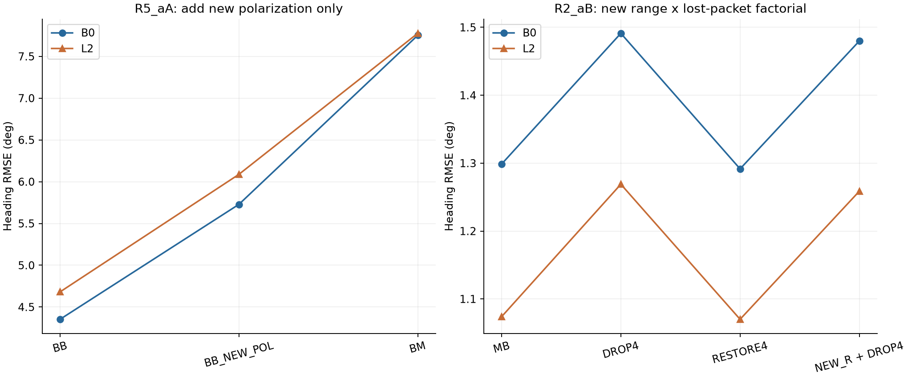

# Δs 보정: 비선형 개입 실험 1–4

> **검증된 결론**
> 대상 6조건 모두 Range 평균 보정 강도에 따라 Heading 편향 크기가 단조 증가했다. 그러나 상수 편파 편향 제거와 직접 Range→Heading 갱신 차단은 그 signed bias 차이를 대부분 해소하지 못했다.
> R5_aA의 신규 편파-only 갱신은 악화에 기여했지만 BM 악화량의 40–45%만 재현했다. R2_aB의 4개 패킷 거절은 약 0.19°의 Heading RMSE 악화를 만들었으나, 복원 후 signed bias 차이가 남아 엄격한 MB 복귀 기준은 통과하지 못했다.

## 1. 실행 범위와 검산

실험 1 → 실험 2 → 실험 3의 순차 갱신 대조 검사 → 실험 3 차단 → 실험 4a → 실험 4b 순서로 완료했다. 선형 기여 분해를 사용하지 않았으며, 모든 궤적에서 물리 측정 함수 h, Jacobian H, 공분산 P와 gain K를 다시 계산했다.

| 단계 | 조건과 Arm | 재현 대조 |
| --- | --- | --- |
| E1 | 14조건 × 5α = 70 | α0=BB, α1=MB |
| E2 | 14조건 × 4 Arm = 56 | oracle=0의 BB/MB |
| E3_CONTROL | 14조건 × 2 Arm = 28 | 차단 없는 순차 BB/MB |
| E3 | 14조건 × 2 Arm = 28 | 모든 E3_CONTROL 통과 후에만 실행 |
| E4a | R5_aA B0/L2 × 3 Arm = 6 | BB/BM |
| E4b | R2_aB B0/L2 × 4 Arm = 8 | MB/MM_NEW_RANGE_ONLY |

총 196개 조건-Arm 결과와 60개 상세 trace NPZ를 저장했다. 명시적 수치 비교 1,483개가 통과했고, 사전 mask·채널 모드 일치, 공분산 대칭/양의 준정부호, 거절 시 상태·공분산 불변 검사도 통과했다. 원본 입력과 X1/X2 파일의 해시를 실행 전후 확인했다.

재현 허용차는 저장된 SI 값 기준 atol=rtol=1e-10이다. 상태의 Heading 차이는 wrap해서 비교했다. 측정 R의 비대각 원소가 0임을 확인했다. 순차 업데이트의 gain 표현 자체가 joint gain과 같아야 한다는 조건은 사용하지 않았다.

**TECHNICAL_PASS는 위 실행·검산 상태다. 아래 C8/C9 가설이 확정되었다는 뜻은 아니다.**

## 2. 공통 정의와 판정

주 분석 대상은 R2_aA_m45, R4_aA_m0, R4_aB_m0의 B0/L2 총 6조건이다. E1–E3는 나머지 조건도 포함한 14조건 전부 실행했으며, [전체 조건 지표](ALL_METRICS.md)에 모두 남겼다.

시간 적분은 t=0부터, 점수 계산은 t≥30초다. 수용 집합은 전체 시간축에서 정의했다. R2_aB는 신규 수용 6개(그중 1개는 30초 이전), 신규 거절 4개다. R5_aA는 신규 수용 26개, 신규 거절 0개다.

G는 MB−BB의 지표 차이다. 개입 후 두 Arm의 차이를 G_after라 두고 다음 두 감소율을 함께 저장했다.

$$
f_{signed}=1-\frac{G_{after}}{G_{before}},\qquad
f_{magnitude}=1-\frac{|G_{after}|}{|G_{before}|}
$$

|G_before|<0.01°이면 판정 불가다. 크기 감소율 ≥70%는 큰 감소, 30–70%는 부분 감소, <30%는 약한 감소로 정했다. 부호 반전은 별도 기록한다. 이는 기술적 운영 기준이며 가설의 통계적 확정·기각 기준은 아니다.

Heading RMSE·signed bias·모집단 std·절대오차 95백분위, Heading NEES, 전체 4상태 NEES, 앵커 거리 RMSE를 모두 저장했다. NEES는 새 PASS/FAIL 임계값을 만들지 않고 수치로 보고한다. 거리 RMSE는 추정 위치에서 계산한 앵커 거리의 오차로, 원시 Range 측정 잔차와 구분한다.

## 3. 실험 1 — 보정 강도와 Heading 편향

$$
\widehat\mu_r(\alpha)=\widehat\mu_r^B+\alpha(\widehat\mu_r^M-\widehat\mu_r^B),
\quad\alpha\in\{0,0.25,0.5,0.75,1\}
$$

mask=A_B, 편파 평균과 R을 고정했다. 대상 6조건 모두 |signed bias|가 단조 증가했다. 이 보정값 보간 경로에서 보정 강도가 Heading 편향 증가를 유발한다는 용량–반응 근거다. C8과 C9 중 어느 경로인지는 이 결과만으로 구분되지 않는다.

| Case | Bias | bias 크기 증가 ° | std 변화 ° | bias 크기 단조 증가 | std 단조 감소 | 거리 RMSE α1/α0 |
| --- | --- | --- | --- | --- | --- | --- |
| R2_aA_m45 | B0 | 0.4493 | -0.1329 | 예 | 예 | 0.489 |
| R2_aA_m45 | L2 | 0.4442 | -0.1372 | 예 | 예 | 0.490 |
| R4_aA_m0 | B0 | 0.1393 | +0.0674 | 예 | 아니오 | 0.435 |
| R4_aA_m0 | L2 | 0.1368 | +0.0669 | 예 | 아니오 | 0.436 |
| R4_aB_m0 | B0 | 0.1986 | +0.0922 | 예 | 아니오 | 0.691 |
| R4_aB_m0 | L2 | 0.2003 | +0.0848 | 예 | 아니오 | 0.690 |

R2_aA_m45는 편향 증가와 std 감소가 함께 나타났다. R4_aA와 R4_aB는 편향과 std가 모두 증가했다. 따라서 세 경로 전체에 ‘변동 감소 대신 편향 증가’라는 하나의 설명을 적용할 수 없다. 그림은 각 경로 내부의 변화가 보이도록 패널별 y축 범위가 다르다.

## 4. 실험 2 — 상수 편파 잔여 편향 oracle

X2에 저장된 정답 기준 잔여 u_s_true에서 BASE 수용 패킷 전체 시간 평균 m_s를 구해 편파 관측에서 뺐다. X2의 실패한 선형 기여값은 사용하지 않았다. 각 조건에서 BB와 MB에 같은 m_s를 적용했다. 이는 정답을 사용하는 진단이며 배포 가능한 보정기가 아니다.

| Case | Bias | 지표 | 개입 전 차이 ° | 개입 후 차이 ° | 크기 감소율 | 부호 반전 | 판정 |
| --- | --- | --- | --- | --- | --- | --- | --- |
| R2_aA_m45 | B0 | signed bias | -0.4493 | -0.4317 | 3.9% | 없음 | 약함 |
| R2_aA_m45 | B0 | RMSE | +0.2648 | +0.0214 | 91.9% | 없음 | 크게 감소 |
| R2_aA_m45 | L2 | signed bias | -0.4442 | -0.4493 | -1.1% | 없음 | 약함 |
| R2_aA_m45 | L2 | RMSE | +0.2463 | -0.0223 | 91.0% | 있음 | 크게 감소 |
| R4_aA_m0 | B0 | signed bias | -0.1393 | -0.0937 | 32.7% | 없음 | 부분 |
| R4_aA_m0 | B0 | RMSE | +0.0890 | +0.0981 | -10.2% | 없음 | 약함 |
| R4_aA_m0 | L2 | signed bias | -0.1368 | -0.0900 | 34.2% | 없음 | 부분 |
| R4_aA_m0 | L2 | RMSE | +0.0843 | +0.0957 | -13.5% | 없음 | 약함 |
| R4_aB_m0 | B0 | signed bias | +0.1986 | +0.1892 | 4.7% | 없음 | 약함 |
| R4_aB_m0 | B0 | RMSE | +0.1324 | +0.1155 | 12.7% | 없음 | 약함 |
| R4_aB_m0 | L2 | signed bias | +0.2003 | +0.1888 | 5.7% | 없음 | 약함 |
| R4_aB_m0 | L2 | RMSE | +0.1337 | +0.1173 | 12.3% | 없음 | 약함 |

**signed bias 차이와 RMSE 차이는 다른 결론을 낸다.**

- R2_aA_m45: signed bias 차이는 거의 남지만 RMSE 차이 크기는 약 91–92% 감소한다. L2에서는 RMSE 차이의 부호도 반전된다. 전체 오차 수준과 bias/std의 조합이 바뀐 결과를 signed bias 원인의 제거로 오인하면 안 된다.
- R4_aA: signed bias 차이 크기는 33–34% 줄지만 두 Arm 자체의 RMSE는 모두 악화한다. 예를 들어 B0에서 BB는 0.712°→1.018°, MB는 0.801°→1.117°다. ‘차이 축소’가 ‘좋은 보정법’이라는 뜻은 아니다.
- R4_aB: signed bias 차이 감소는 약 5–6%, RMSE 차이 감소는 약 12–13%로 작다.

따라서 상수 편파 잔여 편향이 대상 6조건의 signed bias 증가 대부분을 설명한다는 주장은 지지되지 않는다. 이것이 경로 위치에 따라 변하는 편파 잔여나 C8 전체를 기각하는 것은 아니다. 시간 가변 oracle은 이번에 실행하지 않았다.

## 5. 실험 3 — Range 단계의 ψ·gyro bias 직접 갱신 차단

동일 prior의 affine 모델에서 Range → 편파 순차 갱신을 수행했다. 차단 없는 실행이 14조건 모두 X1 BB/MB를 재현한 뒤, Range gain의 ψ와 b_g 성분을 0으로 만들었다. 편파 단계는 Range 상태 변화에 따른 affine 잔차 보정을 유지했다. 공분산은 수정 gain에 대한 Joseph 식을 사용했다.

| Case | Bias | 지표 | 개입 전 차이 ° | 개입 후 차이 ° | 크기 감소율 | 부호 반전 | 판정 |
| --- | --- | --- | --- | --- | --- | --- | --- |
| R2_aA_m45 | B0 | signed bias | -0.4493 | -0.4873 | -8.4% | 없음 | 약함 |
| R2_aA_m45 | B0 | RMSE | +0.2648 | +0.2968 | -12.1% | 없음 | 약함 |
| R2_aA_m45 | L2 | signed bias | -0.4442 | -0.4906 | -10.4% | 없음 | 약함 |
| R2_aA_m45 | L2 | RMSE | +0.2463 | +0.2628 | -6.7% | 없음 | 약함 |
| R4_aA_m0 | B0 | signed bias | -0.1393 | -0.2547 | -82.8% | 없음 | 약함 |
| R4_aA_m0 | B0 | RMSE | +0.0890 | -0.0251 | 71.8% | 있음 | 크게 감소 |
| R4_aA_m0 | L2 | signed bias | -0.1368 | -0.2584 | -88.9% | 없음 | 약함 |
| R4_aA_m0 | L2 | RMSE | +0.0843 | -0.0392 | 53.5% | 있음 | 부분 |
| R4_aB_m0 | B0 | signed bias | +0.1986 | +0.1734 | 12.7% | 없음 | 약함 |
| R4_aB_m0 | B0 | RMSE | +0.1324 | +0.0922 | 30.4% | 없음 | 부분 |
| R4_aB_m0 | L2 | signed bias | +0.2003 | +0.1716 | 14.3% | 없음 | 약함 |
| R4_aB_m0 | L2 | RMSE | +0.1337 | +0.0975 | 27.1% | 없음 | 약함 |

대상 6조건 모두 signed bias 차이의 크기 감소율이 30% 미만이다. R2_aA_m45와 R4_aA에서는 오히려 차이가 커졌다. 따라서 **즉시 Range→ψ/b_g 갱신 차단만으로 MB의 signed bias 차이가 해소되지 않는다.**

R4_aA의 RMSE 차이는 축소·반전됐지만 두 Arm의 절대 RMSE는 원래보다 커졌다. B0에서 차단 BB/MB는 각각 1.134°/1.109°이며, 원래는 0.712°/0.801°였다. 이 상대 차이 반전을 개선책의 성공으로 해석하지 않는다.

Range 직접 갱신을 막으면 후속 P와 편파 gain도 달라진다. 따라서 C9의 부재나 C8의 확정을 뜻하지 않으며, 두 경로의 기여가 상호 배타적이라고 가정하지 않는다. X2에서 실패한 선형 분해를 우회한 **비선형 개입 결과 자체**로 해석한다.

## 6. 실험 4a — R5_aA 신규 편파-only 추가

BB의 기존 joint 갱신은 유지하고 신규 수용 26개에서만 편파 scalar 갱신을 추가했다. 원래 BASE 평균과 R을 사용했다.

| Bias | 지표 | BM−BB ° | NEW_POL−BB ° | 재현율 |
| --- | --- | --- | --- | --- |
| B0 | RMSE | 3.3989 | 1.3756 | 40.5% |
| B0 | signed bias | 2.6744 | 1.0154 | 38.0% |
| L2 | RMSE | 3.0949 | 1.4069 | 45.5% |
| L2 | signed bias | 2.4899 | 1.0749 | 43.2% |

Heading RMSE 악화량은 B0 1.376°, L2 1.407°로 실제로 발생했다. 그러나 BM−BB 악화량의 재현율은 40.5%, 45.5%로 사전의 70% 기준에 미달했다. 신규 편파-only 추가가 악화를 유발한다는 근거는 있지만, 이것만으로 BM 악화 대부분이 재현된다는 충분성 판정은 통과하지 못했다.

X1의 신규 수용 range-only 개입에서 회복이 관찰된 사실과 이번 결과를 함께 보아야 한다. 서로 다른 배경 상태와 갱신 구성이므로 필요성·충분성이 자동으로 대칭이라고 가정할 수 없다.

## 7. 실험 4b — R2_aB의 신규 수용 × 4개 거절

| Arm | 신규 수용 6개 Range-only 추가 | BASE가 수용하던 4개 |
| --- | --- | --- |
| MB | 없음 | 유지 |
| DROP4 | 없음 | 제거 |
| RESTORE4 | 있음 | 유지 |
| MM_NEW_RANGE_ONLY | 있음 | 제거 |

모든 Arm은 M의 Range 평균을 사용했다. 다음 수치는 같은 비선형 계산에서 얻은 값이다.

| Bias | 지표 | MB | DROP4 | RESTORE4 | NEW_R+DROP4 | 복원 후 MB와 차이 |
| --- | --- | --- | --- | --- | --- | --- |
| B0 | RMSE ° | 1.2986 | 1.4912 | 1.2916 | 1.4799 | -0.0071 |
| B0 | signed bias ° | -0.8511 | -1.0514 | -0.8234 | -1.0212 | +0.0278 |
| B0 | 거리 RMSE cm | 1.0350 | 1.0657 | 1.0453 | 1.0719 | +0.0103 |
| L2 | RMSE ° | 1.0739 | 1.2689 | 1.0700 | 1.2586 | -0.0039 |
| L2 | signed bias ° | -0.5788 | -0.7620 | -0.5500 | -0.7288 | +0.0288 |
| L2 | 거리 RMSE cm | 0.9912 | 1.0155 | 1.0042 | 1.0246 | +0.0130 |

4개 제거 시 Heading RMSE 악화는 신규 Range 추가가 없을 때 B0/L2 각각 0.193°/0.195°, 있을 때 0.188°/0.189°다. **이 네 패킷의 거절이 해당 2×2 비교에서 악화에 기여한다는 직접 개입 근거**가 있다.

복원 후 MB와 RMSE 차이는 B0 −0.0071°, L2 −0.0039°로 작다. 그러나 signed bias 차이는 +0.0278°/+0.0288°로 남았다. 사전 복귀 기준은 RMSE와 signed bias 차이가 **둘 다** 0.02° 이하인 것이므로 두 조건 모두 복귀 판정은 미통과다. 결과를 본 뒤 기준을 0.03°로 바꾸지 않았다.

이 2×2의 Heading MSE 상호작용은 B0 −0.0152 deg², L2 −0.0177 deg²다. 이는 신규 Range-only 추가와 네 패킷 제거 사이의 기술적 상호작용이며, 원래 BB/MB/BM/MM 전체의 비가산 효과를 모두 설명한 값은 아니다.

## 8. 해석 범위와 산출물

가장 분명한 결과는 보정 강도와 편향 증가의 관계, 그리고 R2_aB 네 패킷 제거의 악화 효과다. 반면 상수 편파 편향 제거와 직접 Range 갱신 차단은 signed bias 차이를 대부분 해소하지 못했다. R5_aA 편파-only 추가의 높은 재현율 가설도 사전 기준을 통과하지 못했다. 원래 제안의 모든 원인 설명이 확정된 것으로 보고하지 않는다.

B0/L2는 같은 RF를 공유하므로 독립 표본 두 개로 세지 않았다. 주 분석의 세 경로별 해석과 개별 수치를 유지했고, 다른 8조건의 결과도 [전체 조건 지표](ALL_METRICS.md)에 포함했다. 조건 평균으로 상반된 결과를 감추지 않았다. 통계적 유의성·동등성이나 독립 환경 일반화는 주장하지 않는다.

| 파일 | 내용 |
| --- | --- |
| PROTOCOL.md | 결과 확인 전에 고정한 범위·허용차·판정 기준 |
| INPUT_LOCK.json | 원본 소스·RF/POWER 자료·X1/X2 입력 해시, runner/protocol 해시 |
| SCORES.csv / ALL_METRICS.md | 196개 결과의 모든 요청 지표 |
| DOSE_RESPONSE.csv | 14조건별 용량–반응 |
| GAP_REDUCTIONS.csv | E2/E3 모든 조건의 원값, signed/크기 감소율, 부호 반전 |
| GATE_SUFFICIENCY.csv | R5_aA 재현율 |
| GATE_FACTORIAL.csv | R2_aB 2×2 대조와 상호작용 |
| E1~E4b 폴더의 NPZ | prior/posterior, P, h/H/K, 보정값, 잔차, 모드, mask |
| CHECKS.json / 단계별 GATE.json | 재현·수치 검사 |
| MANAGED_FINISH.json | 실행 및 종료 증거 |
| OUTPUT_SHA256.json | 최종 산출물 해시 |

실행 시간: 2026-10-27 09:25:30–09:32:01 KST. 주 실행 exit code 0, 관리 실행 종료와 소유권 해제 확인. 관리 기록의 state는 terminated, termination은 cooperative, stop_reason은 root_exited이며, 실제 본체·감독 프로세스·Job은 모두 부재다. 수치 결과 파일의 완료와 별도로 이 상태를 확인했다.

기존 X1/X2와 원본 입력은 보존했다. 이번 요청 범위인 네 실험과 결과 기록을 마쳤으며, 추가 oracle 실험이나 재학습은 실행하지 않았다.
