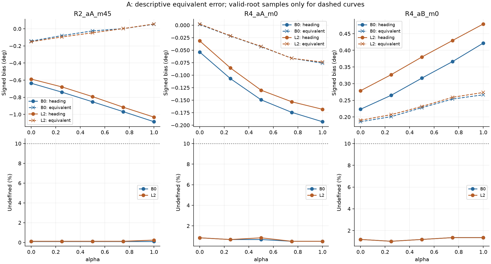
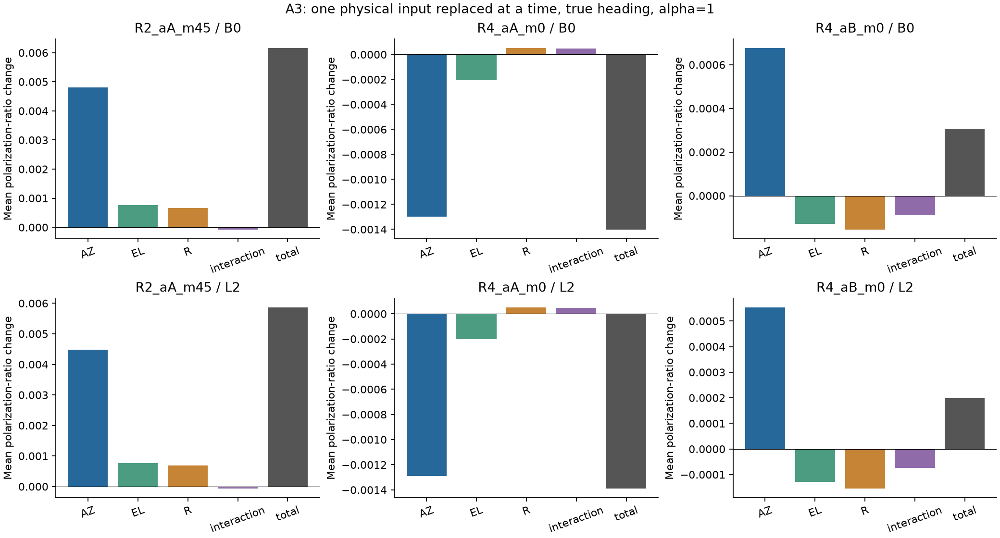
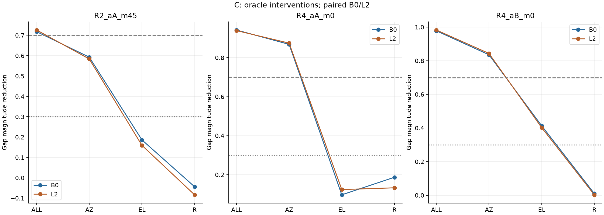

# 물리량 단위 위치–Heading 진단

> 기존 E1 trace의 기술 분해와 GT 위치를 이용한 편파 기하 차단을 구분한다. B0/L2는 같은 RF의 쌍이며 독립 반복이 아니다.

## 핵심 결과

**A0″·A·C 완료. B는 상수 성분의 B0/L2 동일성 검산에서 중단했으며 sweep은 실행하지 않았다.**

| 주 분석 경로 | CUT_ALL gap 크기 감소 B0 / L2 | CUT_AZ 감소 B0 / L2 | 해석 |
| --- | --- | --- | --- |
| R2_aA_m45 | 71.81% / 72.62% | 59.28% / 58.39% | 전체 위치→편파 경로 필요성 지지. 단일 기하 성분의 70% 기준은 충족하지 않음 |
| R4_aA_m0 | 94.16% / 93.85% | 86.80% / 87.45% | 방위각 경로가 주 경로라는 oracle 근거 |
| R4_aB_m0 | 97.79% / 98.26% | 83.54% / 84.33% | 방위각 경로가 주 경로라는 oracle 근거 |

주 분석 6조건에서 CUT_ALL의 gap 부호 반전은 없다. 이 결과는 차단 이후 공분산과 gain 변화까지 포함하는 oracle 개입이며, 유일 원인이나 배포 해법의 확정은 아니다.

R2_aA_m45의 위치 등가 성분은 실제 Heading bias 변화와 반대 부호였지만 CUT_ALL의 gap은 줄었다. 기술적 오차 구성과 재귀 경로 개입은 서로 다른 양이므로 모순으로 보지 않는다.

## 실행 및 검산

- A0: PASS
- A: PASS
- C: PASS
- B: STOP — `PARITY_FAILED:paired_c_R2_aA_m0:0.0002746209233673771`

[실행 전 정의](PROTOCOL.md) · [A 수치 구현 보충](A_NUMERICS_ADDENDUM.md) · [입력 hash](INPUT_LOCK.json)

## A. 위치 등가 Heading 오차와 기술 분해

위치 등가 오차는 추정 위치에서 편파 예측을 GT 값으로 맞추는 Heading 변화다. 재귀 필터의 실제 인과 기여량이나 추정기의 bias 보정값으로 동일시하지 않는다. 근은 유한 격자로 탐색하므로 격자 사이의 매우 가까운 복수 근을 완전히 배제한 수학적 인증은 아니다.

A0″: 145,020개 prior/posterior 상태에서 재구현 G 최대 차이 3.10862e-15. UNCUT 해석 Jacobian도 원본과 비교했으며, 차단 Jacobian은 m0/m45의 안정한 셀·tap 표본에서 수치미분으로 별도 확인했다.

| case | bias | common_undefined | numerator_deg | denominator_common_deg | denominator_E1_all_deg | k_eq | k_eq_E1_all |
| --- | --- | --- | --- | --- | --- | --- | --- |
| R2_aA_m0 | B0 | 0.054282 | 0.009804 | -0.428307 | -0.423193 | -0.022890 | -0.023166 |
| R2_aA_m0 | L2 | 0.107358 | 0.029090 | -0.281387 | -0.270105 | — | — |
| R2_aB_m0 | B0 | 0.095296 | 0.022957 | -0.124917 | -0.163466 | -0.183775 | -0.140437 |
| R2_aB_m0 | L2 | 0.108565 | 0.011947 | -0.167625 | -0.203703 | — | — |
| R2_aA_m45 | B0 | 0.001206 | 0.196147 | -0.449344 | -0.449348 | -0.436519 | -0.436515 |
| R2_aA_m45 | L2 | 0.002413 | 0.207071 | -0.444093 | -0.444245 | -0.466279 | -0.466119 |
| R4_aA_m0 | B0 | 0.008446 | -0.078151 | -0.139390 | -0.139315 | 0.560664 | 0.560965 |
| R4_aA_m0 | L2 | 0.008446 | -0.077105 | -0.136828 | -0.136755 | 0.563515 | 0.563816 |
| R4_aB_m0 | B0 | 0.015203 | 0.072962 | 0.197375 | 0.198599 | 0.369660 | 0.367382 |
| R4_aB_m0 | L2 | 0.015203 | 0.075152 | 0.199111 | 0.200264 | 0.377436 | 0.375263 |
| R5_aA_m0 | B0 | 0.163636 | -0.018029 | 0.092146 | 0.099355 | — | — |
| R5_aA_m0 | L2 | 0.178656 | -0.010921 | 0.189460 | 0.221728 | — | — |
| R5_aB_m0 | B0 | 0.032411 | 0.005452 | 0.201415 | 0.188717 | 0.027068 | 0.028889 |
| R5_aB_m0 | L2 | 0.045059 | 0.031995 | 0.059476 | 0.050360 | 0.537953 | 0.635330 |

분자: alpha0/1의 공통 유효 표본에서 위치 등가 오차 bias 차이. 두 분모는 각각 같은 공통 표본 및 E1 전체 평가 표본이다. 공통 결측 10% 초과 또는 분모 0.05° 미만이면 비율을 해석하지 않는다.

70개 Arm 조건 중 undefined>10%: 12. wrap 항등식 위반 표본 합: 0.

[A 전체 지표](A_METRICS.csv) · [입력별 편파비 변화](A_INPUT_CONTRIBUTIONS.csv)

### 거리 입력 음성 대조

모든 조건/alpha의 |delta_s_r| 최대값: 0.0767323. 편파비의 공통 진폭은 상쇄되지만, 거리별 주파수 위상과 이산 첫 경로 검출은 남을 수 있다. 따라서 비영 값만으로 구현 오류라 판정하지 않는다.

### 물리량별 편파비 변화

전체 70개 Arm 조건 중 성분별 몫 해석 제외: 4. 작은 분모 또는 상호작용 30% 초과 기준을 적용했다.

조건별 최대 거리 효과 표본에서 공통 진폭만 적용했을 때 원래 편파비가 유지되고, 주파수별 위상만 적용했을 때 거리 교체 결과가 재현되는지 검산했다. 이 검산은 선택된 설명용 표본에 대한 결과다.

| case | bias | s_true | s_range | s_amplitude_only | s_phase_only | tap_true | tap_range |
| --- | --- | --- | --- | --- | --- | --- | --- |
| R2_aA_m0 | B0 | 0.190963 | 0.253769 | 0.190963 | 0.253769 | 96 | 97 |
| R2_aA_m0 | L2 | 0.190963 | 0.262459 | 0.190963 | 0.262459 | 96 | 97 |
| R2_aB_m0 | B0 | -0.721490 | -0.769345 | -0.721490 | -0.769345 | 52 | 53 |
| R2_aB_m0 | L2 | -0.721490 | -0.768953 | -0.721490 | -0.768953 | 52 | 53 |
| R2_aA_m45 | B0 | 0.190963 | 0.267696 | 0.190963 | 0.267696 | 96 | 97 |
| R2_aA_m45 | L2 | 0.190963 | 0.267621 | 0.190963 | 0.267621 | 96 | 97 |
| R4_aA_m0 | B0 | 0.018869 | -0.016226 | 0.018869 | -0.016226 | 95 | 96 |
| R4_aA_m0 | L2 | 0.018869 | -0.016215 | 0.018869 | -0.016215 | 95 | 96 |
| R4_aB_m0 | B0 | -0.348699 | -0.310180 | -0.348699 | -0.310180 | 25 | 26 |
| R4_aB_m0 | L2 | -0.348699 | -0.309779 | -0.348699 | -0.309779 | 25 | 26 |
| R5_aA_m0 | B0 | 0.565827 | 0.637014 | 0.565827 | 0.637014 | 96 | 97 |
| R5_aA_m0 | L2 | 0.565827 | 0.639522 | 0.565827 | 0.639522 | 96 | 97 |
| R5_aB_m0 | B0 | -0.284321 | -0.225620 | -0.284321 | -0.225620 | 56 | 57 |
| R5_aB_m0 | L2 | -0.284321 | -0.225392 | -0.284321 | -0.225392 | 56 | 57 |

[거리 효과 검산](A_DISTANCE_AUDIT.csv)

## C. 물리량 경로 차단

G는 alpha1−alpha0 Heading signed bias 차이다. f_magnitude는 gap 크기 감소이며 f_signed와 부호 반전을 별도 보고한다. GT 차단으로 이후 P/K도 변하므로 직접 효과만의 추정값은 아니다.

| case | bias | mode | G_uncut | G_cut | f_magnitude | f_signed | sign_reversal | decision |
| --- | --- | --- | --- | --- | --- | --- | --- | --- |
| R2_aA_m45 | B0 | CUT_ALL | -0.449348 | -0.126684 | 0.718072 | 0.718072 | False | STRONG |
| R2_aA_m45 | B0 | CUT_AZ | -0.449348 | -0.182961 | 0.592830 | 0.592830 | False | PARTIAL |
| R2_aA_m45 | B0 | CUT_EL | -0.449348 | -0.365633 | 0.186305 | 0.186305 | False | WEAK |
| R2_aA_m45 | B0 | CUT_R | -0.449348 | -0.469013 | -0.043762 | -0.043762 | False | WEAK |
| R2_aA_m45 | L2 | CUT_ALL | -0.444245 | -0.121642 | 0.726183 | 0.726183 | False | STRONG |
| R2_aA_m45 | L2 | CUT_AZ | -0.444245 | -0.184858 | 0.583884 | 0.583884 | False | PARTIAL |
| R2_aA_m45 | L2 | CUT_EL | -0.444245 | -0.373321 | 0.159651 | 0.159651 | False | WEAK |
| R2_aA_m45 | L2 | CUT_R | -0.444245 | -0.481359 | -0.083544 | -0.083544 | False | WEAK |
| R4_aA_m0 | B0 | CUT_ALL | -0.139315 | -0.008138 | 0.941586 | 0.941586 | False | STRONG |
| R4_aA_m0 | B0 | CUT_AZ | -0.139315 | -0.018394 | 0.867969 | 0.867969 | False | STRONG |
| R4_aA_m0 | B0 | CUT_EL | -0.139315 | -0.125778 | 0.097170 | 0.097170 | False | WEAK |
| R4_aA_m0 | B0 | CUT_R | -0.139315 | -0.113246 | 0.187119 | 0.187119 | False | WEAK |
| R4_aA_m0 | L2 | CUT_ALL | -0.136755 | -0.008410 | 0.938502 | 0.938502 | False | STRONG |
| R4_aA_m0 | L2 | CUT_AZ | -0.136755 | -0.017168 | 0.874463 | 0.874463 | False | STRONG |
| R4_aA_m0 | L2 | CUT_EL | -0.136755 | -0.119784 | 0.124101 | 0.124101 | False | WEAK |
| R4_aA_m0 | L2 | CUT_R | -0.136755 | -0.118563 | 0.133031 | 0.133031 | False | WEAK |
| R4_aB_m0 | B0 | CUT_ALL | 0.198599 | 0.004390 | 0.977895 | 0.977895 | False | STRONG |
| R4_aB_m0 | B0 | CUT_AZ | 0.198599 | 0.032694 | 0.835376 | 0.835376 | False | STRONG |
| R4_aB_m0 | B0 | CUT_EL | 0.198599 | 0.116494 | 0.413420 | 0.413420 | False | PARTIAL |
| R4_aB_m0 | B0 | CUT_R | 0.198599 | 0.196582 | 0.010154 | 0.010154 | False | WEAK |
| R4_aB_m0 | L2 | CUT_ALL | 0.200264 | 0.003481 | 0.982617 | 0.982617 | False | STRONG |
| R4_aB_m0 | L2 | CUT_AZ | 0.200264 | 0.031376 | 0.843326 | 0.843326 | False | STRONG |
| R4_aB_m0 | L2 | CUT_EL | 0.200264 | 0.119698 | 0.402296 | 0.402296 | False | PARTIAL |
| R4_aB_m0 | L2 | CUT_R | 0.200264 | 0.199741 | 0.002609 | 0.002609 | False | WEAK |

[C 전체 지표](C_SCORES.csv) · [조건별 gap](C_GAP_REDUCTIONS.csv) · [차단 상호작용](C_INTERACTIONS.csv)

### 조건별 해석

- R2_aA_m0/B0: 이 경로만으로 gap을 설명하지 못함; CUT_ALL f_magnitude=-0.0378.
- R2_aA_m0/L2: 이 경로만으로 gap을 설명하지 못함; CUT_ALL f_magnitude=-0.9100.
- R2_aA_m45/B0: 위치→편파 예측 경로의 필요성을 지지하는 oracle 근거; CUT_ALL f_magnitude=0.7181.
- R2_aA_m45/L2: 위치→편파 예측 경로의 필요성을 지지하는 oracle 근거; CUT_ALL f_magnitude=0.7262.
- R2_aB_m0/B0: 이 경로만으로 gap을 설명하지 못함; CUT_ALL f_magnitude=0.0820.
- R2_aB_m0/L2: 이 경로만으로 gap을 설명하지 못함; CUT_ALL f_magnitude=0.1074.
- R4_aA_m0/B0: 위치→편파 예측 경로의 필요성을 지지하는 oracle 근거; CUT_ALL f_magnitude=0.9416.
- R4_aA_m0/L2: 위치→편파 예측 경로의 필요성을 지지하는 oracle 근거; CUT_ALL f_magnitude=0.9385.
- R4_aB_m0/B0: 위치→편파 예측 경로의 필요성을 지지하는 oracle 근거; CUT_ALL f_magnitude=0.9779.
- R4_aB_m0/L2: 위치→편파 예측 경로의 필요성을 지지하는 oracle 근거; CUT_ALL f_magnitude=0.9826.
- R5_aA_m0/B0: 위치→편파 예측 경로의 필요성을 지지하는 oracle 근거; CUT_ALL f_magnitude=0.7295.
- R5_aA_m0/L2: 부분 감소; CUT_ALL f_magnitude=0.5643.
- R5_aB_m0/B0: 이 경로만으로 gap을 설명하지 못함; CUT_ALL f_magnitude=0.2437.
- R5_aB_m0/L2: 이 경로만으로 gap을 설명하지 못함; CUT_ALL f_magnitude=0.1198.

개별 차단의 우세는 CUT_ALL 결과와 함께 읽는다. CUT_R의 작은 결과는 해당 조건에서의 음성대조 관찰이며 일반적인 거리 의존성 부재를 증명하지 않는다.

## B. 중단

PARITY_FAILED:paired_c_R2_aA_m0:0.0002746209233673771

중단 기준을 통과시키기 위해 평균이나 표본을 바꾸지 않았다. CONST/VAR/FULL의 B replay는 시작하지 않았다.

| case | B0_accepted | L2_accepted | mask_differences | delta_mu_max_difference_m | c_B0 | c_L2 | c_difference_m |
| --- | --- | --- | --- | --- | --- | --- | --- |
| R2_aA_m0 | 958 | 950 | 8 | 0.000000 | -0.012177 | -0.012452 | 0.000275 |
| R2_aA_m45 | 940 | 940 | 0 | 0.000000 | 0.026438 | 0.026438 | 0.000000 |
| R2_aB_m0 | 971 | 971 | 0 | 0.000000 | -0.016470 | -0.016470 | 0.000000 |
| R4_aA_m0 | 718 | 718 | 0 | 0.000000 | 0.010502 | 0.010502 | 0.000000 |
| R4_aB_m0 | 726 | 726 | 0 | 0.000000 | 0.006295 | 0.006295 | 0.000000 |
| R5_aA_m0 | 1349 | 1350 | 1 | 0.000000 | -0.021121 | -0.020951 | -0.000170 |
| R5_aB_m0 | 1384 | 1384 | 0 | 0.000000 | -0.025969 | -0.025969 | 0.000000 |

모든 쌍의 packet별 delta_mu 차이는 0이다. 그러나 R2_aA_m0는 BASE 수용 집합이 8개 packet, R5_aA_m0는 1개 packet에서 다르다. 따라서 각자 A_B에서 평균을 내면 c가 달라진다. 같은 RF라는 사실이 재귀 gate mask의 동일성을 보장하지 않는다.

**재개 제안:** 원래 수식대로 각 B0/L2의 A_B에서 c를 계산하고, B0/L2 c 동일성 요구만 제거한다. mean(v|A_B)=0 및 나머지 검산은 유지한다. 이 변경은 아직 적용하지 않았다.

[평균/변동 검산](B_COMPONENTS.csv) · [mask 차이 확인](B_MASK_AUDIT.csv)

## 해석 한계

- GT는 오프라인 oracle 진단에만 사용했다. 배포 가능한 보정기로 제안하지 않는다.
- 기존 X1/X2/E1–E4 결과는 수정하지 않았다. 새 결과의 수치 PASS와 가설 지지를 구분한다.
- 통계적 유의성·동등성·일반화를 주장하지 않는다.
