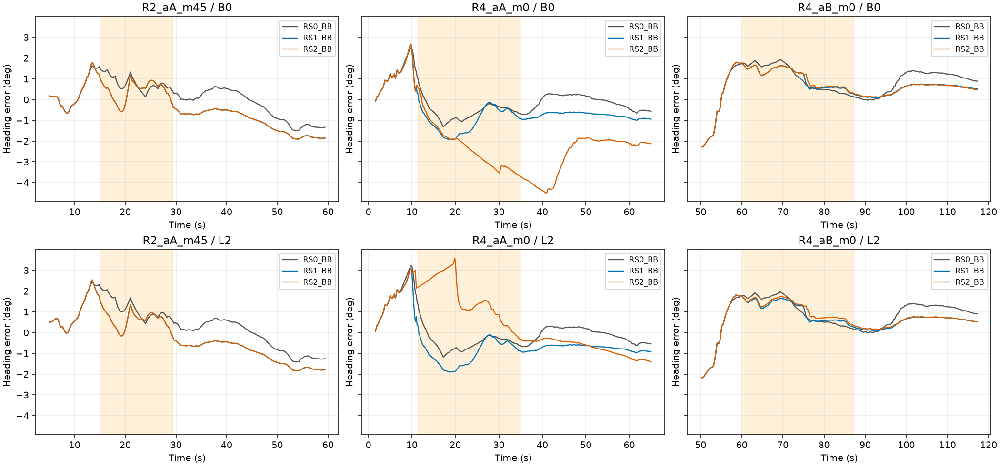
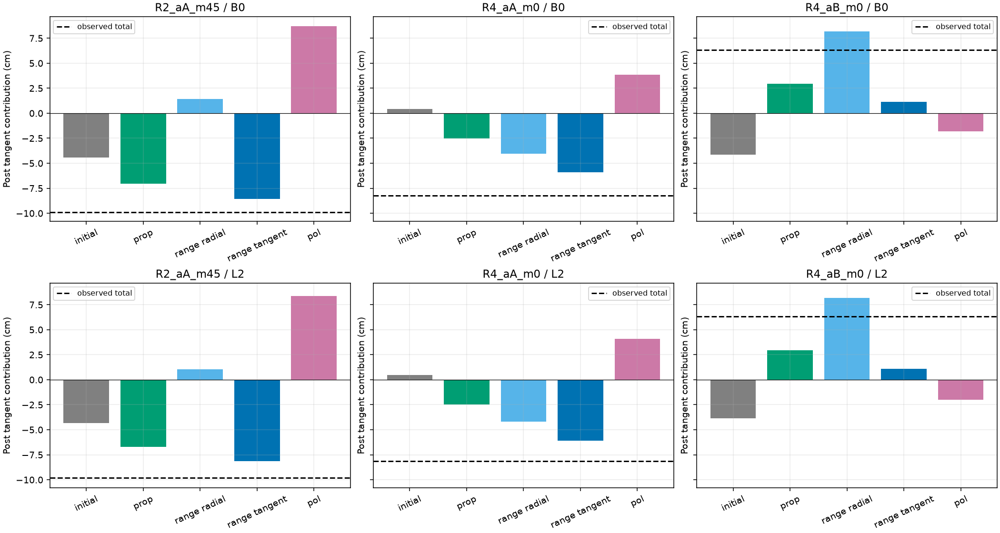
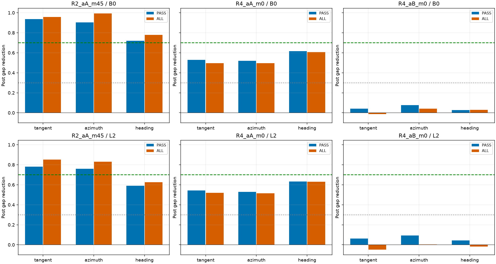
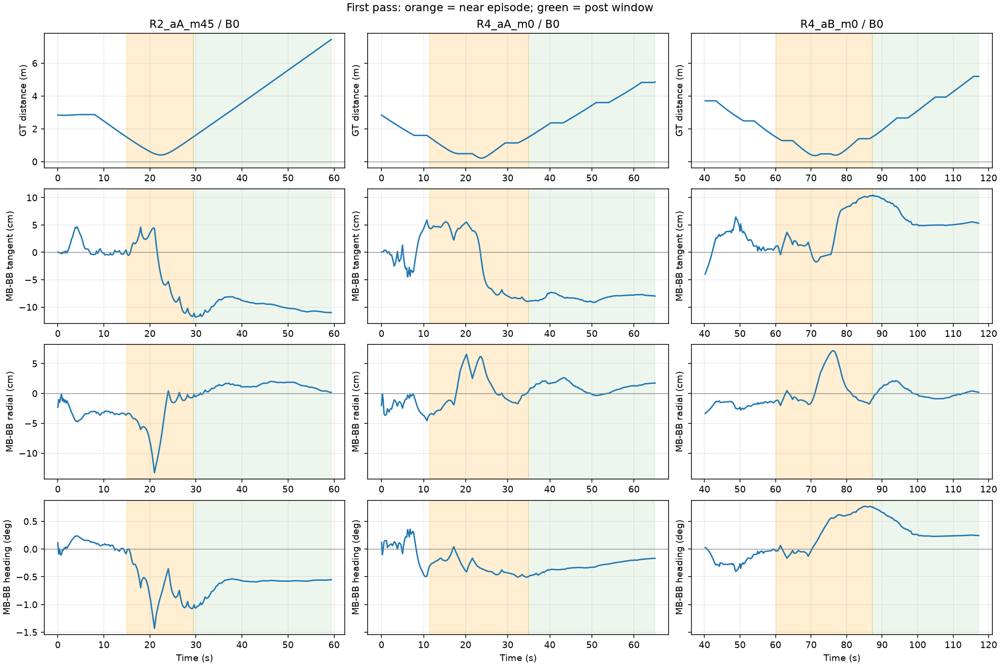
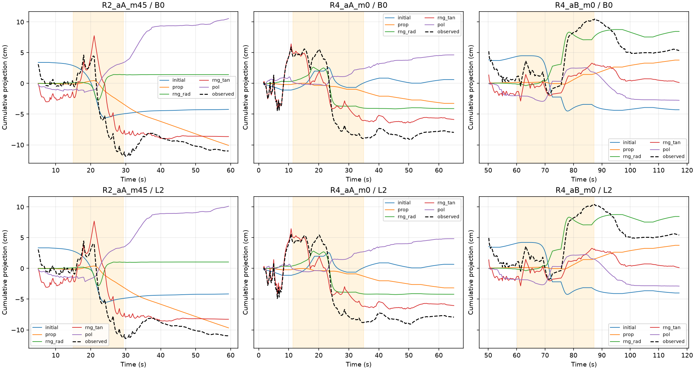

# 앵커 통과 구간 R_s 및 방위각 이동 진단

## 요약

단계0 P1–P4 모두 Go. RS0/RT_OFF 재현과 수치 검산 통과 후 RS1·RS2, 2a 장부, CUT_RT_PASS/ALL을 순서대로 실행했다. 선택 RS3와 2c 윈도우 구현은 실행하지 않았다.

| arm | improved_cases | candidate_cases | result |
| --- | --- | --- | --- |
| RS1 | 1 | 0 | NOT_ADOPTED |
| RS2 | 1 | 0 | NOT_ADOPTED |

**RS1·RS2 모두 채택 기준 미충족.** Heading RMSE가 개선된 R4_aB도 통과 후 접선 bias 크기가 RS1에서1.94–1.95배로 커졌다. R2_aA_m45와 R4_aA는 Heading RMSE도 악화됐다. 작은 NIS가 R_s 감소의 충분한 근거는 아니었다.

**CUT_RT_PASS의 통과 후 접선 gap 감소:** R2_aA_m45 78–94%, R4_aA 53–54%, R4_aB 4–6%. R2에서는 H2 개입 효과가 크고 R4_aA에서는 부분 기여, R4_aB에서는 작은 효과다. Heading gap 감소는 각각59–72%,62–63%,3–4%로 동일하지 않다.

BB 전체 t≥30 Heading RMSE 기준이며 B0/L2 모두 개선해야 case 1개로 센다. 아래 통과 후 지표를 함께 확인한다. case 그룹3개는 독립 route3개가 아니며 실제 route는 R2/R4 두 개다. LORO 학습은 R2/R4/R5의 route 분할이다.

## 검산 및 고정 정의

원문 PROTOCOL.md, 사용자 수정 PROTOCOL_ADDENDUM.md, 실험2 정의를 실행 전에 보존했다. 분석 창은 GT 거리로 공통 정의했고 적용 R_s는 각 arm prior 추정거리로 계산했다. 모든 고정-mask arm은 A_B이며 자연 gate는 RS2만 쓴다. 입력/출력 해시 및 종료 증거는 각 LOCK/CHECKS/FINISH 파일에 기록했다. P/Pprior 대칭·PSD, 거절 상태/P 보존, saved Kν 갱신 일치, 평균 및 range R 보존을 확인했다. RS0와 RT_OFF는 각6조건에서 E1 x/P/prior/Pprior/h/H/K/mu/R/nu/acc를 절대오차1e-10 이하로 재현했다.

## 단계0: 유효성

### P1 LORO 분산

| bin | cv | min_n | all_cells_valid | go |
| --- | --- | --- | --- | --- |
| 0-.5 | 0.1495 | 101 | True | True |
| .5-1 | 0.2696 | 288 | True | True |
| 1-1.5 | 0.3147 | 262 | True | True |

전체시간의 B0/BB만 사용하며, GT/test route를 분산 표 학습에 넣지 않았다. 잔차 평균은 별도 보존하고 ddof=1 분산만 R_s로 사용했다. 이 표는 시뮬레이션 오프라인 잔차로 보정된 것으로 실측 하드웨어 검증이 아니다.

### P2/P3 첫 통과

| case | bias | start_s | end_s | pre_length_s | pre_n | post_length_s | post_n | init_overlap | e_t_cm_pre | e_t_cm_post | formation_ratio | result |
| --- | --- | --- | --- | --- | --- | --- | --- | --- | --- | --- | --- | --- |
| R2_aA_m45 | B0 | 15.0000 | 29.4000 | 15.0000 | 75 | 30.0000 | 150 | True | 0.6662 | -9.8932 | 1.0673 | GO |
| R2_aA_m45 | L2 | 15.0000 | 29.4000 | 15.0000 | 75 | 30.0000 | 150 | True | 0.4918 | -9.8020 | 1.0502 | GO |
| R4_aA_m0 | B0 | 11.4000 | 35.0000 | 11.4000 | 57 | 30.0000 | 150 | True | -0.0237 | -8.2176 | 0.9971 | GO |
| R4_aA_m0 | L2 | 11.4000 | 35.0000 | 11.4000 | 57 | 30.0000 | 150 | True | -0.2660 | -8.1466 | 0.9673 | GO |
| R4_aB_m0 | B0 | 60.2000 | 87.2000 | 30.0000 | 149 | 30.0000 | 150 | False | -0.5935 | 6.3158 | 1.0940 | GO |
| R4_aB_m0 | L2 | 60.2000 | 87.2000 | 30.0000 | 149 | 30.0000 | 150 | False | -0.7959 | 6.3417 | 1.1255 | GO |

초기 짧은 pre는 최소5초 조건을 충족한 부분창이다. R2/R4_aA에는 init_overlap 표시가 있다. 두 번째 이후 통과는 P3_FORMATION.csv의 reexposure 행에 별도 보존했다. 이전 d_est 기반 P2_PASSES.csv는 preliminary이며 최종 공통 창은 P2_PASSES_GT.csv다.

### P4 gate 미리보기

| case | bias | arm | new_reject_n | accepted_n | new_reject_fraction_accepted | result |
| --- | --- | --- | --- | --- | --- | --- |
| R2_aA_m45 | B0 | BB | 6 | 171 | 0.0351 | GO |
| R2_aA_m45 | B0 | MB | 2 | 171 | 0.0117 | GO |
| R2_aA_m45 | L2 | BB | 13 | 171 | 0.0760 | GO |
| R2_aA_m45 | L2 | MB | 3 | 171 | 0.0175 | GO |
| R4_aA_m0 | B0 | BB | 20 | 218 | 0.0917 | GO |
| R4_aA_m0 | B0 | MB | 10 | 218 | 0.0459 | GO |
| R4_aA_m0 | L2 | BB | 22 | 218 | 0.1009 | GO |
| R4_aA_m0 | L2 | MB | 11 | 218 | 0.0505 | GO |
| R4_aB_m0 | B0 | BB | 7 | 232 | 0.0302 | GO |
| R4_aB_m0 | B0 | MB | 9 | 232 | 0.0388 | GO |
| R4_aB_m0 | L2 | BB | 9 | 232 | 0.0388 | GO |
| R4_aB_m0 | L2 | MB | 10 | 232 | 0.0431 | GO |

P4는 기존 prior/innovation 고정 계산이다. RS2의 실제 재귀 상태 변화 뒤 gate 결과를 보장하지 않는다. MB의 원래 자연 gate가 A_B와 같을 필요도 없으며 차이는 P4_BASELINE_GATE_DIFFERENCES.csv에 기록했다.

## 실험1: R_s 재설정

| case | bias | arm | rmse_base | rmse_new | post_et_ratio | heading_gap_abs_ratio | result |
| --- | --- | --- | --- | --- | --- | --- | --- |
| R2_aA_m45 | B0 | RS1 | 0.9847 | 1.6010 | 18.0928 | 1.2635 | REJECT |
| R2_aA_m45 | B0 | RS2 | 0.9847 | 1.6748 | 18.0928 | 0.7395 | REJECT |
| R2_aA_m45 | L2 | RS1 | 0.9558 | 1.5445 | 12.4105 | 1.1400 | REJECT |
| R2_aA_m45 | L2 | RS2 | 0.9558 | 1.6194 | 12.4105 | 0.9021 | REJECT |
| R4_aA_m0 | B0 | RS1 | 0.7116 | 0.8070 | 2.4645 | 0.8516 | REJECT |
| R4_aA_m0 | B0 | RS2 | 0.7116 | 1.9864 | 3.5958 | 4.7905 | REJECT |
| R4_aA_m0 | L2 | RS1 | 0.7072 | 0.7983 | 2.3905 | 0.8330 | REJECT |
| R4_aA_m0 | L2 | RS2 | 0.7072 | 1.4110 | 1.5125 | 0.6584 | REJECT |
| R4_aB_m0 | B0 | RS1 | 1.4418 | 1.3289 | 1.9543 | 0.2198 | CONDITIONAL |
| R4_aB_m0 | B0 | RS2 | 1.4418 | 1.3289 | 2.0062 | 0.4244 | CONDITIONAL |
| R4_aB_m0 | L2 | RS1 | 1.3938 | 1.2676 | 1.9374 | 0.2500 | CONDITIONAL |
| R4_aB_m0 | L2 | RS2 | 1.3938 | 1.2864 | 2.1322 | 0.3977 | CONDITIONAL |

post_et_ratio는 |평균 e_t|의 새값/기준값이다. 원값과 전체 지표는 RS_DECISIONS.csv 및 WINDOW_METRICS.csv에 보존했다.

| case | bias | arm | scope | heading_rmse_deg | heading_bias_deg | et_bias_cm | pol_nis_accepted |
| --- | --- | --- | --- | --- | --- | --- | --- |
| R2_aA_m45 | B0 | RS0_BB | pass | 0.7332 | 0.5094 | 0.7495 | 0.5903 |
| R2_aA_m45 | B0 | RS0_BB | post | 0.7897 | -0.3291 | -0.3765 | 0.7023 |
| R2_aA_m45 | L2 | RS0_BB | pass | 1.1009 | 0.8922 | -0.8058 | 0.6140 |
| R2_aA_m45 | L2 | RS0_BB | post | 0.7604 | -0.2461 | 0.4787 | 0.7143 |
| R4_aA_m0 | B0 | RS0_BB | pass | 0.8748 | -0.0555 | 1.3875 | 0.5460 |
| R4_aA_m0 | B0 | RS0_BB | post | 0.3556 | -0.1283 | 3.4438 | 0.6495 |
| R4_aA_m0 | L2 | RS0_BB | pass | 1.0595 | 0.1333 | 1.1746 | 0.5758 |
| R4_aA_m0 | L2 | RS0_BB | post | 0.3452 | -0.1054 | 3.5145 | 0.6434 |
| R4_aB_m0 | B0 | RS0_BB | pass | 1.1815 | 0.6290 | -5.1540 | 0.5834 |
| R4_aB_m0 | B0 | RS0_BB | post | 0.9881 | 0.8432 | 3.8647 | 1.1669 |
| R4_aB_m0 | L2 | RS0_BB | pass | 1.1901 | 0.6651 | -5.1487 | 0.5753 |
| R4_aB_m0 | L2 | RS0_BB | post | 0.9993 | 0.8591 | 3.8981 | 1.1655 |
| R2_aA_m45 | B0 | RS1_BB | pass | 0.6722 | 0.1093 | -0.1639 | 1.4605 |
| R2_aA_m45 | B0 | RS1_BB | post | 1.1968 | -1.0723 | -6.8126 | 0.7427 |
| R2_aA_m45 | B0 | RS2_BB | pass | 0.6722 | 0.1093 | -0.1639 | 1.4605 |
| R2_aA_m45 | B0 | RS2_BB | post | 1.1968 | -1.0723 | -6.8126 | 0.7427 |
| R2_aA_m45 | L2 | RS1_BB | pass | 0.8826 | 0.3973 | -1.7984 | 1.4776 |
| R2_aA_m45 | L2 | RS1_BB | post | 1.1447 | -1.0157 | -5.9410 | 0.7434 |
| R2_aA_m45 | L2 | RS2_BB | pass | 0.8826 | 0.3973 | -1.7984 | 1.4776 |
| R2_aA_m45 | L2 | RS2_BB | post | 1.1447 | -1.0157 | -5.9410 | 0.7434 |
| R4_aA_m0 | B0 | RS1_BB | pass | 1.1411 | -0.4707 | -3.2710 | 2.8177 |
| R4_aA_m0 | B0 | RS1_BB | post | 0.7724 | -0.7627 | -8.4872 | 0.7898 |
| R4_aA_m0 | B0 | RS2_BB | pass | 2.7415 | -1.8925 | -5.6873 | 2.1269 |
| R4_aA_m0 | B0 | RS2_BB | post | 2.8635 | -2.6997 | -12.3835 | 1.1506 |
| R4_aA_m0 | L2 | RS1_BB | pass | 1.2501 | -0.3535 | -3.5498 | 2.8313 |
| R4_aA_m0 | L2 | RS1_BB | post | 0.7530 | -0.7431 | -8.4014 | 0.7851 |
| R4_aA_m0 | L2 | RS2_BB | pass | 1.7094 | 1.1949 | 1.9668 | 1.5067 |
| R4_aA_m0 | L2 | RS2_BB | post | 0.8102 | -0.7234 | 5.3157 | 0.8241 |
| R4_aB_m0 | B0 | RS1_BB | pass | 1.1313 | 0.6227 | -2.4250 | 1.3587 |
| R4_aB_m0 | B0 | RS1_BB | post | 0.5503 | 0.4925 | 7.5527 | 1.2858 |
| R4_aB_m0 | B0 | RS2_BB | pass | 1.1439 | 0.6468 | -2.1649 | 1.3361 |
| R4_aB_m0 | B0 | RS2_BB | post | 0.5362 | 0.4861 | 7.7532 | 1.2302 |
| R4_aB_m0 | L2 | RS1_BB | pass | 1.1221 | 0.6377 | -2.4240 | 1.3544 |
| R4_aB_m0 | L2 | RS1_BB | post | 0.5559 | 0.4981 | 7.5521 | 1.2852 |
| R4_aB_m0 | L2 | RS2_BB | pass | 1.1768 | 0.7128 | -1.9274 | 1.3079 |
| R4_aB_m0 | L2 | RS2_BB | post | 0.5681 | 0.5222 | 8.3114 | 1.2313 |

R4_aA는 초기 통과 영향 때문에 pass/post 지표를 전체점수와 함께 우선 검토한다. 위 채택표는 사전에 명시된 t≥30 주지표를 유지하며, 통과 지표로 기준을 사후 교체하지 않았다. 개선된 조건도 접선오차나 Heading gap이10% 넘게 악화되면 조건부로 표시했다.

### 실제 재귀 gate 변화

| case | bias | arm | AB_accepted | new_rejected | new_accepted | new_reject_fraction |
| --- | --- | --- | --- | --- | --- | --- |
| R2_aA_m45 | B0 | RS2_BB | 171 | 0 | 0 | 0.0000 |
| R2_aA_m45 | B0 | RS2_MB | 171 | 3 | 2 | 0.0175 |
| R2_aA_m45 | L2 | RS2_BB | 171 | 0 | 0 | 0.0000 |
| R2_aA_m45 | L2 | RS2_MB | 171 | 2 | 1 | 0.0117 |
| R4_aA_m0 | B0 | RS2_BB | 218 | 103 | 0 | 0.4725 |
| R4_aA_m0 | B0 | RS2_MB | 218 | 54 | 0 | 0.2477 |
| R4_aA_m0 | L2 | RS2_BB | 218 | 53 | 0 | 0.2431 |
| R4_aA_m0 | L2 | RS2_MB | 218 | 54 | 0 | 0.2477 |
| R4_aB_m0 | B0 | RS2_BB | 232 | 3 | 0 | 0.0129 |
| R4_aB_m0 | B0 | RS2_MB | 232 | 3 | 4 | 0.0129 |
| R4_aB_m0 | L2 | RS2_BB | 232 | 5 | 0 | 0.0216 |
| R4_aB_m0 | L2 | RS2_MB | 232 | 3 | 4 | 0.0129 |

R4_aA의 RS2_BB 신규 거절은 B0 47.2%, L2 24.3%로, 기존 innovation 고정 P4의 약9–10%보다 컸다. 실제 재귀에서는 gate 변화가 크게 동반되므로 RS1과 분리해 해석해야 한다. 이는 사전 Go 기준의 사후 변경이 아니라 별도 운용 결과다.

## 실험2a: 세계 좌표 장부

| case | bias | post_gap_cm | initial_cm | prop_share | rng_rad_share | rng_tan_share | pol_share | CUT_RT_trigger |
| --- | --- | --- | --- | --- | --- | --- | --- | --- |
| R2_aA_m45 | B0 | -9.8932 | -4.4273 | 0.7130 | -0.1439 | 0.8639 | -0.8806 | True |
| R2_aA_m45 | L2 | -9.8020 | -4.3510 | 0.6824 | -0.1048 | 0.8317 | -0.8532 | True |
| R4_aA_m0 | B0 | -8.2176 | 0.4437 | 0.3080 | 0.4942 | 0.7192 | -0.4674 | True |
| R4_aA_m0 | L2 | -8.1466 | 0.4898 | 0.3015 | 0.5138 | 0.7461 | -0.5013 | True |
| R4_aB_m0 | B0 | 6.3158 | -4.1535 | 0.4699 | 1.2984 | 0.1767 | -0.2874 | False |
| R4_aB_m0 | L2 | 6.3417 | -3.8648 | 0.4626 | 1.2914 | 0.1722 | -0.3169 | False |

장부 합은 각 packet 및 post 평균에서1e-10cm 이내로 관측 gap과 일치한다. 표는 초기차이를 포함한 signed 구성비로, 양·음 성분이 상쇄하므로 합 또는 개별 비율이 직관적 확률이 아니다. 확장 창 내부에서 생긴 증분과 이후 증분은 원본CSV에 분리했다. R2의 prop 몫도 커서 range 접선 성분만의 유일한 원인으로 해석할 수 없다. R4_aB의 range 반경 성분은 H1의 기술적 귀속이며 개입으로 H1을 확정한 것은 아니다.

## 실험2b: CUT_RT

| case | bias | arm | et_f_magnitude | beta_f_magnitude | heading_f_magnitude | et_sign_flip | beta_sign_flip | heading_sign_flip |
| --- | --- | --- | --- | --- | --- | --- | --- | --- |
| R2_aA_m45 | B0 | CUT_RT_PASS | 0.9374 | 0.9041 | 0.7201 | False | False | False |
| R2_aA_m45 | B0 | CUT_RT_ALL | 0.9569 | 0.9922 | 0.7795 | True | True | False |
| R2_aA_m45 | L2 | CUT_RT_PASS | 0.7798 | 0.7599 | 0.5896 | False | False | False |
| R2_aA_m45 | L2 | CUT_RT_ALL | 0.8523 | 0.8305 | 0.6255 | False | False | False |
| R4_aA_m0 | B0 | CUT_RT_PASS | 0.5299 | 0.5184 | 0.6164 | False | False | False |
| R4_aA_m0 | B0 | CUT_RT_ALL | 0.4970 | 0.4955 | 0.6059 | False | False | False |
| R4_aA_m0 | L2 | CUT_RT_PASS | 0.5432 | 0.5285 | 0.6336 | False | False | False |
| R4_aA_m0 | L2 | CUT_RT_ALL | 0.5192 | 0.5139 | 0.6308 | False | False | False |
| R4_aB_m0 | B0 | CUT_RT_PASS | 0.0404 | 0.0763 | 0.0268 | False | False | False |
| R4_aB_m0 | B0 | CUT_RT_ALL | -0.0119 | 0.0403 | 0.0290 | False | False | False |
| R4_aB_m0 | L2 | CUT_RT_PASS | 0.0632 | 0.0942 | 0.0438 | False | False | False |
| R4_aB_m0 | L2 | CUT_RT_ALL | -0.0484 | 0.0045 | -0.0185 | False | False | False |

양수는 gap 감소, 음수는 확대다. PASS는 첫 GT 통과 확장 창, ALL은 전체 구간이며 편파 gain 열은 직접 바꾸지 않았다. 이후 상태·공분산·gain 변화는 개입 효과에 포함된다. 개별 조건 감소가 모든 경로의 유일성을 입증하지 않는다.

## 통과 시계열

## 해석 한계와 다음 단계

- P1 표는 세 route의 유한 표본 분산이며, 평균 편향은 제거하지 않았다. 작은 NIS만으로 R_s 감소의 유효성을 보장할 수 없다.
- 분석/개입 시간창은 GT를 이용하므로 CUT_RT_PASS 자체는 oracle 진단이다. RS1은 oracle A_B 고정, RS2만 온라인 거리와 자기 gate를 쓰는 형태다.
- B0/L2는 같은 RF의 쌍이다. 유의성·동등성·일반화 주장은 하지 않는다.
- 2c는 별도 승인 대상이다. 설계 방향은 첫 통과 창의 range+주행 잔차를 묶어 재선형화하고 후방 위치를 넘기는 것이다. range bias 상태를 추가하면 위치와 bias의 식별 가능성 및 윈도우 prior를 먼저 검토해야 한다. 편파는 방위각 정보원으로 사용하지 않는 계획이나, 이는 편파의 방위각 민감도가 정확히0이라는 뜻은 아니다. 구현하거나 실행하지 않았다.
