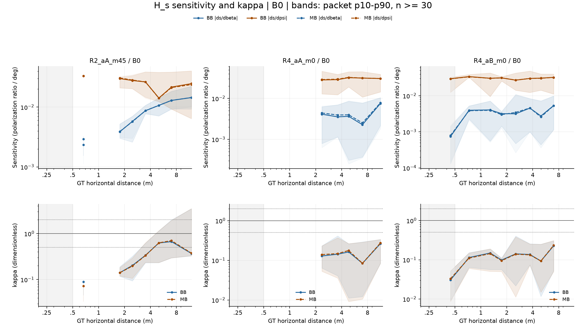
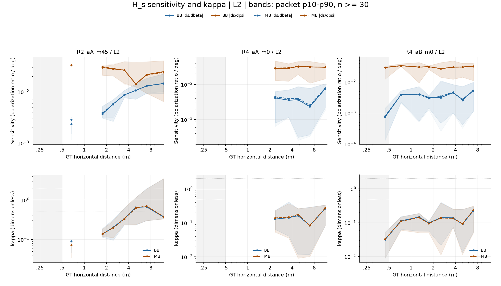
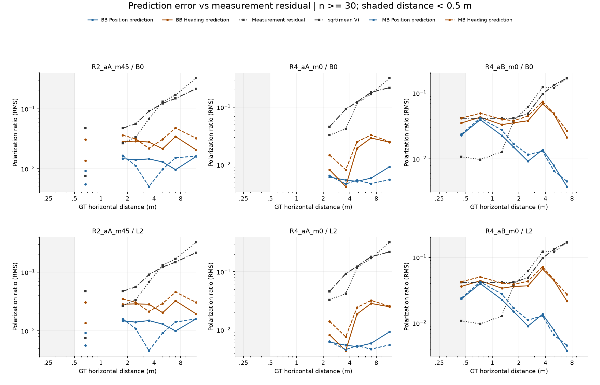
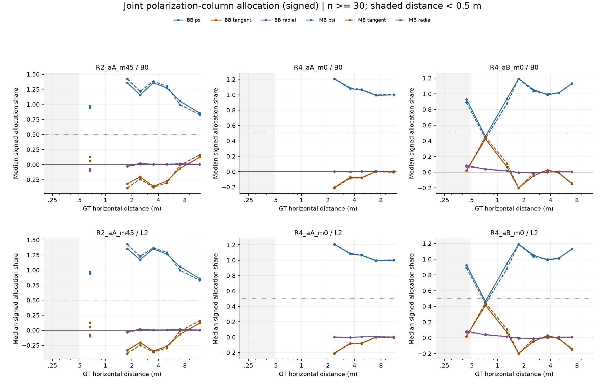
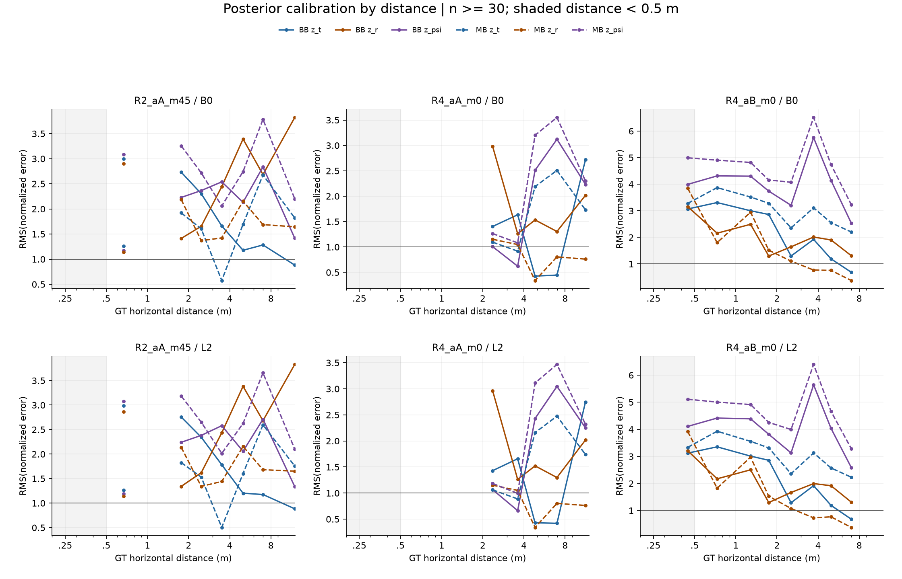
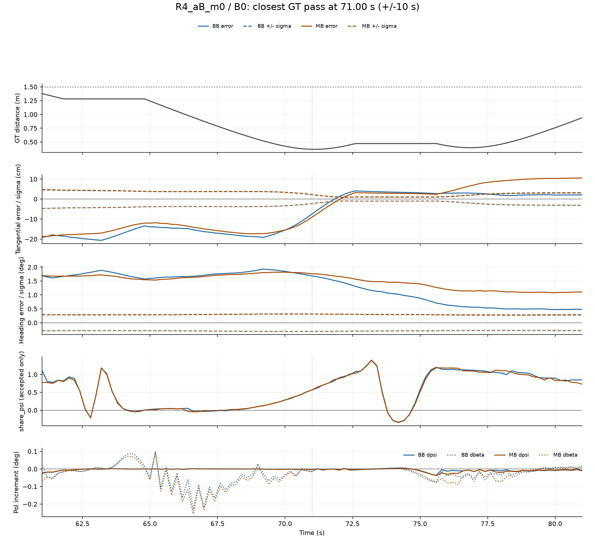

# 편파 innovation 배분과 접선 위치 calibration 진단

## 1. 요약

**기존 trace 재계산과 측정 모델 평가만 수행했다. 필터 replay·재학습·R/Q 변경은 0회다.** 주 분석 6조건, 보조 8조건의 BB/MB를 계산했다. 운영 기준은 계산 전에 고정했다.

| question | SUPPORT | NOT_SUPPORT | NA |
| --- | --- | --- | --- |
| Q1 | 0/3 | 2 | 0 |
| Q1b | 0/3 | 2 | 0 |
| Q2 | 2/3 | 0 | 0 |
| Q3 | 2/3 | 0 | 0 |

여기서 3은 요청서의 주 분석 case 그룹(R2_aA_m45, R4_aA_m0, R4_aB_m0) 수다. 실제 route ID는 R2/R4 두 개다. B0/L2가 모두 SUPPORT일 때만 그룹 SUPPORT로 셌으며 독립 표본으로 세지 않았다.

- Q1: 판정 가능한 두 그룹의 near κ 중앙값은 약 0.09다. |ds/dβ|≈|ds/dψ| 근사는 지지되지 않는다.
- Q1b: near BB λ_pos는 R2_m45 약 0.73, R4_aB 약 2.38로 기준 3 미만이다. R4_aB에서는 위치 오차가 측정 잔차보다 크지만 ‘3배 초과’ 조건에는 미달한다.
- Q2: near BB ψ share 중앙값은 R2_m45 약 0.945, R4_aB 약 0.858로 ψ 우세 조건을 만족한다.
- Q3: near BB RMS(z_t)는 각각 약 2.99와 3.11이며 far보다 크다. 접선 불확실성 과신 기준을 만족한다.

**R4_aA는 near 표본이 아예 없는 것이 아니다. 각 bias/arm에서 원래 26개가 있으나 최소 30개 기준에 미달해 NA다.** R2_m45는 near 원래 71개 중 작은 bin 27개를 제외한 44개로 판정했다. R4_aB는 136개가 모두 유효하다. 이 제외는 결과를 보기 전에 PROTOCOL 부록에 명시했다.

| question | case_group | B0 | L2 | group_result | B0_value | L2_value |
| --- | --- | --- | --- | --- | --- | --- |
| Q1 | R2_aA_m45 | NOT_SUPPORT | NOT_SUPPORT | NOT_SUPPORT | 0.0900 | 0.0898 |
| Q1 | R4_aA_m0 | NA | NA | NA | NA | NA |
| Q1 | R4_aB_m0 | NOT_SUPPORT | NOT_SUPPORT | NOT_SUPPORT | 0.0896 | 0.0894 |
| Q1b | R2_aA_m45 | NOT_SUPPORT | NOT_SUPPORT | NOT_SUPPORT | 0.7277 | 0.7398 |
| Q1b | R4_aA_m0 | NA | NA | NA | NA | NA |
| Q1b | R4_aB_m0 | NOT_SUPPORT | NOT_SUPPORT | NOT_SUPPORT | 2.3698 | 2.3891 |
| Q2 | R2_aA_m45 | SUPPORT | SUPPORT | SUPPORT | 0.9445 | 0.9452 |
| Q2 | R4_aA_m0 | NA | NA | NA | NA | NA |
| Q2 | R4_aB_m0 | SUPPORT | SUPPORT | SUPPORT | 0.8557 | 0.8595 |
| Q3 | R2_aA_m45 | SUPPORT | SUPPORT | SUPPORT | 2.9965 | 2.9860 |
| Q3 | R4_aA_m0 | NA | NA | NA | NA | NA |
| Q3 | R4_aB_m0 | SUPPORT | SUPPORT | SUPPORT | 3.0943 | 3.1249 |

## 2. 실행과 검산

기준 d2fe43a에서 실행 전 HEAD 9ff1810까지 E1/geometry 입력 diff는 없었다. 기존 폴더는 읽기 전용으로 사용했다. [PROTOCOL](PROTOCOL.md), [입력 해시](INPUT_LOCK.json), [C0 필드 목록](C0_TRACE_INVENTORY.json), [E1 점수 재현](C0_PARITY.json), [검산](CHECKS.json)을 보존했다.

C0: 필수 필드가 모두 존재했고 names에서 A0/A1 index를 찾았다. Heading RMSE·signed bias·앵커 3D거리 RMSE를 1e-10 이내로 재현했다. K1 방위각 미분(100점), K2 영 열, K3 gain 배분 합, K4 실제 위치/Heading 갱신, K5 GeometryFFD/SourceFFD 일치, K6 모집단별 bin 개수 대조가 통과했다. P/Pprior 대칭 및 PSD도 확인했다. ψ 검산은 wrap을 적용한다.

K6는 전체 packet, t≥30, t≥30 & accepted를 따로 대조했다. packet 파일에는 전체 시점이 있으며 요약 n의 합은 해당 집계 모집단과 일치한다. [K6_COUNTS](K6_COUNTS.csv)에는 이 구분을 기록했다. Q2 실제 증분은 거절 packet에서 0으로 기록했으며 배분 집계에는 수용 packet만 사용했다. t=0부터 누적한 보조 열도 제공한다.

R2DIAG V는 trace R_ss와 일치했다. R2DIAG의 e_true/r_base는 요청대로 원본 값을 유지했다. 현재 GT 모델로 역산한 측정 잔차와 최대 약 1.1e-5 차이가 있어 [잔차 출처 비교](RESIDUAL_PROVENANCE_CHECK.csv)에 기록했다. 이를 새로운 측정 잡음으로 대체하지 않았다. r_base의 RMS는 잔여 편향을 포함할 수 있어 순수 백색 잡음 표준편차와 동일하지 않다.

## 3. Q1 — 실제 H_s의 방위각·Heading 감도

H/gain 축은 **prior 추정 위치**, 오차/calibration 축과 거리 bin은 **GT 위치**다. 1/rad 미분에 π/180을 곱해 1/deg로 변환했다. κ는 절댓값 비율이며 아래 frac_same_sign은 두 signed 미분의 부호가 같은 packet 비율이다.

띠는 packet p10–p90으로 신뢰구간이 아니다. n<30 셀은 NA라 선이 끊긴다.

| case | bias | arm | n | ds_dbeta_med | ds_dpsi_med | kappa_med | kappa_p10 | kappa_p90 | frac_same_sign |
| --- | --- | --- | --- | --- | --- | --- | --- | --- | --- |
| R2_aA_m45 | B0 | BB | 44 | 0.0029 | 0.0333 | 0.0900 | 0.0451 | 0.0995 | 0.0000 |
| R2_aA_m45 | B0 | MB | 44 | 0.0023 | 0.0332 | 0.0722 | 0.0333 | 0.0775 | 0.0000 |
| R2_aA_m45 | L2 | BB | 44 | 0.0029 | 0.0333 | 0.0898 | 0.0447 | 0.0993 | 0.0000 |
| R2_aA_m45 | L2 | MB | 44 | 0.0023 | 0.0332 | 0.0722 | 0.0334 | 0.0774 | 0.0000 |
| R4_aA_m0 | B0 | BB | 0 | NA | NA | NA | NA | NA | NA |
| R4_aA_m0 | B0 | MB | 0 | NA | NA | NA | NA | NA | NA |
| R4_aA_m0 | L2 | BB | 0 | NA | NA | NA | NA | NA | NA |
| R4_aA_m0 | L2 | MB | 0 | NA | NA | NA | NA | NA | NA |
| R4_aB_m0 | B0 | BB | 136 | 0.0024 | 0.0315 | 0.0896 | 0.0177 | 0.1760 | 0.5662 |
| R4_aB_m0 | B0 | MB | 136 | 0.0024 | 0.0312 | 0.0866 | 0.0189 | 0.1732 | 0.5735 |
| R4_aB_m0 | L2 | BB | 136 | 0.0024 | 0.0315 | 0.0894 | 0.0178 | 0.1755 | 0.5662 |
| R4_aB_m0 | L2 | MB | 136 | 0.0024 | 0.0312 | 0.0866 | 0.0192 | 0.1730 | 0.5735 |

### e*(d) 재계산

요청서에는 e*가 등가로 삼을 오차 크기가 명시되지 않아 실행 전 두 정의를 고정했다. e*_noise=RMS(r_base)/|h_tan|은 해당 bin의 측정 잔차 RMS와 같은 1차 예측 변화를 만드는 접선 오차다. e*_1deg=d_est·(π/180)/κ는 1° Heading 변화와 등가인 접선 오차다. 둘 다 cm로 보고한다. κ=1 근사를 쓴 e*_noise도 비교했다. 작은 κ를 반영하면 같은 편파 변화에 필요한 접선 오차는 더 커지며, 이는 비선형 허용오차나 배포 임계값은 아니다.

| case | bias | bin | n | e_noise_cm_med | e_noise_kappa1_cm_med | e_1deg_cm_med |
| --- | --- | --- | --- | --- | --- | --- |
| R2_aA_m45 | B0 | .5-1 | 44 | 3.4778 | 0.2937 | 14.9923 |
| R2_aA_m45 | B0 | 0-.5 | 0 | NA | NA | NA |
| R2_aA_m45 | B0 | 1-1.5 | 27 | NA | NA | NA |
| R2_aA_m45 | L2 | .5-1 | 44 | 3.4865 | 0.2930 | 15.1554 |
| R2_aA_m45 | L2 | 0-.5 | 0 | NA | NA | NA |
| R2_aA_m45 | L2 | 1-1.5 | 27 | NA | NA | NA |
| R4_aA_m0 | B0 | .5-1 | 0 | NA | NA | NA |
| R4_aA_m0 | B0 | 0-.5 | 0 | NA | NA | NA |
| R4_aA_m0 | B0 | 1-1.5 | 26 | NA | NA | NA |
| R4_aA_m0 | L2 | .5-1 | 0 | NA | NA | NA |
| R4_aA_m0 | L2 | 0-.5 | 0 | NA | NA | NA |
| R4_aA_m0 | L2 | 1-1.5 | 26 | NA | NA | NA |
| R4_aB_m0 | B0 | .5-1 | 30 | 3.1512 | 0.3559 | 11.9259 |
| R4_aB_m0 | B0 | 0-.5 | 45 | 13.7836 | 0.3395 | 29.9188 |
| R4_aB_m0 | B0 | 1-1.5 | 61 | 7.1841 | 0.9863 | 13.6591 |
| R4_aB_m0 | L2 | .5-1 | 30 | 3.1644 | 0.3560 | 11.9549 |
| R4_aB_m0 | L2 | 0-.5 | 45 | 13.7195 | 0.3402 | 29.1566 |
| R4_aB_m0 | L2 | 1-1.5 | 61 | 6.9880 | 0.9859 | 13.6817 |

[전체 감도 bin 표](C1_HS_BY_BIN.csv) · [전체 e* 표](E_STAR_BY_BIN.csv)

## 4. Q1b — 위치/Heading 기인 예측 오차와 측정 잔차

위치 기인 오차는 ψ를 추정값에 고정하고 위치만 GT로 교체한 두 예측의 차이다. Heading 기인 오차는 GT 위치에서 추정 ψ와 GT ψ의 차이다. 두 값의 합은 총 예측 차이가 되지만 RMS의 합이 총 RMS가 되는 것은 아니다.

검은 점선은 RMS(r_base), 검은 일점쇄선은 sqrt(mean V)다. B0/L2는 같은 RF 잔차와 V를 사용한다. BB/MB 예측 오차는 별도로 표시했다.

| case | bias | arm | n | rms_ds_pos | rms_ds_psi | rms_r_base | sqrt_V_rms | lambda_pos | lambda_psi |
| --- | --- | --- | --- | --- | --- | --- | --- | --- | --- |
| R2_aA_m45 | B0 | BB | 44 | 0.0055 | 0.0136 | 0.0076 | 0.0475 | 0.7277 | 1.7960 |
| R2_aA_m45 | B0 | MB | 44 | 0.0092 | 0.0306 | 0.0076 | 0.0475 | 1.2140 | 4.0454 |
| R2_aA_m45 | L2 | BB | 44 | 0.0056 | 0.0136 | 0.0076 | 0.0475 | 0.7398 | 1.7922 |
| R2_aA_m45 | L2 | MB | 44 | 0.0092 | 0.0305 | 0.0076 | 0.0475 | 1.2097 | 4.0272 |
| R4_aA_m0 | B0 | BB | 0 | NA | NA | NA | NA | NA | NA |
| R4_aA_m0 | B0 | MB | 0 | NA | NA | NA | NA | NA | NA |
| R4_aA_m0 | L2 | BB | 0 | NA | NA | NA | NA | NA | NA |
| R4_aA_m0 | L2 | MB | 0 | NA | NA | NA | NA | NA | NA |
| R4_aB_m0 | B0 | BB | 136 | 0.0274 | 0.0362 | 0.0115 | 0.0416 | 2.3698 | 3.1344 |
| R4_aB_m0 | B0 | MB | 136 | 0.0302 | 0.0428 | 0.0115 | 0.0416 | 2.6119 | 3.7043 |
| R4_aB_m0 | L2 | BB | 136 | 0.0276 | 0.0371 | 0.0115 | 0.0416 | 2.3891 | 3.2092 |
| R4_aB_m0 | L2 | MB | 136 | 0.0305 | 0.0436 | 0.0115 | 0.0416 | 2.6395 | 3.7762 |

BB 판정은 두 유효 그룹에서 NOT_SUPPORT다. MB의 λ_pos는 R2에서 약 1.21로, R4_aB에서 약 2.6으로 커지지만 MB는 기술 비교용이다. [구간별 표](C1B_BY_BIN.csv), [MB−BB 차이](MB_MINUS_BB.csv).

## 5. Q2 — 편파 innovation의 배분

share는 H_s k_s를 각 상태 방향이 설명하는 **signed 국소 선형 몫**이다. 전체 에너지 비율이나 인과 기여율이 아니다. 음수 또는 1 초과를 그대로 보존했다. 각 packet에서는 합이 1이지만 각 성분 중앙값들의 합은 1일 필요가 없다.

| case | bias | arm | n | share_psi_med | share_tan_med | share_rad_med | sum_dpsi_pol_deg | sum_dbeta_pol_deg | sum_dt_pol_cm |
| --- | --- | --- | --- | --- | --- | --- | --- | --- | --- |
| R2_aA_m45 | B0 | BB | 44 | 0.9445 | 0.1304 | -0.0976 | 0.6059 | -5.8921 | -8.2466 |
| R2_aA_m45 | B0 | MB | 44 | 0.9690 | 0.0607 | -0.0744 | 1.0876 | -8.0108 | -9.9277 |
| R2_aA_m45 | L2 | BB | 44 | 0.9452 | 0.1292 | -0.0986 | 0.5995 | -5.8644 | -8.2012 |
| R2_aA_m45 | L2 | MB | 44 | 0.9688 | 0.0583 | -0.0745 | 1.0765 | -7.9096 | -9.7966 |
| R4_aA_m0 | B0 | BB | 0 | NA | NA | NA | NA | NA | NA |
| R4_aA_m0 | B0 | MB | 0 | NA | NA | NA | NA | NA | NA |
| R4_aA_m0 | L2 | BB | 0 | NA | NA | NA | NA | NA | NA |
| R4_aA_m0 | L2 | MB | 0 | NA | NA | NA | NA | NA | NA |
| R4_aB_m0 | B0 | BB | 136 | 0.8557 | 0.0712 | 0.0259 | -0.8151 | -2.9869 | -4.0951 |
| R4_aB_m0 | B0 | MB | 136 | 0.8364 | 0.0960 | 0.0230 | -0.9689 | -4.0348 | -5.9445 |
| R4_aB_m0 | L2 | BB | 136 | 0.8595 | 0.0711 | 0.0256 | -0.8514 | -3.1645 | -4.3806 |
| R4_aB_m0 | L2 | MB | 136 | 0.8375 | 0.1004 | 0.0231 | -1.0081 | -4.2288 | -6.2129 |

R2_m45와 R4_aB의 near BB에서 ψ 우세 기준을 충족한다. 다만 R4_aB의 0.5–1m 셀에서는 ψ와 접선 몫이 가까우므로 전체 near 중앙값을 모든 순간에 적용해서는 안 된다. sum_dbeta_pol은 prior 추정 축의 국소 각도 증분 합으로, 최종 방위각 오차나 세계 좌표 누적 위치를 뜻하지 않는다. 구간 합과 t=0부터의 누적값을 구분했다.

[구간별 배분·MB−BB](C2_ALLOC_BY_BIN.csv) · [packet별 range/편파 비교](C2_PACKETS.csv.gz)

## 6. Q3 — 불확실성과 실제 오차의 calibration

σ_t는 GT 접선축에 posterior P_xy를 투영한 표준편차다. RMS(z_t)는 packet마다 e_t/σ_t를 계산한 뒤 RMS를 취했다. RMS(e_t)/median(σ_t)와는 다르다. coverage는 |z|<1.96의 관측 비율이며 유의성 검정은 아니다.

| case | bias | arm | n | rms_e_t | mean_e_t | sigma_t_med | rms_z_t | cov95_t | rms_z_psi | cov95_psi | rho_t_psi_med | rms_et_over_sigma_med |
| --- | --- | --- | --- | --- | --- | --- | --- | --- | --- | --- | --- | --- |
| R2_aA_m45 | B0 | BB | 44 | 6.4952 | 4.3852 | 2.3810 | 2.9965 | 0.5227 | 1.1742 | 0.9773 | -0.0114 | 2.7279 |
| R2_aA_m45 | B0 | MB | 44 | 3.5679 | -0.2072 | 2.6499 | 1.2599 | 0.8636 | 3.0823 | 0.0000 | -0.0512 | 1.3464 |
| R2_aA_m45 | L2 | BB | 44 | 6.4810 | 4.4369 | 2.3824 | 2.9860 | 0.5227 | 1.1874 | 0.9773 | -0.0124 | 2.7203 |
| R2_aA_m45 | L2 | MB | 44 | 3.5561 | -0.2129 | 2.6451 | 1.2612 | 0.8636 | 3.0759 | 0.0000 | -0.0516 | 1.3444 |
| R4_aA_m0 | B0 | BB | 0 | NA | NA | NA | NA | NA | NA | NA | NA | NA |
| R4_aA_m0 | B0 | MB | 0 | NA | NA | NA | NA | NA | NA | NA | NA | NA |
| R4_aA_m0 | L2 | BB | 0 | NA | NA | NA | NA | NA | NA | NA | NA | NA |
| R4_aA_m0 | L2 | MB | 0 | NA | NA | NA | NA | NA | NA | NA | NA | NA |
| R4_aB_m0 | B0 | BB | 136 | 11.0249 | -5.8308 | 3.2223 | 3.0943 | 0.4265 | 4.2051 | 0.3676 | 0.4620 | 3.4214 |
| R4_aB_m0 | B0 | MB | 136 | 11.9006 | -1.9998 | 3.1054 | 3.5235 | 0.0221 | 4.8964 | 0.0000 | 0.4631 | 3.8322 |
| R4_aB_m0 | L2 | BB | 136 | 11.0537 | -5.7642 | 3.2166 | 3.1249 | 0.4191 | 4.3024 | 0.3456 | 0.4611 | 3.4364 |
| R4_aB_m0 | L2 | MB | 136 | 11.9859 | -1.9836 | 3.0957 | 3.5709 | 0.0221 | 4.9992 | 0.0000 | 0.4614 | 3.8718 |

near BB RMS(z_t)는 far보다 크다. R2_m45의 MB는 near 접선 calibration이 개선되는 반면 Heading calibration이 악화된다. R4_aB MB는 near 접선·Heading 모두 악화된다. 따라서 단일 ‘필터 전체가 좋아졌다/나빠졌다’로 묶지 않는다.

| case | bias | n | rms_z_t | cov95_t | rms_z_psi |
| --- | --- | --- | --- | --- | --- |
| R2_aA_m45 | B0 | 598 | 1.0130 | 0.9632 | 1.8567 |
| R2_aA_m45 | L2 | 598 | 0.9969 | 0.9967 | 1.7699 |
| R4_aA_m0 | B0 | 458 | 2.1764 | 0.6769 | 2.4824 |
| R4_aA_m0 | L2 | 458 | 2.1987 | 0.6769 | 2.4609 |
| R4_aB_m0 | B0 | 212 | 1.0010 | 0.9575 | 3.5221 |
| R4_aB_m0 | L2 | 212 | 0.9981 | 0.9575 | 3.4688 |

[모든 bin·prior calibration](C3_CALIB_BY_BIN.csv)

## 7. 앵커 통과 사례 — R4_aB_m0 / B0

GT 수평거리 최소 시점 71 s를 중심으로 ±10 s를 선택했다. 이는 결과가 큰 구간을 골라낸 것이 아니라 사전 고정한 거리 기준이다. 접선 오차가 표준편차보다 큰 구간과, share_ψ가 크게 변하는 구간이 함께 보인다. Δβ_pol은 국소 미분 증분이며 실제 유한 방위각 변화와 같다고 해석하지 않는다.

## 8. 해석 한계

H_s는 활성 cell 내부 미분이다. tap/cell 변화의 비미분 효과는 담지 못하며 C1 packet에 fp_margin, cells, tap을 저장했다. Q1b는 실제 비선형 모델 평가지만 GT를 사용한 오프라인 진단이다. B0/L2는 같은 RF를 쓰며 독립 표본이 아니다. 이는 시뮬레이션 RF 결과이며 실제 하드웨어 일반화·통계적 유의성·인과성을 주장하지 않는다. 작은 표본 bin과 분모<=1e-12의 비율은 NA로 두었다. R4_aA near NA는 반대 증거가 아니다.

보조 8조건은 전체 CSV와 [상세 bin 표](BIN_TABLES.md)에 포함했으며 주 판정 SUPPORT 수에는 넣지 않았다.

## 9. 2단계 제안 — 실행하지 않음

Q2와 Q3가 각각 3개 case 그룹 중 2개에서 SUPPORT여서 요청한 제안 조건을 충족했다. 아래는 별도 승인 이후 검정할 가설이며 효과를 보장하지 않는다.

| Arm | 제안 | 확인할 예측 |
| --- | --- | --- |
| (a) | d<1.5m에서 접선 방향 process noise 증가 | σ_t가 증가하고 share_tan이 증가하며 접선 coverage가 개선되는지 검정. 상관관계 때문에 단조 증가를 보장하지 않음 |
| (b) | (a)+R_s를 측정 잡음 표 σ_s²(d)로 교체 | Heading gap 감소 여부를 검정. gain 증가로 오히려 악화될 가능성도 함께 검정 |
| (c) | (b)+접근 구간 1–4m 윈도우 방위각 고정 | 접근 시점의 방위각 오차 전달을 줄이는지 검정. 방위각 기준/GT 사용 여부를 별도 정의 |

RMS(r_base)는 편향을 포함하므로 (b)의 σ_s²를 그대로 RMS²로 정해서는 안 된다. 분산과 평균 편향을 분리하고 최소 표본 수·거리 경계·process-noise 양·방위각 고정 방식·OFF 재현·평가지표를 승인 전에 고정해야 한다. 이번 계산에서는 이들 arm을 실행하지 않았다.
