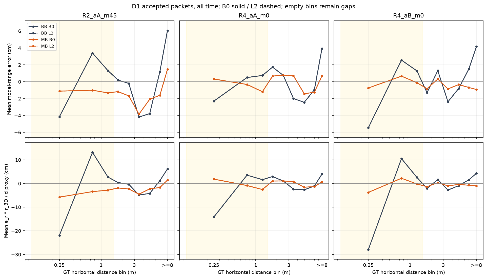
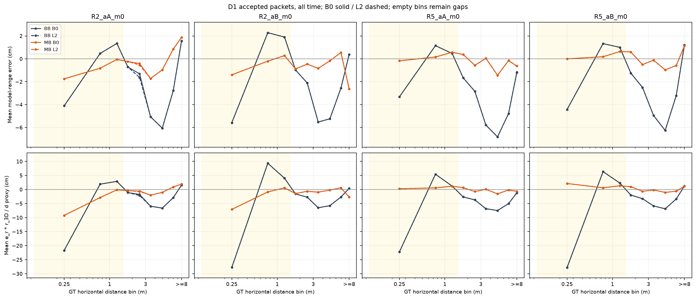
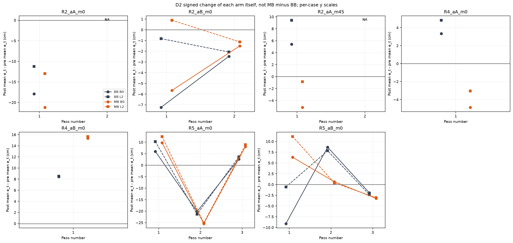
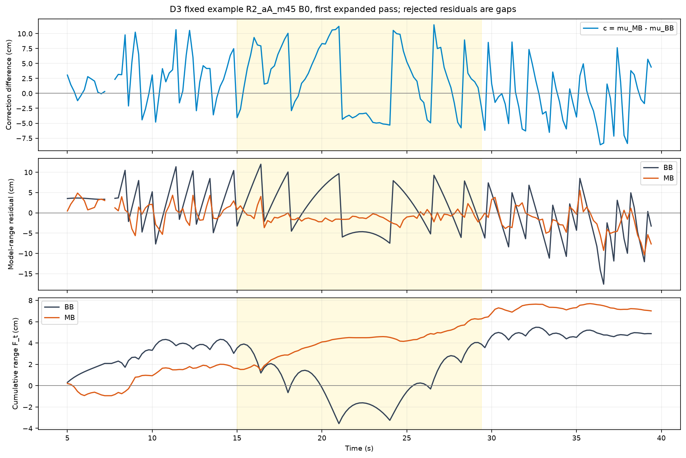
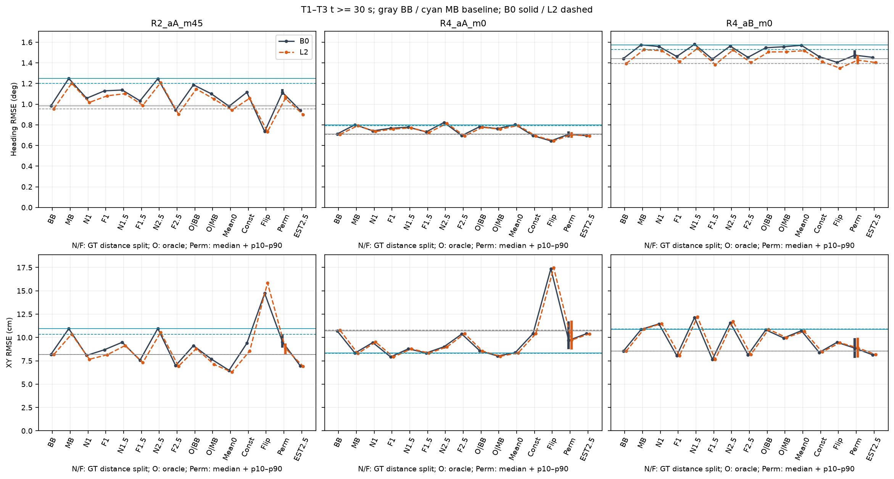
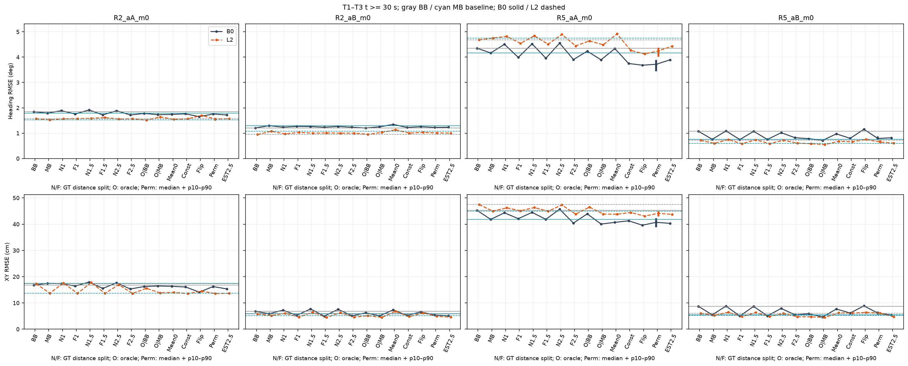

# Δs 보정은 왜 BASE보다 나빠지는가

> 판정은 고정된 운영 기준에 따른 이번 데이터의 결과입니다. 기술적 분해와 개입 결과를 분리하며, 여러 모델 오차 중 유일 원인을 확정하지 않습니다.

## 1. 가설별 판정

| hypothesis | stage | support_cases | NA_cases | total_cases | result |
|---|---|---|---|---|---|
| W1 | D1 | 1 | 0 | 3 | NOT_SUPPORT |
| W1 | T1_D1.0 | 1 | 0 | 3 | NOT_SUPPORT |
| W1 | T1_D1.5 | 1 | 0 | 3 | NOT_SUPPORT |
| W1 | T1_D2.5 | 3 | 0 | 3 | SUPPORT |
| W1_W2_DIRECTION | T2 | 0 | 0 | 3 | NOT_SUPPORT |
| W2 | D3 | 0 | 0 | 3 | NOT_SUPPORT |
| W2 | T3_PERM | 2 | 0 | 3 | SUPPORT |
| W3 | T2 | 1 | 0 | 3 | NOT_SUPPORT |
| W4 | T3_FLIP_LITERAL | 2 | 0 | 3 | SUPPORT |
| W4_AUX | T3_FLIP_GAP | 3 | 0 | 3 | SUPPORT |
| W5 | D0 | 0 | 0 | 3 | NOT_SUPPORT |

SUPPORT는 주 3개 case 중 최소 2개에서 B0/L2가 모두 기준을 만족했다는 뜻입니다. NOT_SUPPORT는 해당 예측 미충족이며 가설 전체의 불가능성을 증명하지 않습니다. W5만은 R 변경이라는 구체적 전제가 실제로 없으므로 그 설명을 배제합니다. D1/D3 행은 기술 후보, T1/T2/T3 행은 개입 판정입니다.

### 결과가 가리키는 차이

- **손상이 집중되는 구간:** D=2.5m의 거리 분할은 주3case 모두 조건을 만족합니다. 그러나 D1에서 근거리 평균 잔차 절댓값이 증가한 것은 R4_aA 하나뿐이고 RMS는 모두 개선됩니다. 따라서 근거리 구간의 중요성과 근거리 range 오보정은 같은 주장이 아닙니다.
- **R2_m45:** 순서 섞기만으로는 gap이 약33–35% 줄어 50% 기준에 못 미칩니다. 통과 평균 제거 효과가 더 크며, oracle0|BB는 Heading RMSE를 약20% 악화시킵니다.
- **R4 두 case:** 순서 섞기는 gap을 중앙값 약74–81% 줄입니다. 통과 평균 제거는 효과가 작고, 상수만 남긴 경우는 BB에 가까워집니다. 느린 잔차 자체보다 보정의 시간·기하 배치가 중요하다는 해석과 부합합니다.
- **상쇄 가설의 범위:** R4_aA oracle 악화9.7–9.9%는 사전10% 기준 미달이며, 반올림해 지지로 바꾸지 않습니다. W3는 R2만 지지하고 전체2/3기준은 미충족입니다.
- **부호 반전:** 원문 delta_e_t 기준 W4는 R2_m45/R4_aA에서 지지됩니다. R4_aB는 접선 gap은 뒤집혀도 각 arm의 post−pre 변화량은 양수로 남습니다. 이 차이를 주·보조 판정으로 구분합니다.

## 2. 실행 계약과 검산

- 기준 commit: `2ee731336fc2b37ffcd67f96a07bdaf3dccc2898`, 브랜치 `research/ds-x1-x2-results-20261026`.
- 14조건, 고정 A_B. CONTROL 4개 arm + T1–T3 31개 arm을 조건마다 실행했습니다. T1-est 대상 D: [2.5].
- D0–D4 검산 700개, 저장 trace 독립 검산 10342개 통과. OFF_BB/MB와 ORACLE_BB/MB 각각 E1 재현 허용차 1e-10.
- 원측정·mu·R·mask, 거리 switch, seed별 순열 분포, oracle 목표, 최적 joint gain, Joseph 공분산, 대칭/PSD, 전체 점수와 pass 점수를 검산했습니다.
- 기존 산출물/Q/학습/편파 평균/R 보존. T4는 R 차이 0으로 생략. 새 통계·코드·trace·그림은 이 폴더 안에만 저장합니다.

### 정의와 학습 근거

range 오차는 기하학적 거리 대신 h_r(GT)=3D거리−0.5315983906250129 m를 기준으로 했습니다. D1/D4는 전체 시간의 accepted packet이며 D1 scoring(t≥30) 표도 별도 포함합니다. posterior 오차는 거절 packet을 포함합니다. 초기 통과는 t<30이어도 개입·통과 통계에 포함됩니다.

편파 평균/R 학습 라벨은 GT 위치·Heading에서 SourceFFD를 평가한 측정 잔차입니다. held route를 제외하고 test와 중복되는 위치도 제외했습니다. BASE posterior를 학습 정답으로 사용한 것이 아닙니다. 현재 predict_one은 q=diag(2e-5·|ds|, radians(0.015)²·dt, 0)의 고정 제어잡음을 운동모델로 전파합니다. 따라서 W3의 “Q가 BASE 궤적에 맞춰 학습됐다”는 설명은 코드 근거가 없습니다.

## 3. D1: 근거리 range 오차

e_lat=e_r·r_3D/d는 거리 감도에 따른 증폭 대용값이며 실제 접선 위치 오차가 아닙니다. 앵커 바로 근처에서는 1/d 때문에 커지므로 이를 위치 오차로 직접 해석하지 않습니다. 빈 bin은 보간하지 않았습니다.

| case | bias | arm | n | mean_er_m | rms_er_m | mean_elat_m |
|---|---|---|---|---|---|---|
| R2_aA_m0 | B0 | BB | 144 | 0.0035 | 0.0531 | -0.0003 |
| R2_aA_m0 | B0 | MB | 144 | -0.0062 | 0.0180 | -0.0246 |
| R2_aA_m0 | L2 | BB | 144 | 0.0035 | 0.0531 | -0.0003 |
| R2_aA_m0 | L2 | MB | 144 | -0.0062 | 0.0180 | -0.0246 |
| R2_aA_m45 | B0 | BB | 144 | 0.0188 | 0.0568 | 0.0586 |
| R2_aA_m45 | B0 | MB | 144 | -0.0114 | 0.0216 | -0.0342 |
| R2_aA_m45 | L2 | BB | 144 | 0.0188 | 0.0568 | 0.0586 |
| R2_aA_m45 | L2 | MB | 144 | -0.0114 | 0.0216 | -0.0342 |
| R2_aB_m0 | B0 | BB | 142 | 0.0092 | 0.0529 | 0.0156 |
| R2_aB_m0 | B0 | MB | 142 | -0.0020 | 0.0156 | -0.0129 |
| R2_aB_m0 | L2 | BB | 142 | 0.0092 | 0.0529 | 0.0156 |
| R2_aB_m0 | L2 | MB | 142 | -0.0020 | 0.0156 | -0.0129 |
| R4_aA_m0 | B0 | BB | 119 | -0.0040 | 0.0501 | -0.0344 |
| R4_aA_m0 | B0 | MB | 119 | -0.0043 | 0.0188 | -0.0054 |
| R4_aA_m0 | L2 | BB | 119 | -0.0040 | 0.0501 | -0.0344 |
| R4_aA_m0 | L2 | MB | 119 | -0.0043 | 0.0188 | -0.0054 |
| R4_aB_m0 | B0 | BB | 136 | -0.0066 | 0.0538 | -0.0574 |
| R4_aB_m0 | B0 | MB | 136 | -0.0015 | 0.0172 | -0.0083 |
| R4_aB_m0 | L2 | BB | 136 | -0.0066 | 0.0538 | -0.0574 |
| R4_aB_m0 | L2 | MB | 136 | -0.0015 | 0.0172 | -0.0083 |
| R5_aA_m0 | B0 | BB | 220 | -0.0013 | 0.0494 | -0.0247 |
| R5_aA_m0 | B0 | MB | 220 | 0.0023 | 0.0156 | 0.0071 |
| R5_aA_m0 | L2 | BB | 220 | -0.0013 | 0.0494 | -0.0247 |
| R5_aA_m0 | L2 | MB | 220 | 0.0023 | 0.0156 | 0.0071 |
| R5_aB_m0 | B0 | BB | 219 | -0.0018 | 0.0495 | -0.0335 |
| R5_aB_m0 | B0 | MB | 219 | 0.0030 | 0.0165 | 0.0122 |
| R5_aB_m0 | L2 | BB | 219 | -0.0018 | 0.0495 | -0.0335 |
| R5_aB_m0 | L2 | MB | 219 | 0.0030 | 0.0165 | 0.0122 |

## 4. D2·D3: 접선 변화와 3항 분해

그림은 |오차|가 아니라 각 arm 자체의 signed post−pre 변화입니다. BB를 뺀 gap과 구별합니다. R5의 세 통과를 모두 포함하고 유효 post가 부족한 통과는 NA로 남겼습니다.

정확한 분해는 −K_M c + (K_M−K_B)ν_B − K_M(h_M−h_B)입니다. 마지막 항은 이미 달라진 prior 위치에 대한 반응을 포함합니다. 주 결과는 공통 GT축, 비교 결과는 공통 BB prior축이며 각 arm 자기 축의 합도 별도 열로 제공합니다. 자기 축의 차이를 세 항의 효과로 섞지 않았습니다.

| case | bias | F_BB_cm | F_MB_cm | correction_cm | gain_difference_cm | prediction_difference_cm | sign_relation | opposite_similar | tau_BB_s | tau_MB_s |
|---|---|---|---|---|---|---|---|---|---|---|
| R2_aA_m0 | B0 | -0.2489 | -2.0410 | 5.9711 | 0.0749 | -7.8381 | OPPOSITE | True | 0.4000 | 0.4000 |
| R2_aA_m0 | L2 | -2.5594 | -3.0530 | 5.6673 | 0.0996 | -6.2605 | OPPOSITE | True | 0.2000 | 0.4000 |
| R2_aA_m45 | B0 | 4.8803 | 7.0149 | 17.8454 | 0.6039 | -16.3148 | OPPOSITE | True | 0.4000 | 0.4000 |
| R2_aA_m45 | L2 | 7.5780 | 10.0848 | 19.3745 | 0.3979 | -17.2657 | OPPOSITE | True | 0.4000 | 0.4000 |
| R2_aB_m0 | B0 | -13.1363 | 0.3184 | 9.4892 | 0.0797 | 3.8858 | SAME | False | 0.4000 | 0.4000 |
| R2_aB_m0 | L2 | -12.6719 | 0.4088 | 7.6689 | 0.2226 | 5.1893 | SAME | False | 0.4000 | 0.4000 |
| R4_aA_m0 | B0 | -5.0200 | -4.2805 | 11.2770 | -1.6732 | -8.8642 | OPPOSITE | True | 0.4000 | 0.2000 |
| R4_aA_m0 | L2 | -1.7092 | -0.6325 | 11.0416 | -1.5406 | -8.4242 | OPPOSITE | True | 0.4000 | 0.2000 |
| R4_aB_m0 | B0 | -1.3569 | -2.6679 | 3.9120 | 1.3345 | -6.5575 | OPPOSITE | True | 0.4000 | 0.2000 |
| R4_aB_m0 | L2 | -1.0771 | -2.3960 | 3.9095 | 1.2506 | -6.4790 | OPPOSITE | True | 0.4000 | 0.2000 |
| R5_aA_m0 | B0 | -5.5235 | 6.9089 | -5.9270 | -1.7338 | 20.0933 | OPPOSITE | False | 0.2000 | 0.4000 |
| R5_aA_m0 | L2 | -3.7788 | 6.1502 | -6.9971 | -1.6810 | 18.6072 | OPPOSITE | False | 0.2000 | 0.4000 |
| R5_aB_m0 | B0 | -15.6579 | -3.2536 | -18.4600 | 0.5298 | 30.3345 | OPPOSITE | True | 0.4000 | 0.4000 |
| R5_aB_m0 | L2 | -13.0783 | 0.2990 | -17.0876 | 0.5662 | 29.8988 | OPPOSITE | True | 0.4000 | 0.4000 |

주 분석에서는 보정항과 예측 차이항이 반대 부호이며 크기가 비슷합니다. 이는 접선축에 투영했을 때 복원 방향의 성분이 상당함을 보여줍니다. 그 사실만으로 “복원이 접선으로 새는 것이 유일 원인”이라고 확정하지 않습니다. gain과 예측은 이전 상태에 의존하므로 장부 항을 독립 개입 효과처럼 해석할 수 없습니다. 창 경계는 소수8자리 시간으로 고정했으므로 이전 탐색적 계산과 경계 packet 포함 여부가 다를 수 있습니다.

### R2_aB 별도 기술값

| bias | F_BB_cm | F_MB_cm | correction_cm | gain_difference_cm | prediction_difference_cm | tau_BB_s | tau_MB_s |
|---|---|---|---|---|---|---|---|
| B0 | -13.1363 | 0.3184 | 9.4892 | 0.0797 | 3.8858 | 0.4000 | 0.4000 |
| L2 | -12.6719 | 0.4088 | 7.6689 | 0.2226 | 5.1893 | 0.4000 | 0.4000 |

| bias | arm | pass_id | pre_cm | post_cm | delta_et_cm | valid |
|---|---|---|---|---|---|---|
| B0 | BB | 1 | 3.7055 | -3.5227 | -7.2282 | True |
| B0 | BB | 2 | -0.0541 | -2.5283 | -2.4742 | True |
| B0 | MB | 1 | 0.4817 | -5.1702 | -5.6519 | True |
| B0 | MB | 2 | -1.7316 | -3.2372 | -1.5056 | True |
| L2 | BB | 1 | -1.2260 | -2.0512 | -0.8252 | True |
| L2 | BB | 2 | -0.1667 | -2.2412 | -2.0745 | True |
| L2 | MB | 1 | -4.8590 | -3.9698 | 0.8891 | True |
| L2 | MB | 2 | -2.0366 | -3.1720 | -1.1355 | True |

R2_aB의 D1 near 값은 위 표에, 전체 거리 bin과 D3 전·중·후/창밖 분해는 원 CSV에 보존합니다. 주 3개 case의 결론에 이 보조 조건을 포함하지 않습니다.

## 5. T1–T3 개입 결과

회색은 BB, 청록은 MB 기준선입니다. B0/L2를 평균하지 않았으며 Perm은 20 seed 중앙값과 p10–p90입니다. 고정 A_B와 GT switch의 oracle 진단이므로 실제 배포 성능과 구별합니다.

### T1: 거리 분할

| case | bias | D | near_signed_reproduction | far_abs_reproduction | range_retention | pass_goal | valid |
|---|---|---|---|---|---|---|---|
| R2_aA_m45 | B0 | 1.0000 | 0.3836 | 0.5871 | 0.9484 | False | True |
| R2_aA_m45 | L2 | 1.0000 | 0.3738 | 0.5688 | 0.9539 | False | True |
| R4_aA_m0 | B0 | 1.0000 | 0.3939 | 0.7522 | 1.0099 | False | True |
| R4_aA_m0 | L2 | 1.0000 | 0.3937 | 0.7659 | 1.0114 | False | True |
| R4_aB_m0 | B0 | 1.0000 | 1.0518 | 0.0216 | 1.2009 | True | True |
| R4_aB_m0 | L2 | 1.0000 | 1.0465 | 0.0432 | 1.2051 | True | True |
| R2_aA_m45 | B0 | 1.5000 | 0.6300 | 0.2942 | 0.9657 | False | True |
| R2_aA_m45 | L2 | 1.5000 | 0.6490 | 0.2611 | 0.9732 | False | True |
| R4_aA_m0 | B0 | 1.5000 | 0.7514 | 0.4195 | 1.0586 | False | True |
| R4_aA_m0 | L2 | 1.5000 | 0.7667 | 0.4405 | 1.0615 | False | True |
| R4_aB_m0 | B0 | 1.5000 | 1.1995 | 0.2221 | 1.1805 | True | True |
| R4_aB_m0 | L2 | 1.5000 | 1.1856 | 0.2017 | 1.1844 | True | True |
| R2_aA_m45 | B0 | 2.5000 | 0.8816 | 0.0664 | 0.9355 | True | True |
| R2_aA_m45 | L2 | 2.5000 | 0.9011 | 0.0459 | 0.9443 | True | True |
| R4_aA_m0 | B0 | 2.5000 | 1.1155 | 0.0889 | 0.8030 | True | True |
| R4_aA_m0 | L2 | 2.5000 | 1.1158 | 0.1363 | 0.8079 | True | True |
| R4_aB_m0 | B0 | 2.5000 | 1.0835 | 0.0859 | 1.1239 | True | True |
| R4_aB_m0 | L2 | 2.5000 | 1.0982 | 0.0596 | 1.1258 | True | True |

T1-est는 같은 D에서 주2/3 case의 B0/L2가 모두 기준을 만족할 때만 실행하도록 했습니다. 대상 D=[2.5]. 빈 목록이면 T1-est는 미실행입니다.

### 추정 거리 switch 후속 결과

추정 거리 2.5 m 밖에서만 보정한 FAR_EST_2.5는 주 6조건에서 Heading bias gap을 86.2–96.0% 줄이고 range RMSE 개선량을 79.8–112.5% 유지했습니다. R4_aB의 Heading RMSE는 BB보다 약0.01° 높게 남습니다. 이는 고정 A_B에서의 결과이며 자연 gate 또는 새 데이터의 성능을 입증하지 않습니다.

| case | bias | arm | heading_rmse_deg | heading_bias_deg | range_rmse_cm | xy_rmse_m |
|---|---|---|---|---|---|---|
| R2_aA_m0 | B0 | FAR_EST_2.5 | 1.7173 | -1.1342 | 2.5525 | 0.1532 |
| R2_aA_m0 | L2 | FAR_EST_2.5 | 1.5711 | -1.2698 | 2.2172 | 0.1365 |
| R2_aB_m0 | B0 | FAR_EST_2.5 | 1.2339 | -0.7452 | 1.1309 | 0.0510 |
| R2_aB_m0 | L2 | FAR_EST_2.5 | 1.0020 | -0.4592 | 1.0872 | 0.0459 |
| R2_aA_m45 | B0 | FAR_EST_2.5 | 0.9392 | -0.6639 | 1.8810 | 0.0695 |
| R2_aA_m45 | L2 | FAR_EST_2.5 | 0.8998 | -0.6053 | 1.8683 | 0.0690 |
| R4_aA_m0 | B0 | FAR_EST_2.5 | 0.6952 | -0.0688 | 0.9600 | 0.1040 |
| R4_aA_m0 | L2 | FAR_EST_2.5 | 0.6921 | -0.0503 | 0.9554 | 0.1039 |
| R4_aB_m0 | B0 | FAR_EST_2.5 | 1.4534 | 0.2050 | 1.1994 | 0.0814 |
| R4_aB_m0 | L2 | FAR_EST_2.5 | 1.4035 | 0.2683 | 1.1984 | 0.0818 |
| R5_aA_m0 | B0 | FAR_EST_2.5 | 3.8935 | 2.3259 | 1.8954 | 0.4031 |
| R5_aA_m0 | L2 | FAR_EST_2.5 | 4.4342 | 2.8139 | 1.8881 | 0.4374 |
| R5_aB_m0 | B0 | FAR_EST_2.5 | 0.8184 | -0.5684 | 0.8916 | 0.0542 |
| R5_aB_m0 | L2 | FAR_EST_2.5 | 0.6056 | -0.3677 | 0.8760 | 0.0471 |

| case | bias | f_bias_magnitude | f_tangent_magnitude | range_retention |
|---|---|---|---|---|
| R2_aA_m0 | B0 | 0.2780 | 0.8649 | 1.1425 |
| R2_aA_m0 | L2 | -0.6001 | 0.6347 | 1.1838 |
| R2_aA_m45 | B0 | 0.9384 | 0.9194 | 0.9393 |
| R2_aA_m45 | L2 | 0.9602 | 0.9807 | 0.9480 |
| R2_aB_m0 | B0 | 0.6478 | -1.8428 | 0.8629 |
| R2_aB_m0 | L2 | 0.5874 | -1.6647 | 0.8592 |
| R4_aA_m0 | B0 | 0.8922 | 0.6702 | 0.7976 |
| R4_aA_m0 | L2 | 0.8623 | 0.6550 | 0.8022 |
| R4_aB_m0 | B0 | 0.9086 | 0.9099 | 1.1251 |
| R4_aB_m0 | L2 | 0.9474 | 0.9641 | 1.1248 |
| R5_aA_m0 | B0 | -0.4006 | 0.5376 | 0.9917 |
| R5_aA_m0 | L2 | 0.8106 | 0.6382 | 1.0216 |
| R5_aB_m0 | B0 | 0.2118 | 0.2570 | 1.0016 |
| R5_aB_m0 | L2 | 0.2835 | 0.2680 | 1.0288 |

추정 거리 switch는 이번 데이터에서의 실사용 후보 검사입니다. 자연 gate와 독립 경로 검증을 하지 않았으므로 배포 채택으로 확정하지 않습니다.

### T2: 모델 기준 oracle

| case | bias | arm | heading_rmse_deg | heading_bias_deg | range_rmse_cm | xy_rmse_m |
|---|---|---|---|---|---|---|
| R2_aA_m0 | B0 | OFF_BB | 1.8437 | -0.8286 | 2.9888 | 0.1676 |
| R2_aA_m0 | B0 | OFF_MB | 1.7916 | -1.2518 | 2.6069 | 0.1745 |
| R2_aA_m0 | L2 | OFF_BB | 1.5714 | -0.8376 | 2.7980 | 0.1732 |
| R2_aA_m0 | L2 | OFF_MB | 1.5226 | -1.1077 | 2.3074 | 0.1370 |
| R2_aB_m0 | B0 | OFF_BB | 1.2047 | -0.6877 | 1.7343 | 0.0683 |
| R2_aB_m0 | B0 | OFF_MB | 1.2986 | -0.8511 | 1.0350 | 0.0588 |
| R2_aB_m0 | L2 | OFF_BB | 0.9467 | -0.3751 | 1.6730 | 0.0577 |
| R2_aB_m0 | L2 | OFF_MB | 1.0739 | -0.5788 | 0.9912 | 0.0518 |
| R2_aA_m45 | B0 | OFF_BB | 0.9847 | -0.6363 | 3.6171 | 0.0820 |
| R2_aA_m45 | B0 | OFF_MB | 1.2495 | -1.0856 | 1.7688 | 0.1094 |
| R2_aA_m45 | L2 | OFF_BB | 0.9558 | -0.5877 | 3.6174 | 0.0817 |
| R2_aA_m45 | L2 | OFF_MB | 1.2021 | -1.0319 | 1.7724 | 0.1036 |
| R4_aA_m0 | B0 | OFF_BB | 0.7116 | -0.0538 | 1.7484 | 0.1070 |
| R4_aA_m0 | B0 | OFF_MB | 0.8006 | -0.1931 | 0.7600 | 0.0833 |
| R4_aA_m0 | L2 | OFF_BB | 0.7072 | -0.0314 | 1.7456 | 0.1078 |
| R4_aA_m0 | L2 | OFF_MB | 0.7915 | -0.1682 | 0.7606 | 0.0828 |
| R4_aB_m0 | B0 | OFF_BB | 1.4418 | 0.2232 | 1.8380 | 0.0854 |
| R4_aB_m0 | B0 | OFF_MB | 1.5742 | 0.4218 | 1.2704 | 0.1086 |
| R4_aB_m0 | L2 | OFF_BB | 1.3938 | 0.2788 | 1.8402 | 0.0853 |
| R4_aB_m0 | L2 | OFF_MB | 1.5276 | 0.4791 | 1.2696 | 0.1090 |
| R5_aA_m0 | B0 | OFF_BB | 4.3532 | 2.4650 | 2.7219 | 0.4530 |
| R5_aA_m0 | B0 | OFF_MB | 4.1659 | 2.5644 | 1.8885 | 0.4183 |
| R5_aA_m0 | L2 | OFF_BB | 4.6811 | 2.8559 | 2.6119 | 0.4748 |
| R5_aA_m0 | L2 | OFF_MB | 4.7525 | 3.0776 | 1.9034 | 0.4495 |
| R5_aB_m0 | B0 | OFF_BB | 1.0731 | -0.7171 | 1.6581 | 0.0869 |
| R5_aB_m0 | B0 | OFF_MB | 0.7588 | -0.5284 | 0.8928 | 0.0546 |
| R5_aB_m0 | L2 | OFF_BB | 0.7156 | -0.4038 | 1.6206 | 0.0609 |
| R5_aB_m0 | L2 | OFF_MB | 0.5996 | -0.3534 | 0.8968 | 0.0527 |
| R2_aA_m0 | B0 | ORACLE0_BB | 1.7801 | -1.0019 | 2.7454 | 0.1625 |
| R2_aA_m0 | B0 | ORACLE0_MB | 1.7304 | -1.2769 | 2.5314 | 0.1646 |
| R2_aA_m0 | L2 | ORACLE0_BB | 1.5116 | -0.8626 | 2.5397 | 0.1556 |
| R2_aA_m0 | L2 | ORACLE0_MB | 1.6413 | -1.3589 | 2.1411 | 0.1380 |
| R2_aB_m0 | B0 | ORACLE0_BB | 1.2017 | -0.6356 | 1.3739 | 0.0623 |
| R2_aB_m0 | B0 | ORACLE0_MB | 1.2491 | -0.7507 | 1.0245 | 0.0508 |
| R2_aB_m0 | L2 | ORACLE0_BB | 0.9540 | -0.3283 | 1.3180 | 0.0513 |
| R2_aB_m0 | L2 | ORACLE0_MB | 1.0286 | -0.4805 | 0.9900 | 0.0449 |
| R2_aA_m45 | B0 | ORACLE0_BB | 1.1873 | -0.9385 | 3.6393 | 0.0913 |
| R2_aA_m45 | B0 | ORACLE0_MB | 1.1008 | -0.9077 | 1.4720 | 0.0769 |
| R2_aA_m45 | L2 | ORACLE0_BB | 1.1475 | -0.8933 | 3.6492 | 0.0881 |
| R2_aA_m45 | L2 | ORACLE0_MB | 1.0489 | -0.8488 | 1.4727 | 0.0711 |
| R4_aA_m0 | B0 | ORACLE0_BB | 0.7819 | -0.1578 | 1.6631 | 0.0858 |
| R4_aA_m0 | B0 | ORACLE0_MB | 0.7634 | -0.1599 | 0.6573 | 0.0801 |
| R4_aA_m0 | L2 | ORACLE0_BB | 0.7758 | -0.1452 | 1.6643 | 0.0855 |
| R4_aA_m0 | L2 | ORACLE0_MB | 0.7579 | -0.1400 | 0.6579 | 0.0799 |
| R4_aB_m0 | B0 | ORACLE0_BB | 1.5465 | 0.3995 | 1.7883 | 0.1081 |
| R4_aB_m0 | B0 | ORACLE0_MB | 1.5560 | 0.3801 | 1.1406 | 0.0994 |
| R4_aB_m0 | L2 | ORACLE0_BB | 1.5055 | 0.4576 | 1.7908 | 0.1088 |
| R4_aB_m0 | L2 | ORACLE0_MB | 1.5071 | 0.4373 | 1.1367 | 0.0999 |
| R5_aA_m0 | B0 | ORACLE0_BB | 4.2357 | 2.4345 | 2.5281 | 0.4393 |
| R5_aA_m0 | B0 | ORACLE0_MB | 3.8940 | 2.3338 | 1.9192 | 0.4004 |
| R5_aA_m0 | L2 | ORACLE0_BB | 4.6395 | 2.8600 | 2.4426 | 0.4651 |
| R5_aA_m0 | L2 | ORACLE0_MB | 4.4877 | 2.8608 | 1.9286 | 0.4384 |
| R5_aB_m0 | B0 | ORACLE0_BB | 0.7826 | -0.4927 | 1.3436 | 0.0590 |
| R5_aB_m0 | B0 | ORACLE0_MB | 0.7134 | -0.4760 | 0.7253 | 0.0463 |
| R5_aB_m0 | L2 | ORACLE0_BB | 0.5842 | -0.2552 | 1.3227 | 0.0473 |
| R5_aB_m0 | L2 | ORACLE0_MB | 0.5475 | -0.3010 | 0.7288 | 0.0443 |

ORACLE0|BB 악화는 해당 배경에서 보정 range를 정확하게 만드는 개입이 손상을 준다는 관찰입니다. 다른 오차와의 상쇄라는 설명과 부합하지만, 특정 편파 편향이나 Q/R이 그 상대였다는 것을 단독으로 식별하지 않습니다. ORACLE0|BB와 ORACLE0|MB는 확장창 밖 c와 그로 인해 달라진 상태 이력을 포함해 비교됩니다. 확장창 밖은 모두 원거리가 아니므로 T1 FAR_ONLY와 동일 개입으로 취급하지 않습니다.

### T3: 순서·평균·부호 교란

| case | bias | n | median | p10 | p90 | minimum | maximum | n_ge_half |
|---|---|---|---|---|---|---|---|---|
| R2_aA_m0 | B0 | 20 | 0.2884 | 0.0748 | 0.5038 | -0.1469 | 0.5707 | 2 |
| R2_aA_m0 | L2 | 20 | -0.4414 | -0.8055 | 0.2324 | -0.9627 | 0.4813 | 0 |
| R2_aA_m45 | B0 | 20 | 0.3292 | 0.2526 | 0.3695 | 0.1645 | 0.4448 | 0 |
| R2_aA_m45 | L2 | 20 | 0.3463 | 0.2927 | 0.3903 | 0.2146 | 0.4702 | 0 |
| R2_aB_m0 | B0 | 20 | 0.8047 | 0.6478 | 0.9366 | 0.5827 | 0.9867 | 20 |
| R2_aB_m0 | L2 | 20 | 0.6857 | 0.5656 | 0.8026 | 0.5217 | 0.9019 | 20 |
| R4_aA_m0 | B0 | 20 | 0.7448 | 0.5089 | 0.9369 | 0.3831 | 0.9953 | 18 |
| R4_aA_m0 | L2 | 20 | 0.7382 | 0.5041 | 0.9342 | 0.3520 | 0.9949 | 18 |
| R4_aB_m0 | B0 | 20 | 0.8064 | 0.3732 | 0.9565 | 0.2907 | 0.9763 | 17 |
| R4_aB_m0 | L2 | 20 | 0.7816 | 0.3672 | 0.9816 | 0.3218 | 0.9903 | 17 |
| R5_aA_m0 | B0 | 20 | -1.2259 | -3.5430 | 0.0406 | -4.2447 | 0.3615 | 0 |
| R5_aA_m0 | L2 | 20 | 0.3345 | -0.4759 | 0.7987 | -0.7040 | 0.9759 | 6 |
| R5_aB_m0 | B0 | 20 | -0.3942 | -0.5262 | -0.1994 | -0.5657 | -0.0732 | 0 |
| R5_aB_m0 | L2 | 20 | -1.2901 | -1.8739 | -0.6918 | -1.9603 | -0.5057 | 0 |

| case | bias | hypothesis | stage | result | value | note |
|---|---|---|---|---|---|---|
| R2_aA_m0 | B0 | W4_AUX | T3_FLIP_GAP | NOT_SUPPORT | 0.0000 | relative to BB; not proof of unique geometric correlates |
| R2_aA_m0 | B0 | W4 | T3_FLIP_LITERAL | NOT_SUPPORT | 0.0000 | original D2 delta=post-pre; heading movement relative to BB |
| R2_aA_m0 | L2 | W4_AUX | T3_FLIP_GAP | NOT_SUPPORT | 0.0000 | relative to BB; not proof of unique geometric correlates |
| R2_aA_m0 | L2 | W4 | T3_FLIP_LITERAL | NOT_SUPPORT | 0.0000 | original D2 delta=post-pre; heading movement relative to BB |
| R2_aB_m0 | B0 | W4_AUX | T3_FLIP_GAP | NOT_SUPPORT | 0.0000 | relative to BB; not proof of unique geometric correlates |
| R2_aB_m0 | B0 | W4 | T3_FLIP_LITERAL | NOT_SUPPORT | 0.0000 | original D2 delta=post-pre; heading movement relative to BB |
| R2_aB_m0 | L2 | W4_AUX | T3_FLIP_GAP | NOT_SUPPORT | 0.0000 | relative to BB; not proof of unique geometric correlates |
| R2_aB_m0 | L2 | W4 | T3_FLIP_LITERAL | NOT_SUPPORT | 0.0000 | original D2 delta=post-pre; heading movement relative to BB |
| R2_aA_m45 | B0 | W4_AUX | T3_FLIP_GAP | SUPPORT | 1.0000 | relative to BB; not proof of unique geometric correlates |
| R2_aA_m45 | B0 | W4 | T3_FLIP_LITERAL | SUPPORT | 1.0000 | original D2 delta=post-pre; heading movement relative to BB |
| R2_aA_m45 | L2 | W4_AUX | T3_FLIP_GAP | SUPPORT | 1.0000 | relative to BB; not proof of unique geometric correlates |
| R2_aA_m45 | L2 | W4 | T3_FLIP_LITERAL | SUPPORT | 1.0000 | original D2 delta=post-pre; heading movement relative to BB |
| R4_aA_m0 | B0 | W4_AUX | T3_FLIP_GAP | SUPPORT | 1.0000 | relative to BB; not proof of unique geometric correlates |
| R4_aA_m0 | B0 | W4 | T3_FLIP_LITERAL | SUPPORT | 1.0000 | original D2 delta=post-pre; heading movement relative to BB |
| R4_aA_m0 | L2 | W4_AUX | T3_FLIP_GAP | SUPPORT | 1.0000 | relative to BB; not proof of unique geometric correlates |
| R4_aA_m0 | L2 | W4 | T3_FLIP_LITERAL | SUPPORT | 1.0000 | original D2 delta=post-pre; heading movement relative to BB |
| R4_aB_m0 | B0 | W4_AUX | T3_FLIP_GAP | SUPPORT | 1.0000 | relative to BB; not proof of unique geometric correlates |
| R4_aB_m0 | B0 | W4 | T3_FLIP_LITERAL | NOT_SUPPORT | 0.0000 | original D2 delta=post-pre; heading movement relative to BB |
| R4_aB_m0 | L2 | W4_AUX | T3_FLIP_GAP | SUPPORT | 1.0000 | relative to BB; not proof of unique geometric correlates |
| R4_aB_m0 | L2 | W4 | T3_FLIP_LITERAL | NOT_SUPPORT | 0.0000 | original D2 delta=post-pre; heading movement relative to BB |
| R5_aA_m0 | B0 | W4_AUX | T3_FLIP_GAP | SUPPORT | 1.0000 | relative to BB; not proof of unique geometric correlates |
| R5_aA_m0 | B0 | W4 | T3_FLIP_LITERAL | NOT_SUPPORT | 0.0000 | original D2 delta=post-pre; heading movement relative to BB |
| R5_aA_m0 | L2 | W4_AUX | T3_FLIP_GAP | SUPPORT | 1.0000 | relative to BB; not proof of unique geometric correlates |
| R5_aA_m0 | L2 | W4 | T3_FLIP_LITERAL | NOT_SUPPORT | 0.0000 | original D2 delta=post-pre; heading movement relative to BB |
| R5_aB_m0 | B0 | W4_AUX | T3_FLIP_GAP | NOT_SUPPORT | 0.0000 | relative to BB; not proof of unique geometric correlates |
| R5_aB_m0 | B0 | W4 | T3_FLIP_LITERAL | SUPPORT | 1.0000 | original D2 delta=post-pre; heading movement relative to BB |
| R5_aB_m0 | L2 | W4_AUX | T3_FLIP_GAP | NOT_SUPPORT | 0.0000 | relative to BB; not proof of unique geometric correlates |
| R5_aB_m0 | L2 | W4 | T3_FLIP_LITERAL | SUPPORT | 1.0000 | original D2 delta=post-pre; heading movement relative to BB |

C_PERM은 창 안 c의 분포와 평균을 보존합니다. C_MEAN0/MEANONLY는 각 조건·각 통과의 자기 A_B 확장창 평균을 사용합니다. 기존 component_azimuth의 전역 c 평균과 달리 창 밖 보정은 MB 그대로이므로 수치를 직접 같은 성분 몫으로 합산하지 않습니다. W4 주 판정은 원문 D2의 각 arm delta_e_t(post−pre) 부호 반전과 BB 대비 Heading bias 이동 반전을 함께 봅니다. 접선도 BB 대비 gap으로 보는 보조 판정은 W4_AUX로 구분합니다. DECISION_CLARIFICATION.md에 원문 대응을 명시했습니다. 모든 seed 결과는 T3_PERM_SEEDS.csv에 있습니다.

### 기존 전역 성분 분리와 비교

| case | bias | definition | heading_rmse_deg | heading_bias_deg | xy_rmse_m |
|---|---|---|---|---|---|
| R2_aA_m45 | B0 | global_constant | 1.3955 | -1.2201 | 0.1548 |
| R2_aA_m45 | B0 | global_zero_mean | 0.8807 | -0.4727 | 0.0990 |
| R2_aA_m45 | B0 | full | 1.2495 | -1.0856 | 0.1094 |
| R2_aA_m45 | B0 | pass_mean_only_with_MB_outside | 1.1149 | -0.9385 | 0.0939 |
| R2_aA_m45 | B0 | pass_mean_removed_with_MB_outside | 0.9799 | -0.7335 | 0.0648 |
| R2_aA_m45 | L2 | global_constant | 1.3429 | -1.1643 | 0.1478 |
| R2_aA_m45 | L2 | global_zero_mean | 0.8537 | -0.4120 | 0.1041 |
| R2_aA_m45 | L2 | full | 1.2021 | -1.0319 | 0.1036 |
| R2_aA_m45 | L2 | pass_mean_only_with_MB_outside | 1.0576 | -0.8726 | 0.0855 |
| R2_aA_m45 | L2 | pass_mean_removed_with_MB_outside | 0.9426 | -0.6796 | 0.0629 |
| R4_aA_m0 | B0 | global_constant | 0.7212 | -0.1032 | 0.1024 |
| R4_aA_m0 | B0 | global_zero_mean | 0.8131 | -0.1866 | 0.0873 |
| R4_aA_m0 | B0 | full | 0.8006 | -0.1931 | 0.0833 |
| R4_aA_m0 | B0 | pass_mean_only_with_MB_outside | 0.6954 | -0.0712 | 0.1042 |
| R4_aA_m0 | B0 | pass_mean_removed_with_MB_outside | 0.8027 | -0.1926 | 0.0838 |
| R4_aA_m0 | L2 | global_constant | 0.7167 | -0.0854 | 0.1018 |
| R4_aA_m0 | L2 | global_zero_mean | 0.8034 | -0.1628 | 0.0867 |
| R4_aA_m0 | L2 | full | 0.7915 | -0.1682 | 0.0828 |
| R4_aA_m0 | L2 | pass_mean_only_with_MB_outside | 0.6917 | -0.0495 | 0.1042 |
| R4_aA_m0 | L2 | pass_mean_removed_with_MB_outside | 0.7935 | -0.1677 | 0.0834 |
| R4_aB_m0 | B0 | global_constant | 1.4270 | 0.2032 | 0.0818 |
| R4_aB_m0 | B0 | global_zero_mean | 1.5903 | 0.4461 | 0.1136 |
| R4_aB_m0 | B0 | full | 1.5742 | 0.4218 | 0.1086 |
| R4_aB_m0 | B0 | pass_mean_only_with_MB_outside | 1.4605 | 0.2237 | 0.0839 |
| R4_aB_m0 | B0 | pass_mean_removed_with_MB_outside | 1.5699 | 0.4141 | 0.1072 |
| R4_aB_m0 | L2 | global_constant | 1.3819 | 0.2640 | 0.0818 |
| R4_aB_m0 | L2 | global_zero_mean | 1.5494 | 0.5076 | 0.1142 |
| R4_aB_m0 | L2 | full | 1.5276 | 0.4791 | 0.1090 |
| R4_aB_m0 | L2 | pass_mean_only_with_MB_outside | 1.4113 | 0.2862 | 0.0845 |
| R4_aB_m0 | L2 | pass_mean_removed_with_MB_outside | 1.5179 | 0.4661 | 0.1065 |

기존 FULL_1과 이번 OFF_MB 점수가 일치함을 검산했습니다. 전역 상수/변동과 통과별 상수/변동은 적용 영역과 평균이 다르므로 동일 실험으로 취급하지 않습니다.

## 6. D4와 해석 한계

D4 회귀는 sin/cos Heading, 상대방위, world-y, 거리와 sign(dy_GT/dt)를 사용했습니다. 마지막 항은 지그재그 위상 대용변수입니다. 상관이 큰 변수가 섞이므로 계수/rank/조건수/R²를 함께 저장했습니다. 통과 블록이 1–3개라 CI와 유의성 판정은 하지 않았습니다. 높은 R²를 원인 증거로 쓰지 않습니다.

B0/L2는 동일 RF의 쌍입니다. R4 두 앵커 case를 서로 독립인 물리적 route로 세지 않습니다. 이 결과는 현 시뮬레이션 RF·필터·고정 mask에 한정됩니다. W1–W4 운영 예측이 미충족이어도 다른 형태의 모델 불일치·시간상관·기하 의존성이 모두 배제되는 것은 아닙니다.

## 산출물

PROTOCOL.md / INPUT_LOCK.json / REPLAY_INPUT_LOCK.json / CHECKS.json / OUTPUT_SHA256.json에서 정의·입력·검산·산출 해시를 확인할 수 있습니다. CONTROL과 INTERVENTIONS 폴더에는 원 trace, T1/T2/T3_SCORES.csv에는 점수, GAP_METRICS.csv에는 분자·분모·부호와 감소율이 있습니다. HYPOTHESIS_DECISIONS.csv는 조건별 판정, HYPOTHESIS_SUMMARY.csv는 B0/L2 쌍을 묶은 주 case 판정입니다.
