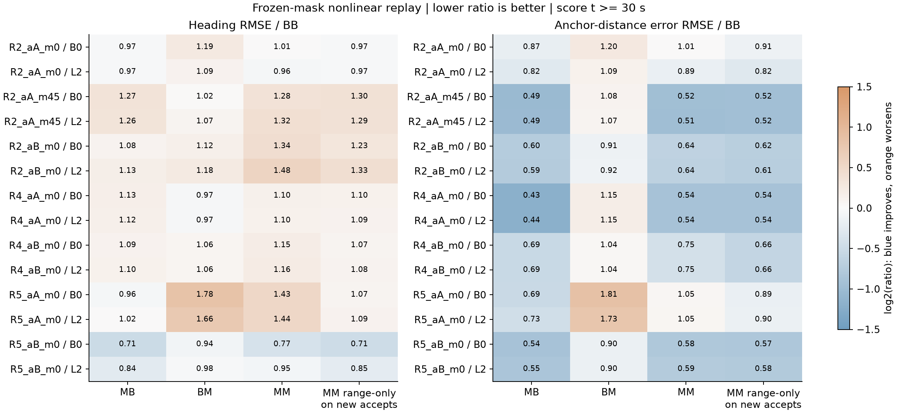
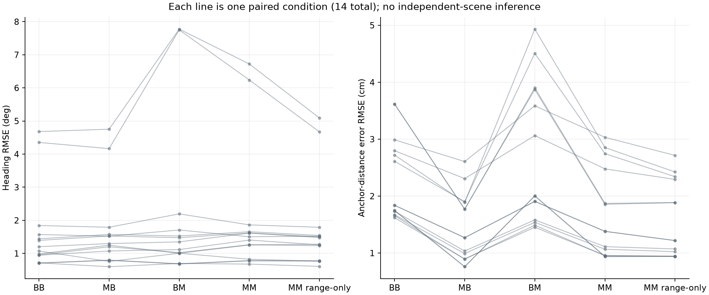
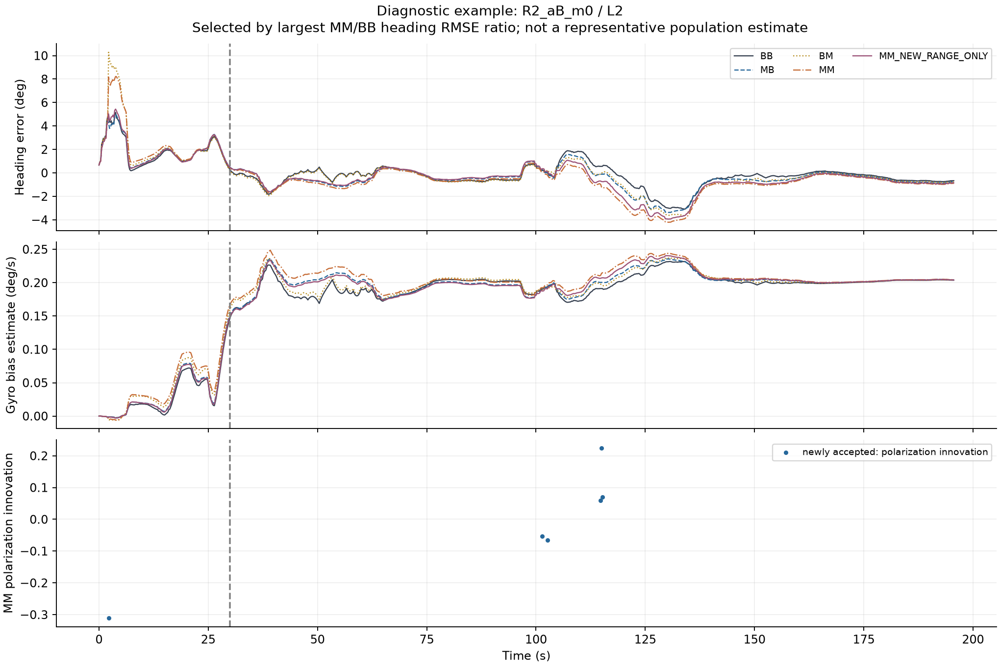

# Δs 보정: X0a → X1 실행 결과

> **핵심 결과**
> BASE의 수용 mask를 그대로 유지해도 Δs 기반 Range 평균 보정은 거리 오차를 14/14조건에서 줄였다. 그러나 Heading은 9/14조건에서 악화됐다.
> 신규 수용 패킷에서 편파 갱신을 제외하면 원래 Δs Arm보다 Heading이 12/14조건에서 개선됐다. **Heading 악화를 gate 하나로 설명할 수 없으며, 평균 보정과 수용 이력 변화가 함께 작용한다.**

## 1. 완료 범위와 검증

입력 고정 → X0a 원본 재현 → X1 비선형 고정-mask 비교를 순서대로 완료했다. 복도 7 case × B0/L2 = 14조건이며, 모든 조건에서 Full 채널과 기존 sensor seed 0을 사용했다. 재귀 계산은 t=0부터 수행하고 점수는 t≥30초에서 계산했다.

| 단계 | 결과 | 근거 |
| --- | --- | --- |
| 소스 동일성 | 101/101 Git blob 일치 | SOURCE_IDENTITY_CHECK.json |
| 입력 고정 | 147개 파일 기록 및 종료 후 해시 재확인 | INPUT_LOCK.json |
| X0a | 14/14조건 PASS | X0A_GATE.json, X0A_CHECKS.json |
| X1 | 14조건 × 5 Arm 완료 | X1_SCORES.csv, x1/*.npz |
| 전체 수치 검사 | 1287개 통과 | ALL_CHECKS.json |
| 프로세스 | 정상 종료, exit code 0; 본체·감독 프로세스·Job 종료 확인 | MANAGED_FINISH.json |

X0a는 기존에 저장된 mask, NIS, innovation, Heading·거리 오차, Heading 표준편차 및 점수를 재현했다. 원본 업데이트와 독립 구현한 비교 코드 사이에서는 prior/posterior, P, K, H, 보정값과 mask도 비교했다. **과거 아카이브에는 전체 P/K/prior 벡터가 없으므로, 과거 전체 상태까지 직접 대조했다고 주장하지 않는다.**

X1에서는 BB/MM 궤적의 X0a 일치, 강제 mask 일치, 거절 시 상태·공분산 불변, 공분산 대칭성과 양의 준정부호를 검사했다. 이것은 계산 검증의 PASS이며 모델 채택이나 과학적 가설의 PASS가 아니다.

## 2. 무엇을 바꾸었는가

B는 BASE(POWER_DIAG), M은 기존 MU_R_EXDS를 뜻한다. 첫 글자는 Range 평균 보정, 둘째 글자는 수용 mask의 출처다.

| Arm | Range 평균 | 고정 수용 mask | 갱신 |
| --- | --- | --- | --- |
| BB | BASE | BASE의 A_B | Range+편파 |
| MB | MU_R_EXDS | BASE의 A_B | Range+편파 |
| BM | BASE | MU_R_EXDS의 A_M | Range+편파 |
| MM | MU_R_EXDS | MU_R_EXDS의 A_M | Range+편파 |
| MM_NEW_RANGE_ONLY | MU_R_EXDS | MU_R_EXDS의 A_M | 신규 수용 집합 A_M∧¬A_B에서만 Range 단독, 나머지는 공동 갱신 |

MU_R_EXDS는 기존 CIR 특징과 Δs 특징으로 예측한 **전체 Range 오차 평균으로 BASE의 Range 평균을 대체**한다. Δs-only 모델이나 BASE 평균에 잔차를 더하는 방식으로 해석하면 안 된다. 편파 평균과 측정 공분산 R은 원래 POWER 값을 유지했다.

A_B와 A_M은 원본 재귀 실행에서 한 번 확보하고 고정했다. 각 Arm은 자신의 궤적에서 h/H/P/K를 다시 계산한다. 고정한 것은 수용 일정이며, Kalman gain이나 prior를 고정한 것은 아니다. 강제 수용 뒤 추가 gate는 적용하지 않았다. 신규 수용 집합은 t≥30초에만 한정하지 않고 전체 시간축에서 정의했다.

Range 단독 갱신은 편파 innovation만 0으로 만드는 근사가 아니다. Range 행 H_r와 R_rr로 계산한 1차원 Kalman gain 및 Joseph 공분산 갱신을 사용했다.

### 기존 예측값 복원

새 학습 없이 저장된 보정 후 잔차에서 당시 예측값을 복원했다.

$$
\widehat{\mu}_r^M=e_r-\frac{\text{MR의 보정 후 Range 잔차 [cm]}}{100}
$$

여기서 e_r는 원래 관측 Range 오차다. 정답 라벨은 **이미 저장된 예측값을 대수적으로 복원하는 데만** 사용했으며 새로운 보정값을 적합하지 않았다. B0/L2에서 동일한 값임을 검사했고 원래 재귀 결과까지 재현했다. 이 절차는 새 데이터에 대한 배포 가능성이나 학습 일반화를 검증하지 않는다.

## 3. 핵심 비교

아래 비율은 각 조건의 RMSE를 해당 조건 BB의 RMSE로 나눈 뒤, 14조건의 중앙값을 계산한 것이다. 1보다 작으면 개선이다. 전체 패킷을 합친 pooled RMSE가 아니다.

| Arm | Heading 비율 중앙값 | 거리 비율 중앙값 | Heading 개선 | 거리 개선 | Heading 10% 초과 악화 |
| --- | --- | --- | --- | --- | --- |
| BB | 1.000 | 1.000 | 0/14 | 0/14 | 0/14 |
| MB | 1.085 | 0.595 | 5/14 | 14/14 | 5/14 |
| BM | 1.065 | 1.074 | 4/14 | 4/14 | 5/14 |
| MM | 1.155 | 0.639 | 3/14 | 11/14 | 9/14 |
| MM_NEW_RANGE_ONLY | 1.082 | 0.615 | 4/14 | 14/14 | 4/14 |

여기서 **거리 오차는 추정 위치로 계산한 앵커까지의 거리와 정답 거리의 차이**다. 패킷별 원시 Range 잔차나 XY 위치 오차와 구분한다.

조건별 절대 변화도 함께 보면 다음과 같다. 음수는 개선이다.

| Arm | Heading RMSE 차이 중앙값 (deg) | 거리 RMSE 차이 중앙값 (cm) |
| --- | --- | --- |
| BB | +0.0000 | +0.0000 |
| MB | +0.0867 | -0.7161 |
| BM | +0.0839 | +0.2549 |
| MM | +0.2191 | -0.6142 |
| MM_NEW_RANGE_ONLY | +0.1054 | -0.6553 |

### 보정값만 변경: MB 대 BB

BASE mask를 유지해도 거리 RMSE는 14/14조건에서 개선됐고 비율 중앙값은 0.595였다. 따라서 관찰된 거리 개선은 신규 패킷 수용만으로 설명되지 않는다.

같은 비교에서 Heading 비율 중앙값은 1.085이며 9/14조건에서 악화됐다. Range 평균 변경이 상태·공분산·후속 편파 innovation을 거쳐 Heading에 영향을 주는 경로가 남아 있다. 이 결과만으로 Δs 특징 자체가 Heading 정보를 제거했다고 결론 낼 수는 없다.

### mask만 변경: BM 대 BB

BASE 보정값에 A_M을 적용하면 Heading 비율 중앙값은 1.065, 거리 비율 중앙값은 1.074였다. 두 지표 모두 10/14조건에서 악화됐다. 수용 이력 변화만으로도 오차가 달라진다는 근거다.

다만 A_M은 원래 M 궤적에서 나온 mask이며 BM 자신의 NIS 판단과 다를 수 있다. 따라서 BM은 실제 배포 정책의 성능이 아니라 고정 수용 이력의 개입 진단이다.

### 신규 수용에서 편파 제외: MM_NEW_RANGE_ONLY 대 MM

Heading은 12/14조건에서 개선됐다. BB 대비 Heading 비율 중앙값은 MM의 1.155에서 1.082로 낮아졌다. BB 대비 거리 개선 조건도 11/14에서 14/14로 늘었다.

그러나 BB 대비 Heading은 여전히 10/14조건에서 악화됐고, R2_aA_m0/L2와 R2_aA_m45/B0에서는 MM보다도 나빠졌다. 신규 수용의 편파 갱신이 많은 조건에서 악화에 기여했지만, 이를 제거하면 항상 해결된다는 결과는 아니다. 이 개입은 후속 공분산과 gain도 바꾸므로 단일 패킷 편파 항의 즉시 효과만 분리한 결과로 볼 수 없다.

## 4. 조건별 Heading RMSE

단위는 degree다. 거리·XY·gyro bias의 조건별 값과 차이는 X1_PAIRED_COMPARISONS.csv에 함께 저장했다.

| Case | Bias | BB | MB | BM | MM | MM 신규 range-only |
| --- | --- | --- | --- | --- | --- | --- |
| R2_aA_m0 | B0 | 1.8437 | 1.7916 | 2.1952 | 1.8628 | 1.7906 |
| R2_aA_m0 | L2 | 1.5714 | 1.5226 | 1.7083 | 1.5042 | 1.5212 |
| R2_aB_m0 | B0 | 1.2047 | 1.2986 | 1.3494 | 1.6156 | 1.4799 |
| R2_aB_m0 | L2 | 0.9467 | 1.0739 | 1.1175 | 1.4044 | 1.2586 |
| R2_aA_m45 | B0 | 0.9847 | 1.2495 | 1.0062 | 1.2578 | 1.2780 |
| R2_aA_m45 | L2 | 0.9558 | 1.2021 | 1.0238 | 1.2632 | 1.2341 |
| R4_aA_m0 | B0 | 0.7116 | 0.8006 | 0.6884 | 0.7860 | 0.7796 |
| R4_aA_m0 | L2 | 0.7072 | 0.7915 | 0.6828 | 0.7755 | 0.7685 |
| R4_aB_m0 | B0 | 1.4418 | 1.5742 | 1.5266 | 1.6561 | 1.5441 |
| R4_aB_m0 | L2 | 1.3938 | 1.5276 | 1.4768 | 1.6178 | 1.5025 |
| R5_aA_m0 | B0 | 4.3532 | 4.1659 | 7.7520 | 6.2383 | 4.6709 |
| R5_aA_m0 | L2 | 4.6811 | 4.7525 | 7.7760 | 6.7226 | 5.0911 |
| R5_aB_m0 | B0 | 1.0731 | 0.7588 | 1.0058 | 0.8248 | 0.7670 |
| R5_aB_m0 | L2 | 0.7156 | 0.5996 | 0.6984 | 0.6783 | 0.6097 |

## 5. 수용 이력과 시간 추이

평가 구간의 조건-패킷 행 12,402개에서 신규 수용은 135개, 신규 거절은 34개였다. B0/L2가 같은 RF 시퀀스를 재사용하므로 이 수치는 서로 독립인 RF 패킷 수가 아니다. 전체 시간축과 t≥30초의 집계는 X1_MASK_TRANSITIONS.csv에 나누어 저장했다.

그림은 MM/BB Heading RMSE 비율이 가장 큰 R2_aB_m0/L2를 선택했다. 전체 환경의 대표 사례라는 뜻은 아니다. 점선은 점수 계산 시작 시각 30초다. 신규 수용 시각과 이후 상태 차이를 함께 관찰할 수 있지만, 개별 시점의 단독 원인이나 시간별 누적 기여량은 이번 단계에서 확정하지 않았다.

## 6. 해석 한계와 다음 판단

이번 결과가 지지하는 범위는 **고정된 기존 모델 출력에 대한 복도 비선형 재귀 진단**이다. 평균 보정과 수용 이력 두 요인 모두 결과를 바꾸며, 신규 수용에서 편파를 제외하는 개입은 대부분 조건의 Heading 악화를 완화한다.

아직 Δs와 d0의 입력 특징 우열, 같은 학습기의 일반화, 분산 재보정 효과, 공통 prior의 출력 민감도, 10~40초 누적 경로별 기여는 검증하지 않았다. R2/R4/R5와 B0/L2를 독립된 14개 환경으로 취급하지 않았고 유의성·동등성·단일 원인 비율을 주장하지 않는다. mask 교환 두 방향과 range-only 결과가 일관되지 않은 조건도 그대로 남겼다.

승인 범위인 X0a와 X1에서 종료했다. 이후에는 남아 있는 Heading 악화를 설명할 공통 prior 진단 또는 같은 Range 학습기의 CIR/Δs/d0 비교 중 목적에 맞는 다음 단계를 선택할 수 있다. 다음 실험은 실행하지 않았다.

## 7. 재현 근거

- 원본 MR run: 39574195919, 소스 commit `902ddcaf0f8e59734bb8026d3bcdc36eab506a27`.
- 원본 HG run: 39586037715. 비교 파일의 정확한 blob은 source_blob_lock.json에 기록.
- 숫자 패키지: NumPy 2.3.3, SciPy 1.16.2, pandas 2.3.2, scikit-learn 1.7.2. 로컬 Python 3.13 Windows와 원본 Python 3.11 Linux의 차이는 사전 수치 재현 gate로 검사했다.
- 실행: `2026-10-26T08:58:30.233994+00:00` ~ `2026-10-26T09:06:45.400240+00:00` (UTC). managed resource `728d19aa-e004-4d16-b64f-d6a488b29061`.
- 기준 입력: `D:/SLAM_bot/OFFICE_CORRIDOR_TRANSFER_FIX_20261026/execution_33e9849`를 읽기 전용으로 사용. 입력 해시를 종료 후 재확인했다.
- X0a 허용차: NIS 1e-7, Heading/거리cm/Heading sigma 1e-8, innovation 1e-9. 독립 구현과 원본의 전체 새 상태 비교는 atol 1e-11, rtol 1e-10. 사전 PROTOCOL.md 그대로 적용.
- 모든 비교의 prior/posterior·P·K·H·innovation·mask: `x0a/*.npz`, `x1/*.npz`.
- 패킷별 강제 수용과 자기 NIS의 가상 수용 여부: X1_PACKETS.csv.gz.
- 조건별 차이와 비가산 상호작용 진단: X1_CONTRASTS.csv. 상호작용 값은 기술통계이며 기여율로 해석하지 않는다.
- 경로·bias별 중앙값: X1_ROUTE_SUMMARY.csv. 경로 집계가 독립 환경 표본을 추가하지 않는다.
- 그림 3개는 직접 렌더링하여 축·단위·라벨·겹침을 확인했다. 정확한 수치는 연결된 CSV를 기준으로 한다.
