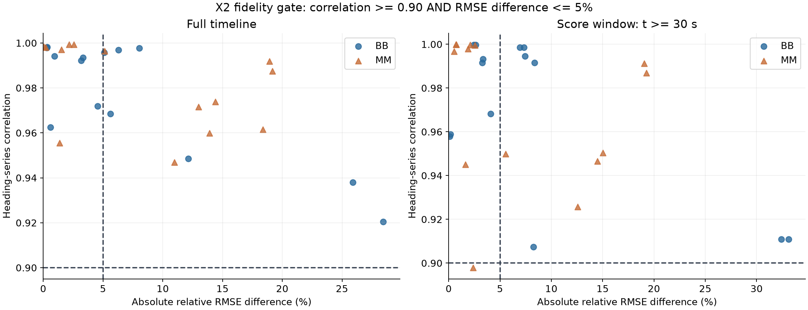
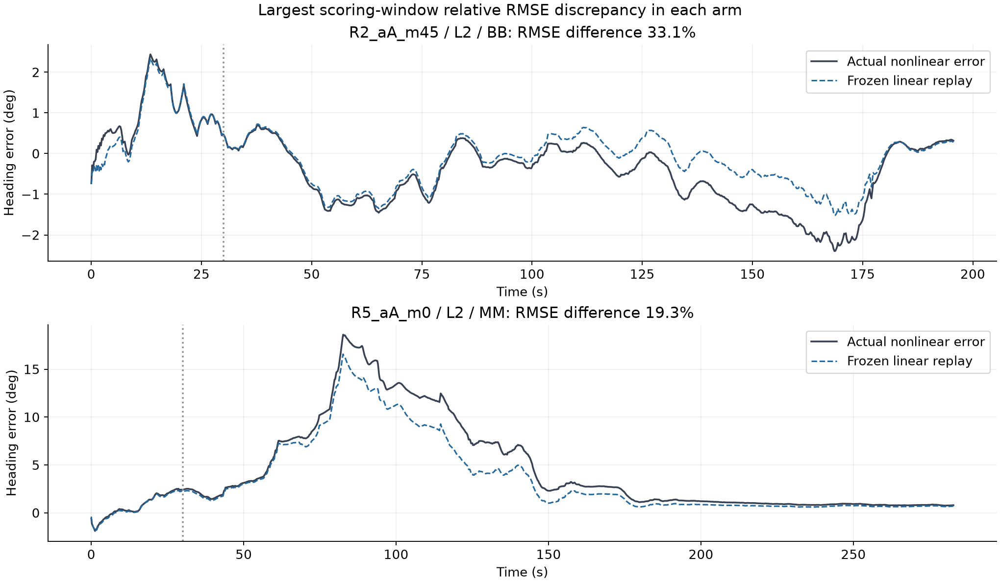

# X2 실행 결과: 선형 근사 기준 미충족

> **판정: STOP_LINEAR_GATE**
> 14조건의 BASE와 MU_R_EXDS에 대해 선형 replay를 실행했다. 평가 구간에서 각각 7/14조건만 사전 기준을 통과했다. 따라서 패킷별 기여와 Range–편파 교차항을 이용한 ‘상쇄 붕괴’ 판정은 수행하지 않았다.
> 이 결과는 상쇄 붕괴 가설의 기각이 아니라, **현재 선형 근사가 그 가설을 판정할 만큼 충분히 재현되지 않았다는 뜻**이다.

## 1. X0a 통과 후에도 검사가 필요했던 이유

X0a는 원본 비선형 필터와 독립 구현의 수치 일치를 검증했다. X2는 다른 질문이다. 실제 비선형 측정 함수를 선형 오차 전파식으로 근사했을 때도 실제 Heading 오차를 유지하는지 확인해야 한다.

X1의 고정 입력과 14조건을 그대로 사용했다. BB는 BASE, MM은 MU_R_EXDS이며, 각 Arm 자신의 비선형 궤적에서 얻은 K/H/F와 mask를 고정했다. BASE의 gain을 모든 Arm에 공통 적용한 실험이나 gain Shapley 분해는 아니다. 먼저 각 Arm 자신의 gain을 유지하는 근사부터 검증했다.

## 2. 선형 replay의 정의

상태는 위치 x/y, Heading ψ, gyro bias b_g의 4차원이다. 오차의 부호는 추정값−정답이며, 각도 차이는 원본과 같은 국소 각도 좌표에서 계산했다.

$$
u_k=z_k-h(x_k^{true})-widehatmu_k,qquad
w_k=f(x_{k-1}^{true},a_k)-x_k^{true}
$$

u는 정답 상태에서 본 보정 후 측정 오차다. 필터 innovation과는 다르다. w는 실제 주행 입력을 정답 상태에 적용했을 때 생기는 전파 오차로, 입력 잡음과 운동 모델의 영향을 포함한다. 정답은 이 오프라인 진단에만 사용했다.

$$
A_k=I-K_kH_k,qquad T_k=A_kF_k
$$

$$
widetilde x_k^{lin}=T_kwidetilde x_{k-1}^{lin}+A_kw_k+K_ku_k
$$

K는 거절 패킷에서 0으로 설정했다. F는 원본 transition 함수가 해당 Arm의 직전 posterior에서 계산한 Jacobian이고, H와 K는 X1에 저장된 값이다. 최초 오차도 실제 초기 prior와 정답의 차이를 그대로 사용했다. 초기 상태와 주행 입력의 기여를 빠뜨려 RF에 잘못 배분하지 않도록 별도 성분으로 유지했다.

### 구현 검사와 근사 정확도 검사의 구분

실제 궤적과 선형식의 비선형 잔여항도 계산했다. 잔여항을 포함한 식이 원래 상태 오차를 복원하는지 검사한 결과, 28개 조건-Arm 모두 통과했고 최대 절대 차이는 1.285e-13였다. 이 값은 상태 성분의 각 단위(m, rad, rad/s)에서 얻은 수치 차이이며 물리적인 통합 오차 지표가 아니다.

원본 전파와 저장된 prior 일치 등을 포함한 구현 검사는 29,046개 통과했다. **잔여항을 넣어 실제 오차를 복원하는 것은 대수적 일관성 검사이며 선형 근사의 성공이 아니다.** 아래 정확도 판정에는 잔여항을 넣지 않았다.

## 3. 사전 기준과 결과

계획서의 기준은 Heading 시계열 상관 ≥0.9 및 실제 대비 Heading RMSE 차이 ≤5%다. 실행 전에 전체 시간축과 t≥30초 구간을 모두 확인하도록 PROTOCOL.md에 고정했다. 어느 조건이든 실패하면 전체 비교의 패킷 기여 해석을 중단한다.

| 구간 | BASE (BB) | MU_R_EXDS (MM) |
| --- | --- | --- |
| 전체 시간 | 7/14 | 6/14 |
| t≥30초 | 7/14 | 7/14 |

전체 시간축 조건을 추가했기 때문에만 중단한 것은 아니다. 기존 점수 구간인 t≥30초만 보아도 28개 조건-Arm 중 14개가 실패한다.

상관이 높아도 RMSE가 일치하지 않는 경우가 많다. 예를 들어 R5_aA_m0/L2의 MM은 상관이 약 0.987이지만 Heading RMSE를 약 19.3% 작게 추정했다. R2_aA_m45/L2의 BB에서는 약 33.1%의 차이가 생겼다. R5_aB_m0/L2의 MM은 상관 0.8979로 상관 기준도 충족하지 못했다.

두 그림은 각 Arm에서 평가 구간의 상대 RMSE 차이가 가장 큰 조건을 골랐다. 전체 환경의 대표성이 아니라 근사 실패의 크기를 보여주는 진단 예시다. 회색 점선은 평가 시작 시각 30초다.

## 4. 조건별 결과

RMSE 차이는 |RMSE_linear/RMSE_actual−1|이다. 패킷 개수나 독립 환경 수로 가중하지 않은 조건별 진단이다.

| Case | Bias | Arm | 상관 | 실제 RMSE (deg) | 선형 RMSE (deg) | RMSE 차이 | 판정 |
| --- | --- | --- | --- | --- | --- | --- | --- |
| R2_aA_m0 | B0 | BB | 0.9579 | 1.8437 | 1.8457 | 0.11% | PASS |
| R2_aA_m0 | B0 | MM | 0.9450 | 1.8628 | 1.8325 | 1.62% | PASS |
| R2_aA_m0 | L2 | BB | 0.9682 | 1.5714 | 1.5071 | 4.09% | PASS |
| R2_aA_m0 | L2 | MM | 0.9257 | 1.5042 | 1.3150 | 12.58% | FAIL |
| R2_aB_m0 | B0 | BB | 0.9945 | 1.2047 | 1.2942 | 7.43% | FAIL |
| R2_aB_m0 | B0 | MM | 0.9979 | 1.6156 | 1.6459 | 1.87% | PASS |
| R2_aB_m0 | L2 | BB | 0.9916 | 0.9467 | 1.0258 | 8.36% | FAIL |
| R2_aB_m0 | L2 | MM | 0.9967 | 1.4044 | 1.4120 | 0.54% | PASS |
| R2_aA_m45 | B0 | BB | 0.9108 | 0.9847 | 0.6655 | 32.42% | FAIL |
| R2_aA_m45 | B0 | MM | 0.9466 | 1.2578 | 1.0754 | 14.50% | FAIL |
| R2_aA_m45 | L2 | BB | 0.9109 | 0.9558 | 0.6394 | 33.11% | FAIL |
| R2_aA_m45 | L2 | MM | 0.9504 | 1.2632 | 1.0734 | 15.03% | FAIL |
| R4_aA_m0 | B0 | BB | 0.9998 | 0.7116 | 0.7304 | 2.64% | PASS |
| R4_aA_m0 | B0 | MM | 1.0000 | 0.7860 | 0.7919 | 0.75% | PASS |
| R4_aA_m0 | L2 | BB | 0.9998 | 0.7072 | 0.7245 | 2.45% | PASS |
| R4_aA_m0 | L2 | MM | 1.0000 | 0.7755 | 0.7809 | 0.69% | PASS |
| R4_aB_m0 | B0 | BB | 0.9986 | 1.4418 | 1.5476 | 7.34% | FAIL |
| R4_aB_m0 | B0 | MM | 0.9996 | 1.6561 | 1.6981 | 2.54% | PASS |
| R4_aB_m0 | L2 | BB | 0.9985 | 1.3938 | 1.4907 | 6.95% | FAIL |
| R4_aB_m0 | L2 | MM | 0.9997 | 1.6178 | 1.6519 | 2.11% | PASS |
| R5_aA_m0 | B0 | BB | 0.9916 | 4.3532 | 4.2113 | 3.26% | PASS |
| R5_aA_m0 | B0 | MM | 0.9912 | 6.2383 | 5.0490 | 19.06% | FAIL |
| R5_aA_m0 | L2 | BB | 0.9932 | 4.6811 | 4.5243 | 3.35% | PASS |
| R5_aA_m0 | L2 | MM | 0.9869 | 6.7226 | 5.4276 | 19.26% | FAIL |
| R5_aB_m0 | B0 | BB | 0.9588 | 1.0731 | 1.0714 | 0.16% | PASS |
| R5_aB_m0 | B0 | MM | 0.9498 | 0.8248 | 0.7790 | 5.55% | FAIL |
| R5_aB_m0 | L2 | BB | 0.9074 | 0.7156 | 0.7747 | 8.25% | FAIL |
| R5_aB_m0 | L2 | MM | 0.8979 | 0.6783 | 0.6622 | 2.37% | FAIL |

## 5. X2에서 확정한 것과 남은 것

확정한 것은 현재의 궤적별 고정 K/H/F 선형 오차 모델이 모든 조건에서 원래 Heading 오차를 재현하지 못한다는 점이다. 측정 함수 또는 운동 전파의 비선형 잔여항을 무시한 영향이 실제로 남아 있다. 어느 셀 경계·FP 전환·시간대가 이를 지배하는지는 이번 검사만으로 확정하지 않았다.

따라서 다음 값은 과학적 결과로 산출하거나 해석하지 않았다.

- 패킷 j가 후속 시각 t의 Heading에 미친 c[t,j] 기여량.
- 신규 수용·기존 수용 패킷의 기여 부호 분포.
- BASE와 MU_R의 Range–편파 교차항 부호 변화 및 ‘상쇄 붕괴’ 판정.
- d0 gate가 상쇄 패킷을 제거한다는 C6 판정. 이번 입력에는 B_GATE5 궤적이 없으며, BASE/MU_R 결과만으로 이를 확정할 수도 없다.

선형 replay 계산 과정의 초기/주행·Range·편파 합계와 비선형 잔여항은 원인 조사 재료로 보존했다. 이 성분들을 검증된 실제 기여량으로 사용하면 안 된다. 통과 조건만 사후 선택해 전체 가설을 지지하는 결과로 제시하지 않았다.

다음 단계의 타당한 후보는 X1과 같은 **비선형 replay에서 특정 패킷 집합의 채널을 직접 개입하는 비교**다. 해당 비교도 상호작용 때문에 단일 기여율을 주지는 않지만 선형 근사 실패를 우회해 가설을 검증할 수 있다. 이번 요청에서는 X2 선행 검사와 결과 기록에서 종료했으며 추가 실험은 실행하지 않았다.

## 6. 산출물과 실행 증거

- 입력 및 소스 SHA256: INPUT_LOCK.json. X1 산출물 manifest와 원본 입력 해시를 읽고 실행 전·후 확인했다.
- 사전 정의: PROTOCOL.md. 실행 스크립트와 protocol의 해시는 INPUT_LOCK.json에 저장했다.
- 조건·Arm·구간별 gate: LINEAR_GATE.csv, LINEAR_GATE.json.
- 실제/선형 오차·Jacobian 전파 행렬·입력 오차·잔여항: linear/*.npz (28개).
- 구현 검사: CHECKS.json. 최종 상태: EXECUTION_RESULT.json.
- 관리 프로세스: `28d21deb-0df7-4992-b415-f7e9c29611ee`, run `c5b33c5a-c285-4020-bbac-54fb488c3ac8`.
- 실행 시각 UTC: `2026-10-26T09:15:29.323896+00:00` ~ `2026-10-26T09:16:00.472488+00:00`. exit code 0, 정상 종료. 본체·감독 프로세스·Job 모두 부재 확인.
- 원본 X0a/X1 결과와 입력은 변경하지 않았다. 결과는 이 X2 전용 폴더에만 저장했다.

코드의 정상 종료와 X2 정확도 gate 실패는 별개다. `STOP_LINEAR_GATE`를 실행 성공이나 가설 PASS로 바꾸어 기록하지 않았다.
