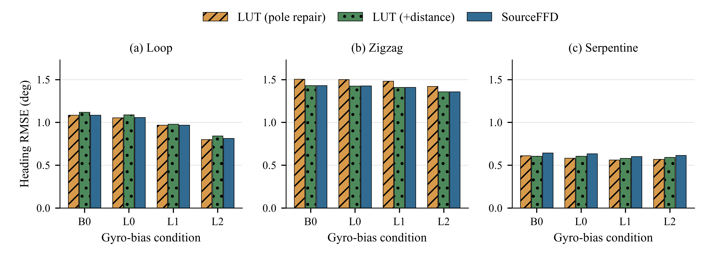
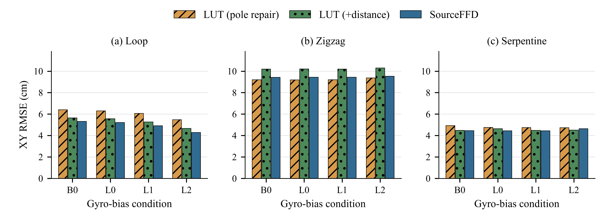
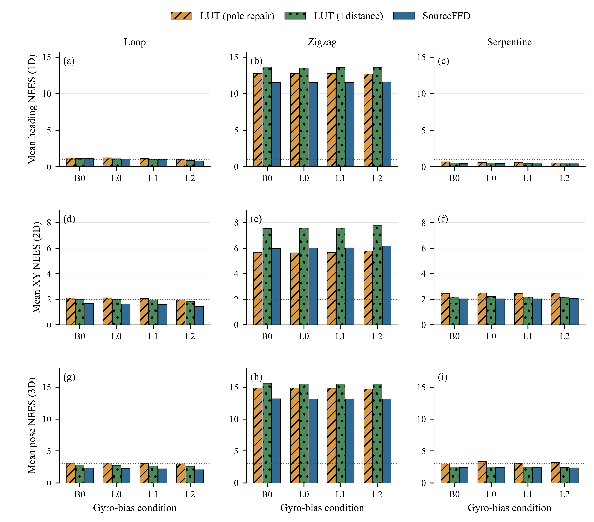

# Dual-LP 원고·LUT 실험 작업 체크포인트 — 2026-11-02

사용자가 요청한 현재 작업 상태의 Git 보존본이다. Obsidian 논문 폴더의 원고·그림·표·코드·입출력 해시·검증 기록을 원본 바이트 그대로 복사했다. 캐시와 Python bytecode만 제외했다. 원본 볼트나 기존 저장소 원고를 덮어쓰지 않았다.

## 추가 체크포인트: 거리 LUT의 BB_ORIG/self 대 MB_VAR/self

질문 ID `DLP-LUT-BB-MB-MATCHED-001`. 기존 커밋 `a9214294a0d1811c2a90a4137a0e4957393e01d8`의 거리 반영 LUT를 그대로 사용해 Anchor B의 R2/R4/R5 × B0/L0/L1/L2에서 BB_ORIG 12개와 MB_VAR 12개를 전체 재생했다. SourceFFD 참조 24개도 재현 검증했다. 기존 거리 LUT MB 12개는 X/P/R/used와 일치했다. BB는 원 BB donor와 원 관측공분산을 사용하며, zero-mean 고정 R0 일반 EKF와 다르다.

별도 하위 에이전트의 독립 재집계·감사 판정은 **ACCEPT**, 과학 결과는 **MIXED**이다. MB_VAR는 BB_ORIG 대비 Heading 11/12조건, XY 8/12조건에서 개선했다. R4 지그재그의 B0 Heading은 1.415916→1.429696°로 악화했고, R4의 네 조건에서 XY가 모두 악화했다. 한 환경·한 RF realization·동일 seed의 synthetic LUT 비교이며 실측 전이·일반적 우위·NEES 일관성 통과를 주장하지 않는다. 원고나 모델 채택은 수행하지 않았다.

- [12조건 paired 결과](paper/figures/lut_bb_mb_matched_20261102/PAIRED_BB_MB_12.csv)
- [24개 전체 지표](paper/figures/lut_bb_mb_matched_20261102/FULL_SCORE_24.csv)
- [한국어 결과 설명](paper/figures/lut_bb_mb_matched_20261102/RESULTS_TO_MANUSCRIPT_KO.md)
- [동결 계약](paper/figures/lut_bb_mb_matched_20261102/CONTRACT_BB_MB_DISTANCE_LUT.json)
- [실행 manifest](paper/figures/lut_bb_mb_matched_20261102/RUN_MANIFEST.json)
- [독립 감사 판정](paper/figures/lut_bb_mb_matched_20261102/audit/INDEPENDENT_AUDIT.json)
- [최종 실행·감사 상태](paper/figures/lut_bb_mb_matched_20261102/FINAL_DELIVERY_STATUS.json)
- [추가 복사본의 SHA256 manifest](MATCHED_BB_MB_SNAPSHOT_MANIFEST.json)

기존 역사 coverage 기준은 보존하고 계약의 정확한 χ² coverage는 별도 열에 기록했다. 차이는 [정의 보완 기록](paper/figures/lut_bb_mb_matched_20261102/CONTRACT_CLARIFICATION.json)을 따른다. 기존 `SNAPSHOT_MANIFEST.json`은 최초 체크포인트 범위를 그대로 보존하며 추가 70개 파일은 별도 manifest가 식별한다. 실행·감사 때의 원본 바이트와 입력 잠금 해시는 유지했고 Python bytecode만 복사에서 제외했다. 이 추가 체크포인트의 Git 커밋을 과거 실행의 소스 커밋으로 소급하지 않는다.

## 원고

현재 볼트의 한글 초안·01b·영문 초안과 검토 기록은 `OBSIDIAN_NOTES_SYNC_20261102.json`에 기록한 해시로 갱신했다. 노트에서 새로 참조하는 사용자 그림도 포함했다. 본문을 추가 편집하거나 수용 상태를 바꾸지 않고 원본 바이트를 복사했으며, 이전 내용은 이전 Git 커밋에 보존된다. 최초 `SNAPSHOT_MANIFEST.json`의 해당 노트 해시는 당시 커밋의 기록이며 현재 노트에는 새 동기화 manifest를 적용한다.

- [한글 초안](paper/01%20초안%20-%20한글.md)
- [01b 물리 관측·모델·결과 초안](paper/01b%20본문%20초안%20-%20물리%20관측·모델·결과.md)
- [작성·수용 운용 방식](paper/00%20논문%20작성%20시스템%20운용%20방식.md)

문서의 draft/accepted 상태는 원본의 표시를 따른다. 이 푸시는 원고 수용이나 모델 채택을 뜻하지 않는다. Obsidian wikilink·embed는 원본 표현을 보존했으므로 GitHub에서 일부 링크가 자동 표시되지 않을 수 있다.

## 최신 MB_VAR 비교

Anchor B의 순환(R2)·지그재그(R4)·사행(R5) × B0/L0/L1/L2에서 기존 극점 수정 LUT·거리 반영 LUT·SourceFFD를 비교했다. 거리 반영 LUT 12조건을 새 실행했고 기존 수정 LUT 12조건 재현, 실제 prior 37,632건 Jacobian 차분 검사와 입력 불변 검사를 통과했다. SourceFFD는 앞서 재현 확인한 저장 결과를 재채점했다. 자체 검사이며 독립 감사가 아니다.

| 관측모델 | heading RMSE (deg) | XY RMSE (cm) | heading NEES | XY NEES | pose NEES |
|---|---:|---:|---:|---:|---:|
| 기존 수정 LUT | 0.968851 | 6.411489 | 3.446163 | 3.048230 | 5.692454 |
| 거리 반영 LUT | 0.959092 | 6.439532 | 3.536604 | 3.304233 | 5.417322 |
| SourceFFD | 0.959158 | 6.072518 | 3.068593 | 2.785835 | 4.717821 |

같은 t≥30 s 표본을 합산했다. pose NEES는 x,y,heading의 3차원이며 gyro bias를 제외한다. 단일 장면·seed의 상관된 시계열이다. 거리 반영이 모든 오차·NEES를 개선하지 않았으며, 특히 지그재그 경로의 XY·NEES는 증가했다. 이 결과를 일반 성능 우월성이나 통계적 일관성 통과로 확대하지 않는다.

- [최신 결과 폴더](paper/figures/distance_lut_mbvar_20261102_v3/)
- [조건별 비교표](paper/figures/distance_lut_mbvar_20261102_v3/ALL_SCORES_36.csv)
- [실행·자체 검사](paper/figures/distance_lut_mbvar_20261102_v3/RESULT_CHECKS.json)
- [실험 계약](paper/figures/distance_lut_mbvar_20261102_v3/CONTRACT.json)
- [극점 수정 결과·잔여 차이 진단](paper/figures/lut_pole_fix_20261102_v3/)
- [최초 관측함수 교체 결과](paper/figures/lut_observer_swap_20261102/)

PDF 벡터와 PNG 600 dpi를 함께 보존했다. 실패한 준비·검사 실행과 중단한 부분 실행도 별도 버전 폴더로 보존했다. 최신 완결 실행은 각 `v3` 폴더의 계약·검사 기록을 기준으로 한다.

## 재현 범위와 출처

`SNAPSHOT_MANIFEST.json`은 모든 복사 파일의 상대 경로·크기·SHA256을 기록한다. 저장소 기반 커밋은 61475a1f12071cb0fcdbd62a728d833f1d6732b5이며, 실행 당시의 복구 런타임·입력은 각 실험의 파일 해시로 식별한다. 푸시 커밋을 과거 실행의 코드 커밋으로 소급하지 않는다.

이 체크포인트는 로컬 경로가 포함된 실행 코드와 증거를 보존한다. 외부 FFD bank·RF 입력 및 일부 런타임은 계약에 기록된 위치·해시로 참조되며 이 폴더만으로 독립 재실행 가능한 배포본이라고 주장하지 않는다. 새 시뮬레이션은 이 푸시 과정에서 실행하지 않았다.
