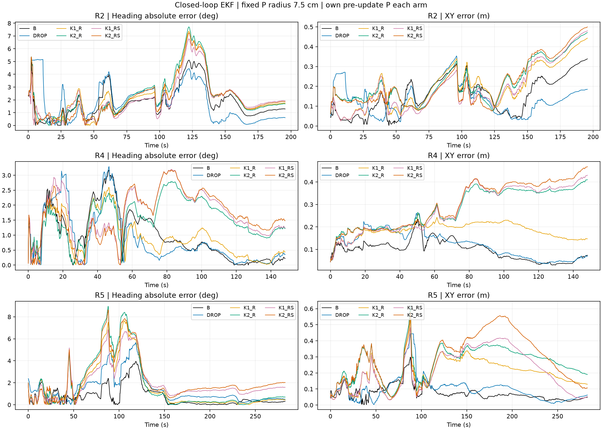
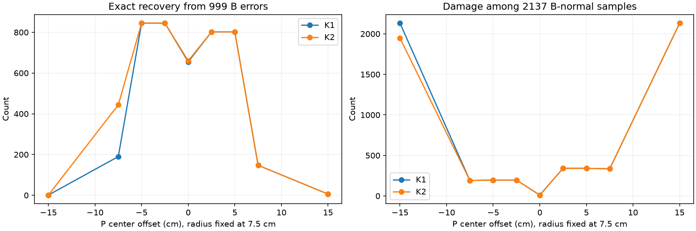

# R4–R5: 고정 B + P 7.5 cm 재귀 EKF 비교

전체 3,136행에서는 B 기준이 Heading 1.557도 / XY 12.81 cm RMSE로 가장 좋았다. 경보 제외는 1.894도 / 13.85 cm, 네 복구 구성은 Heading 2.361~2.684도 / XY 21.32~30.06 cm였다. R2의 경보 제외는 XY를, R4의 K1 거리만 복구는 Heading을 개선했지만, 두 지표를 함께 개선한 구성은 없었다.

R4에서는 ±2.5 cm의 중심 편차만으로 정상 훼손이 11건에서 196/341건으로 증가했다. R5에서도 네 복구 구성의 정상 tap 훼손이 736~1,100건으로 증가했다. 예측 중심의 변화와 오정정 증가가 함께 관찰됐으나 각 요인의 인과 기여를 분리해 입증한 것은 아니다. 고정 P의 복구 성능을 그대로 폐루프 성능으로 해석할 수 없으며 현재 결과는 복구 정책 채택을 지지하지 않는다.

## 실행 범위와 결론 해석

원본 SourceFFD·운동모델·W0 재귀 EKF를 재사용했다. R4는 저장 P 중심의 편차 민감도, R5는 각 실행의 측정 전 상태·공분산으로 P를 다시 계산하는 폐루프 재생이다. 궤도/센서 입력은 동일하며 로봇을 실제로 운행하지 않았다.

6개 구성 모두 원래 초기 상태·공분산, odometry/gyro, Q, 기본 R, muMB/muBASE 및 SourceFFD 관측모델을 고정했다. 각 구성은 자체 shadow 게이트를 원래 W0 구조대로 유지하고 해당 구성의 관측으로 수용 여부를 계산한다. 경보 제외는 main과 shadow 모두 해당 시점의 거리/S 관측 갱신을 건너뛴다. 거리만 복구하면 S는 B tap 값, 동시 복구하면 두 RX의 선택된 공통 tap 값이다. 보정항 재학습이나 선택 정책 튜닝은 하지 않았다.

P는 main 필터의 현재 측정 전 prior·공분산을 2σ 7점 SourceFFD stencil에 넣은 native range min/max의 중점이다. 최종 반경은 항상 0.075 m다. 이전 실험의 경보 689건은 R5에서 고정하지 않는다. 미래 프레임·true pose·참조 tap은 선택과 재귀 계산 입력이 아니며 평가에만 사용한다.

## 궤도별 RMSE

각 셀은 Heading RMSE (deg) / XY RMSE (cm). XY는 좌표별 평균이 아닌 2차원 위치오차 norm의 RMS다. Heading 오차는 ±π로 wrap했다. 초기 표본 포함 전체 R2 979행, R4 742행, R5 1,415행.

|구성|R2|R4|R5|전체 3136행|
|---|---:|---:|---:|---:|
|B 기준|2.162 / 18.03|1.262 / 10.62|1.141 / 8.92|1.557 / 12.81|
|경보 제외|2.280 / 15.66|1.218 / 13.41|1.891 / 12.71|1.894 / 13.85|
|K1 거리만|2.712 / 22.67|1.133 / 18.76|2.569 / 21.62|2.361 / 21.32|
|K2 거리만|2.848 / 24.23|1.679 / 29.61|2.953 / 28.17|2.671 / 27.36|
|K1 거리+S|2.492 / 22.51|1.879 / 29.99|2.557 / 25.04|2.393 / 25.57|
|K2 거리+S|2.683 / 24.42|1.859 / 31.62|3.028 / 32.65|2.684 / 30.06|

## 폐루프 관측 처리와 정상 훼손

|궤도|구성|경보|수용 관측|선택 정확 복구|선택 정상 훼손|수용된 정상 훼손|
|---|---|---:|---:|---:|---:|---:|
|R2|B 기준|209|977|0|0|0|
|R2|경보 제외|249|729|0|0|0|
|R2|K1 거리만|307|975|179|107|106|
|R2|K2 거리만|386|975|178|191|190|
|R2|K1 거리+S|308|976|179|108|108|
|R2|K2 거리+S|381|976|179|186|186|
|R4|B 기준|249|737|0|0|0|
|R4|경보 제외|301|439|0|0|0|
|R4|K1 거리만|469|719|7|330|323|
|R4|K2 거리만|520|736|14|415|413|
|R4|K1 거리+S|465|723|11|339|334|
|R4|K2 거리+S|519|725|14|413|404|
|R5|B 기준|352|1411|0|0|0|
|R5|경보 제외|390|1025|0|0|0|
|R5|K1 거리만|596|1407|173|301|301|
|R5|K2 거리만|761|1415|161|493|493|
|R5|K1 거리+S|586|1407|177|289|289|
|R5|K2 거리+S|774|1415|164|501|501|

정상 훼손은 각 궤도의 원래 B=참조인 표본이 잘못된 tap으로 바뀐 건수다. 폐루프의 정상 경보 집합은 고정 실험의 11건보다 커질 수 있다. 선택 복구 수와 실제 게이트를 통과해 필터에 들어간 수를 분리했다. 경보 제외의 복구 0건은 관측을 고치지 않고 뺀다는 정책 정의에 따른다.

## 신뢰도

truth 파일은 [x,y,yaw] 3열이므로 NEES는 3차원 pose marginal 공분산으로 계산했다. gyro bias 참값을 만들거나 4차원 NEES로 표기하지 않았다. 95% 영역은 χ² 임계값 pose 7.8147, XY 5.9915, Heading 3.8415다.

|궤도|구성|평균 NEES3|Pose 95% 포함률|XY 95% 포함률|Heading 95% 포함률|
|---|---|---:|---:|---:|---:|
|R2|B 기준|17.29|49.7%|47.1%|53.9%|
|R2|경보 제외|9.31|48.3%|35.2%|83.4%|
|R2|K1 거리만|49.72|11.7%|11.2%|54.4%|
|R2|K2 거리만|72.53|1.0%|4.5%|42.1%|
|R2|K1 거리+S|49.60|16.6%|13.1%|56.4%|
|R2|K2 거리+S|71.67|1.0%|5.6%|50.1%|
|R4|B 기준|56.58|20.8%|18.2%|55.3%|
|R4|경보 제외|79.60|15.1%|14.2%|82.2%|
|R4|K1 거리만|370.23|2.0%|1.9%|52.8%|
|R4|K2 거리만|522.48|1.8%|1.5%|25.7%|
|R4|K1 거리+S|412.03|2.0%|1.9%|25.3%|
|R4|K2 거리+S|519.76|1.8%|1.5%|31.9%|
|R5|B 기준|14.05|56.9%|55.1%|87.8%|
|R5|경보 제외|13.82|68.6%|64.0%|81.7%|
|R5|K1 거리만|138.50|2.5%|6.3%|69.3%|
|R5|K2 거리만|266.85|1.7%|2.8%|71.3%|
|R5|K1 거리+S|149.38|2.5%|7.2%|25.6%|
|R5|K2 거리+S|311.64|1.7%|3.0%|22.8%|

포함률이 명목 95%와 다르면 RMSE 개선만으로 공분산 신뢰도까지 개선됐다고 주장할 수 없다. 현재 결과는 시간적으로 상관된 한 seed의 노출 데이터로, 독립 환경 반복이나 일반화 검증이 아니다.

## R4: 예측 중심 편차 민감도

아래 수치는 전체 999건의 기존 오류 중 정확 복구 / 기존 정상 2,137건 중 훼손. 중심 이동 후 경보를 다시 판정했으므로 복구 수가 기존 경보 TP 678을 넘을 수 있다. 이 스윕으로 운영 중심이나 반경을 재선정하지 않았다.

|중심 편차(cm)|K1 복구 / 훼손|K2 복구 / 훼손|
|---:|---:|---:|
|-15|1 / 2132|1 / 1947|
|-7.5|190 / 191|444 / 191|
|-5|845 / 196|845 / 196|
|-2.5|845 / 196|845 / 196|
|+0|655 / 11|660 / 11|
|+2.5|802 / 341|802 / 341|
|+5|802 / 341|802 / 341|
|+7.5|147 / 335|147 / 335|
|+15|6 / 2131|6 / 2131|

## 검증 및 재현

- 실제 FFD bank 2개의 SHA256과 원본 SourceFFD/운동모델/W0 코드 해시 검사 통과. 원본 W0를 세 궤도 전부 재실행해 보관된 prior·Pprior·h·H·Reff·K·mask와 비교했다.
- 새 루프의 B 구성을 원래 W0 함수에 B 관측을 넣은 별도 계산과 비교해 x·P·prior·H·K 및 수용 mask 일치를 확인했다. 고정 P 중심도 전체 표본에서 재현했다. 허용오차는 정규화 1e-10, mask는 정확 일치.
- R4 중심 편차 0 결과는 R2의 네 정책 정확 복구·정상 훼손 수와 일치했다. 모든 trace는 유한하며 공분산 PSD 검사를 통과했다.
- 최초 R4_RUN_001은 과거 캐시 경로 탐색 누락으로 계산 전에 실패했다. 파일·SHA를 바꾸지 않고 기존 캐시를 읽도록 수정한 R4_RUN_002에서 완료했고 실패 기록을 보존했다.
- 구현자 자체 검증 완료이며 독립 감사, 실시간 하드웨어 검증, 최종 정책 채택은 아니다. R5에서 종료했다.

[정밀 지표 CSV](R5_METRICS.csv) · [행별 오차·경보·수용 CSV](R5_ROWS.csv) · [R4 전체 표](R4_SENSITIVITY.csv) · [검사 결과](CHECKS.json) · [동결 계약](CONTRACT.json)

전체 상태·공분산·prior·관측모델·관측·gain·shadow 상태는 R2_TRACE.npz, R4_TRACE.npz, R5_TRACE.npz에 보존했다. 소스 기준 커밋은 fca24720524068badeab79b78098a244cebc62b5이며 로컬 실험 스크립트는 별도 SHA로 식별한다. GitHub에 새 코드를 배포하지 않았다.