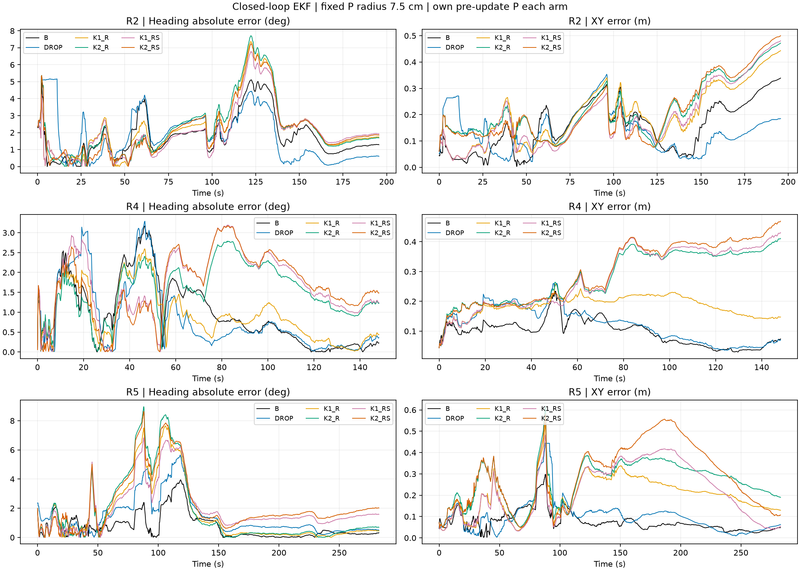

# B + P 7.5 cm: R0–R5 결과

고정 기준: B는 RX별 자기 peak 30% crossing 중 유효한 이른 tap, P 반경은 7.5 cm, M 없음. 소스 기준 커밋은 `fca24720524068badeab79b78098a244cebc62b5`다.

## 결과

- R0–R1: 경보 오류 678건 모두 참조가 유효 RF∩P 후보에 남았다. 후보 누락 0건. 정상 경보 11건에도 P 안의 유효 대안이 있었다.
- R2: K1 정확 복구 655건, K2 660건. 두 정책 모두 정상 11건 훼손. K3는 전부 보류.
- R3: 거리 오차는 감소했지만 LoS 대비 S MAE/RMSE는 증가했다.
- R4: P 중심 ±2.5 cm 편차에서 정상 훼손이 196/341건으로 늘었다. 반경 재선정은 하지 않았다.
- R5: 재귀 EKF의 전체 3,136행에서 B 기준이 Heading/XY RMSE 모두 가장 좋았다. 현재 복구 정책 채택을 지지하지 않는다.

|구성|Heading RMSE (deg)|XY RMSE (cm)|
|---|---:|---:|
|B 기준|1.557|12.81|
|경보 제외|1.894|13.85|
|K1 거리만|2.361|21.32|
|K2 거리만|2.671|27.36|
|K1 거리+S|2.393|25.57|
|K2 거리+S|2.684|30.06|

## 보고서와 근거

- [R0–R1 보고서](RUN_002/REPORT_KO.md), [CIR 근거 갤러리](RUN_002/EVIDENCE.html)
- [R2 정책 비교](R2_RUN_001/REPORT_KO.md)
- [R3 거리·S 비교](R3_RUN_001/REPORT_KO.md), [궤도별 S 그림](R3_RUN_001/S_BY_TRAJECTORY.png)
- [R4 중심 편차 전체 표](R4_RUN_002/SENSITIVITY.csv)
- [R4–R5 종합 보고서](R45_RUN_001/REPORT_KO.md), [Heading·XY 지표](R45_RUN_001/R5_METRICS.csv)
- [재귀 EKF 검증](R45_RUN_001/CHECKS.json)

## 범위와 재현 기록

R2/R4/R5 × B0 × Full × sensor seed10의 기존 노출 데이터 3,136행이다. R0–R3은 고정 P, R5는 각 실행의 측정 전 prior·공분산으로 P를 다시 계산했다. 원본 SourceFFD, motion core, W0 함수를 재사용하고 초기 상태·센서 입력·잡음·보정항을 고정했다. 참값은 평가 전용이다. 원래 W0와 새 B 루프의 상태·공분산·관측모델·gain·수용 mask 재현 검사를 통과했다. 3열 pose truth에 맞춰 NEES3을 계산했다. 독립 감사·일반화·실제 로봇 실행·정책 채택은 아니다.

원본 결과와 실패 기록을 보존했다. 각 단계 CONTRACT/SUMMARY/CHECKS 및 해시는 해당 폴더에 있다. `UPLOAD_MANIFEST.json`은 이 업로드의 전체 파일 SHA256 목록이다. 소형 파생 CIR/trace NPZ는 이 폴더 안에서만 일반 Git blob으로 저장했다.

대형 원본 CFR 입력과 약 496 MB FFD banks, 중복 ZIP은 포함하지 않았다. 원본 입력 경로와 SHA는 `RUN_002/SUMMARY.json`의 source_hashes 및 input_manifests에 있고 위 고정 커밋의 GitHub/LFS에서 확보할 수 있다. 원본 코드 사본은 sources 및 R45_sources에 있다.

스크립트는 실행 당시 경로와 출력을 보존한 기록이다. 재실행 시 새 작업 디렉터리/출력 run 이름을 사용하고, 기록된 입력 캐시를 SHA 검증해 구성해야 한다. governance 파일의 로컬 경로도 실행 환경에 맞게 연결해야 한다. 저장된 결과 폴더에 덮어쓰는 재실행은 지원하지 않는다. 이 업로드는 추가 실험을 실행하지 않았다.
