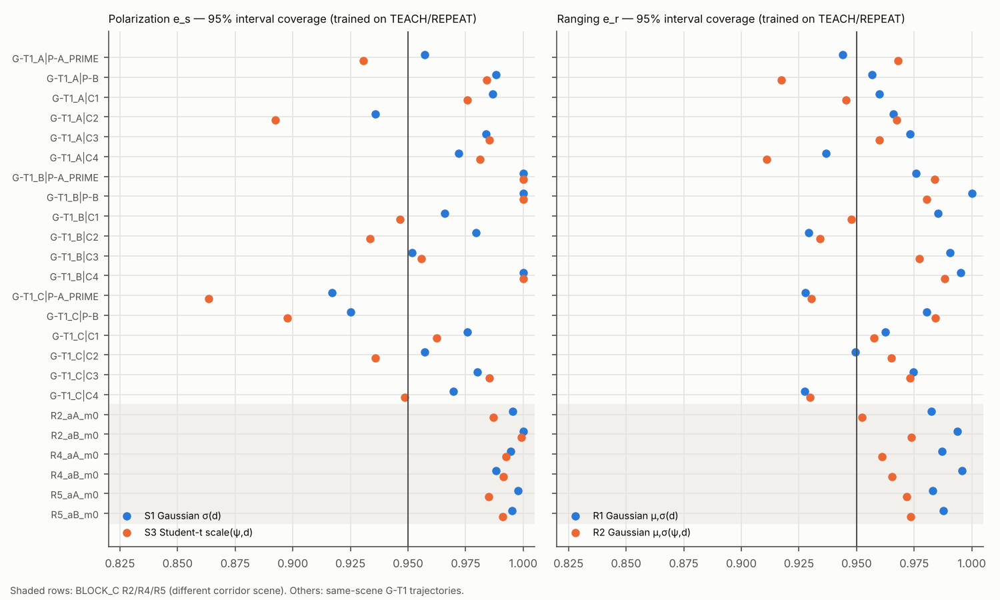

# G1-CHAR-002 결과: TEACH/REPEAT로 학습한 heading 조건부 모형의 궤적별 성능 (2026-11-15)

상태: DIAGNOSTIC_ONLY, mount 0. 사양은 [SPEC_KO.md](SPEC_KO.md)이며 실행 전 `2e85c74`에 커밋했다. 이번 결과는 packet 단위 calibration이며, EKF 재실행은 포함하지 않는다.

## 0. 요약

1. **편파 e_s.**
   - TEACH/REPEAT로 학습한 모형은 같은 장면의 다른 궤적(G-T1 C1–C4, P-B, P-A_PRIME)에서 95% 구간 coverage가 0.86–1.00이었다.
   - 다른 장면의 R2/R4/R5에서는 0.985–1.000이었다.
   - R2/R4/R5에서는 구간이 넘친다. 실제 오차 규모(거리 정규화 σ 0.04–0.07)가 TEACH 학습 데이터(0.07–0.135)의 절반 정도이기 때문이다.
   - 그 결과 heading 95% 반폭의 중앙값은 11–41°인데, 실제 등가 heading 오차의 중앙값은 2–4°다. integrity 쪽으로는 안전하지만 정보를 크게 버린다.
2. **heading 조건(ψ) 추가의 효과.**
   - coverage 오차를 줄이지 못했다. 같은 장면에서 평균 |coverage−0.95|는 S1 0.027, S3 0.032였다. 다른 장면에서는 S1 0.045, S3 0.041이었다.
   - 대신 예측분포가 날카로워졌다. 평균 log score가 같은 장면에서 0.99→1.25, 다른 장면에서 0.75→1.11로 올랐다.
   - 사전 규칙 기준으로는 "heading 조건 필요"에 해당하지 않는다.
3. **heading 조건부 s 평균(S4, Goal 2 후보).** 학습된 평균이 ψ 구간마다 −0.008~+0.009로 거의 0이다. 어느 평가에서도 S3보다 낫지 않았다. heading별 편향은 이전되는 구조가 아니다.
4. **ranging e_r.**
   - heading 조건부 μ(ψ,d)·σ(ψ,d)(R2)가 R2/R4/R5에서 coverage 0.952–0.974로 가장 잘 맞았다.
   - 거리만 쓴 R1은 0.982–0.996으로 넘쳤다.
   - 같은 장면에서는 R1과 R2가 비슷했다(평균 |coverage−0.95| 0.023 vs 0.022). 사전 규칙 기준으로 ranging은 heading 조건이 이득이다.
5. **S(LoS 편파비) 가정.**
   - 사전 등록한 180° 접기 가정은 **성립하지 않았다**. 같은 pose에서 yaw와 yaw+180°의 s 차이 p90이 0.36–0.46이다. FFD 패턴이 LP 이상형과 다르기 때문이다.
   - 수정안 A1(360°, 24구간)로 다시 돌렸지만 결론은 같았다(§4).
   - heading 민감도 |g_ψ|는 앵커를 향하는 방향(ψ_f 0–15°, 165–180°)에서 0.008–0.012/°로 가장 낮다. 비스듬한 방향(45–60°, 135–150°)에서는 0.039–0.044/°로 가장 높다.

## 1. 설정

- **학습.** G-T1 A/B/C의 P-A_TEACH ∪ P-A_REPEAT, 6,012 pose. d는 2.25–10.89 m이고, yaw는 0±60°다.
- **평가 1 (같은 장면).** G-T1 A/B/C의 P-A_PRIME, P-B, C1–C4, 18 궤적.
- **평가 2 (다른 장면).** BLOCK_C R2/R4/R5 × 앵커 A/B, 6 궤적.
  - 복도 폭이 2.4 m로, G-T1의 1.94 m보다 넓다.
  - 앵커는 x=4/10에 있다. 높이와 재질은 G-T1과 같다.
- **외삽 표본.** 학습 범위 밖의 표본이다. R2_aA 335개, R4_aA 215개, R5_aA 483개가 d>10.9 m여서 따로 집계했다.

## 2. 궤적별 결과 (사전 등록 180° 접기)

oracle은 해당 궤적 자체로 다시 맞춘 S1/R1이다. 학습-평가 이전 손실을 보기 위한 참고값이며, 판정에는 쓰지 않는다.

| 평가 | 궤적 | n (외삽) | e_s S1 σ(d) | e_s S3 t(ψ,d) | e_s S4 [G2] | e_s oracle | e_r R1 μ,σ(d) | e_r R2 μ,σ(ψ,d) | e_r oracle | heading 95% 반폭 S3 중앙 [°] | 실제 \|e_ψ\| 중앙 / q95 [°] |
|---|---|---|---|---|---|---|---|---|---|---|---|
| 1 같은 장면 | G-T1_A P-A_PRIME | 374 (0) | 0.957 | 0.930 | 0.933 | 0.925 | 0.944 | 0.968 | 0.947 | 33.5 | 3.8 / 134 |
| 1 같은 장면 | G-T1_A P-B | 254 (0) | 0.988 | 0.984 | 0.984 | 0.972 | 0.957 | 0.917 | 0.984 | 24.1 | 4.2 / 36 |
| 1 같은 장면 | G-T1_A C1 | 824 (0) | 0.987 | 0.976 | 0.976 | 0.933 | 0.960 | 0.945 | 0.959 | 14.4 | 1.9 / 16 |
| 1 같은 장면 | G-T1_A C2 | 1171 (0) | 0.936 | 0.892 | 0.894 | 0.921 | 0.966 | 0.968 | 0.957 | 29.5 | 5.7 / 84 |
| 1 같은 장면 | G-T1_A C3 | 748 (0) | 0.984 | 0.985 | 0.985 | 0.936 | 0.973 | 0.960 | 0.965 | 7.5 | 1.4 / 12 |
| 1 같은 장면 | G-T1_A C4 | 427 (0) | 0.972 | 0.981 | 0.981 | 0.934 | 0.937 | 0.911 | 0.965 | 12.7 | 2.5 / 14 |
| 1 같은 장면 | G-T1_B P-A_PRIME | 374 (0) | 1.000 | 1.000 | 1.000 | 0.930 | 0.976 | 0.984 | 0.965 | 23.9 | 5.5 / 30 |
| 1 같은 장면 | G-T1_B P-B | 254 (0) | 1.000 | 1.000 | 1.000 | 0.933 | 1.000 | 0.980 | 0.980 | 20.7 | 3.9 / 24 |
| 1 같은 장면 | G-T1_B C1 | 824 (0) | 0.966 | 0.947 | 0.947 | 0.927 | 0.985 | 0.948 | 0.987 | 12.7 | 1.5 / 12 |
| 1 같은 장면 | G-T1_B C2 | 1171 (0) | 0.980 | 0.933 | 0.935 | 0.941 | 0.929 | 0.934 | 0.940 | 24.8 | 5.7 / 49 |
| 1 같은 장면 | G-T1_B C3 | 748 (0) | 0.952 | 0.956 | 0.956 | 0.932 | 0.991 | 0.977 | 0.951 | 7.9 | 1.8 / 11 |
| 1 같은 장면 | G-T1_B C4 | 427 (0) | 1.000 | 1.000 | 1.000 | 0.946 | 0.995 | 0.988 | 0.977 | 9.5 | 1.5 / 5 |
| 1 같은 장면 | G-T1_C P-A_PRIME | 374 (0) | 0.917 | 0.864 | 0.864 | 0.930 | 0.928 | 0.930 | 0.928 | 74.7 | 8.9 / 237 |
| 1 같은 장면 | G-T1_C P-B | 254 (0) | 0.925 | 0.898 | 0.898 | 0.929 | 0.980 | 0.984 | 0.961 | 45.7 | 4.8 / 233 |
| 1 같은 장면 | G-T1_C C1 | 824 (0) | 0.976 | 0.962 | 0.962 | 0.945 | 0.962 | 0.958 | 0.958 | 28.5 | 5.1 / 117 |
| 1 같은 장면 | G-T1_C C2 | 1171 (407) | 0.957 | 0.936 | 0.936 | 0.925 | 0.950 | 0.965 | 0.952 | 57.1 | 7.4 / 87 |
| 1 같은 장면 | G-T1_C C3 | 748 (154) | 0.980 | 0.985 | 0.985 | 0.929 | 0.975 | 0.973 | 0.968 | 21.0 | 3.3 / 20 |
| 1 같은 장면 | G-T1_C C4 | 427 (0) | 0.970 | 0.948 | 0.948 | 0.948 | 0.927 | 0.930 | 0.932 | 25.4 | 7.0 / 26 |
| 2 다른 장면 | R2_aA_m0 | 1303 (335) | 0.995 | 0.987 | 0.988 | 0.933 | 0.982 | 0.952 | 0.971 | 41.1 | 4.0 / 89 |
| 2 다른 장면 | R2_aB_m0 | 1303 (0) | 1.000 | 0.999 | 0.999 | 0.937 | 0.994 | 0.974 | 0.965 | 25.9 | 3.1 / 53 |
| 2 다른 장면 | R4_aA_m0 | 922 (215) | 0.995 | 0.992 | 0.992 | 0.946 | 0.987 | 0.961 | 0.977 | 16.6 | 2.2 / 25 |
| 2 다른 장면 | R4_aB_m0 | 922 (0) | 0.988 | 0.991 | 0.991 | 0.949 | 0.996 | 0.965 | 0.962 | 11.1 | 2.1 / 10 |
| 2 다른 장면 | R5_aA_m0 | 1883 (483) | 0.998 | 0.985 | 0.985 | 0.936 | 0.983 | 0.972 | 0.963 | 38.4 | 3.8 / 121 |
| 2 다른 장면 | R5_aB_m0 | 1883 (0) | 0.995 | 0.991 | 0.991 | 0.951 | 0.988 | 0.973 | 0.964 | 24.1 | 2.6 / 33 |



### 묶음 요약

평균 |coverage−0.95| / 최소 coverage / 평균 log score 순이다.

| 표현 | 같은 장면 18 궤적 | R2/R4/R5 6 궤적 |
|---|---|---|
| S0 Gaussian 상수 | 0.037 / 0.845 / 0.23 | 0.024 / 0.908 / 0.39 |
| S1 Gaussian σ(d) | 0.027 / 0.917 / 0.99 | 0.045 / 0.988 / 0.75 |
| S2 Gaussian σ(ψ,d) | 0.029 / 0.887 / 1.03 | 0.042 / 0.983 / 0.89 |
| S3 Student-t scale(ψ,d) | 0.032 / 0.864 / 1.25 | 0.041 / 0.985 / 1.11 |
| S4 S3+μ(ψ) [G2] | 0.032 / 0.864 / 1.26 | 0.041 / 0.985 / 1.11 |
| R0 Gaussian 상수 | 0.032 / 0.845 / 0.73 | 0.019 / 0.948 / 0.70 |
| R1 Gaussian μ,σ(d) | 0.023 / 0.927 / 0.96 | 0.038 / 0.982 / 0.88 |
| R2 Gaussian μ,σ(ψ,d) | 0.022 / 0.911 / 0.97 | **0.016 / 0.952 / 0.89** |
| R3 Student-t μ,scale(ψ,d) | 0.026 / 0.906 / 1.03 | 0.023 / 0.964 / 0.97 |

S0와 R0가 R2/R4/R5에서 0.95에 가까운 것은 우연이다. 거리 의존성을 무시한 과대·과소가 상쇄된 결과다. 같은 표의 d 구간별 coverage는 `out/EVAL.json`의 `by_distance`에 있다.

## 3. 왜 R2/R4/R5에서 구간이 넘치는가

학습 모형 S1의 σ는 d=4 m에서 0.101이고, d^1.75에 비례한다. 같은 거리 정규화로 각 데이터의 σ를 비교했다.

| 데이터 | 정규화 σ | 정규화 MAD |
|---|---|---|
| G-T1 TEACH/REPEAT A / B / C | 0.086 / 0.135 / 0.069 | 0.061 / 0.078 / 0.051 |
| R2 aA / aB | 0.044 / 0.041 | 0.026 / 0.032 |
| R4 aA / aB | 0.055 / 0.066 | 0.044 / 0.054 |
| R5 aA / aB | 0.038 / 0.039 | 0.024 / 0.026 |

TEACH/REPEAT의 오차가 주행 궤적보다 약 2배 크다. 원인은 두 가지가 겹친다.

- **TEACH 경로 자체의 특성.** 제자리 ±60° sweep이 대부분이고, 로봇이 벽에서 0.5 m 떨어진 차선을 주행한다. 같은 장면의 주행 궤적(C1–C4)에서도 S1 coverage가 0.95–1.00으로 넘치는 경우가 많다.
- **장면 차이.** BLOCK_C 복도가 0.46 m 넓어 벽 반사가 약하다.

두 효과는 현재 데이터로 분리할 수 없다. BLOCK_C 장면에서 TEACH 경로를 생성하면 분리할 수 있다.

## 4. 수정안 A1: 360° 구간 (180° 접기 가정 실패)

| 앵커 | s(ψ) vs s(ψ+180°) 차이 p90 | g_ψ 차이 p90 | \|g_ψ\| 중앙값 |
|---|---|---|---|
| G-T1_A | 0.359 | 0.019 | 0.026 |
| G-T1_B | 0.371 | 0.017 | 0.026 |
| G-T1_C | 0.457 | 0.025 | 0.024 |

24구간(15°)으로 다시 돌린 결과는 `out_A1_360/`에 있다. 학습 데이터에 rel bearing −120~−60° 구간이 비어 있어 외삽 표본이 늘었다(같은 장면 1,109개, R2/R4/R5 1,199개).

| 표현 | 같은 장면 | R2/R4/R5 |
|---|---|---|
| S1 | 0.027 / 0.917 / 0.99 | 0.045 / 0.988 / 0.75 |
| S3 | 0.035 / 0.872 / 1.21 | 0.043 / 0.988 / 0.98 |
| R1 | 0.023 / 0.927 / 0.96 | 0.038 / 0.982 / 0.88 |
| R2 | 0.027 / 0.836 / 0.85 | **0.007 / 0.943 / 0.89** |

결론은 180° 접기와 같다. e_s는 heading 조건으로 coverage가 나아지지 않고, e_r은 heading 조건이 R2/R4/R5에서 가장 잘 맞는다. 다만 360°에서는 학습 표본이 얇아져 같은 장면에서 R2의 최소 coverage가 0.836으로 떨어졌다.

## 5. 사전 규칙 적용

| 규칙 | 판정 |
|---|---|
| heading 조건 필요(S2/S3가 S1보다 평가 1·2 모두에서 coverage 오차 감소) | e_s: **아니다**(평가 1에서 악화). e_r: **그렇다**(R2가 평가 1·2 모두에서 R1보다 낫다) |
| 장면 이전 실패(평가 1은 맞고 평가 2만 실패) | **실패가 아니라 과대 보수**다. R2/R4/R5에서 coverage가 0.985 이상으로, 덜 덮이지 않고 넘친다 |
| heading 조건부 편향 이전(S4가 S3 대비 평가 2 coverage 오차를 절반 이하로) | **아니다**(0.041 vs 0.041) |
| 외삽 영역에서만 실패 | **아니다**. d>10.9 m 외삽 표본의 S3 coverage는 0.96–1.00이다 |

## 6. 해석과 다음 단계

- **목표 2의 1차 표현 후보(학습 데이터 TEACH/REPEAT 기준).**
  - 편파: Student-t scale(ψ,d). coverage는 S1과 같고 예측분포가 더 날카롭다.
  - 거리: Gaussian μ(ψ,d)·σ(ψ,d).
  - 평균 μ(ψ)를 붙인 s 편향 보정(S4)은 효과가 없으므로 Goal 2 후보에서도 우선순위가 낮다.
- **packet 단위 calibration과 필터 integrity는 다르다.**
  - CHAR-001에서 오차의 상관 길이는 이동으로 2–5 cm, 회전으로 16–20°였다. 0.2 m/s, 5 Hz 주행(packet당 4 cm)에서 인접 packet의 상관이 남는다.
  - 회전 중에는 상관이 강하다.
  - 따라서 packet 단위로 넘치는 구간이 필터 NEES에서 그대로 유지된다는 보장은 없다.
- **2단계(EKF) 사양 필요.**
  - R2/R4/R5 각 궤적에서 위 학습 모형으로 packet EKF를 돌린다. 비교 지표는 NEES, Pose95, heading RMSE이고, 기존 native O30 + MB_VAR(Pose95 88.8%)와 비교한다.
  - 이를 위해 BLOCK_C 원 EKF 입력(B0 Full, sensor seed10)과 SourceFFD/W0 코드가 필요하다. 이들은 FP-SC 계열 브랜치에 고정되어 있다.
- **과대 보수 문제.** TEACH 경로가 실제 주행보다 나쁜 조건(sweep, 벽 근접)을 대표한다. 이 문제는 다음 둘 중 하나로 다뤄야 한다.
  - TEACH 경로 설계를 주행 조건에 맞게 바꾼다.
  - 학습한 scale을 주행 조건에 맞게 옮기는 규칙을 둔다(사전 등록 필요).

## 7. 재현

```
python char2_fit_eval.py --errors <CHAR_001 ERRORS_*.npz 폴더> --src <qclean_uwb src> --banks <FFD banks> --out out --fold 180
python char2_fit_eval.py ... --out out_A1_360 --fold 360
```

입력 해시와 명령은 `out/FIT.json`에 있다. ERRORS 파일은 CHAR_001 `char_extract.py`로 다시 만든다.
