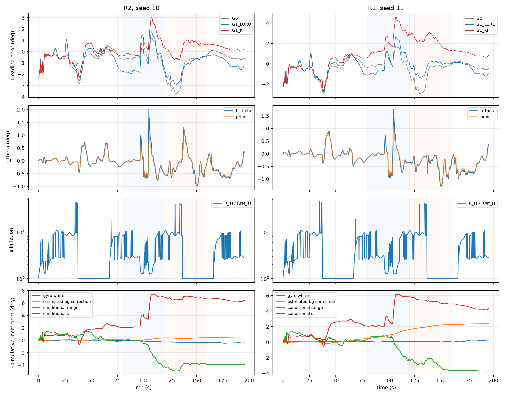
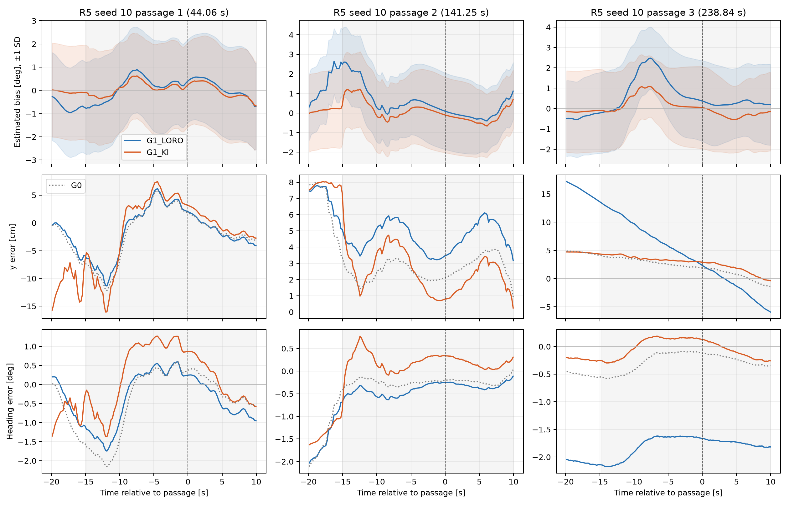

# Stage 0 — 기존 trace로 본 G1+KI 취약성·R5 통과·감도 노출

**세 진단을 완료했다. 추가 EKF 재생은 0회다.** 현재 G1+KI를 검증된 M7 주 arm으로 그대로 승격할 근거는 없다. R2의 열화는 주입 gyro 잡음의 직접 누적보다 추정 gyro bias와 관측 갱신·이전 오차의 결합에서 크게 나타났다. R5에서는 원거리에서 들어온 bθ 하나가 근거리 성능 차이의 주원인이라는 설명도 충분하지 않았다. 따라서 M7에서는 G1+KI를 미해결 대조로 보존하고, 원거리 할인과 pose·bias 결합을 구분할 수 있게 설계해야 한다.

분류는 **DIAGNOSTIC_ONLY**다. 동결한 기존 M6의 mount 0·앵커 B·B0·R2/R4/R5와 wheel/gyro seed 10–14, 기존 D3 분해를 사용했다. gate와 초기 추정은 M6와 같다. seed들은 하나의 RF 실현을 공유하며 wheel과 gyro 입력이 함께 바뀐다. 실행 성공·회계 검증은 새 구조 채택이나 독립 RF 일반화와 다르다.

루트 질문 ID는 `G1-FINAL-MODEL/STAGE0-TRACE-DIAG-20261116`, 계약 SHA256은 `3e6413fa4294ab8e5568b9811477504f02711eb8f8585846da989edff713eb59`이다. 수치에 맞춘 판정 문턱이나 모수 적합은 추가하지 않았다. 원본 저장소 revision은 `a9b1766c51c6006adc77b1370d7045eeaa94d494`다. 이 새 산출물은 로컬 artifact이며 해당 revision에 이미 포함돼 있다는 뜻은 아니다.

## 1. R2 seed 11: gyro 직접항보다 추정 상태·관측 경로 차이

| seed / arm | 80–120 s heading RMS (°) | 120–160 s heading RMS (°) |
|---|---:|---:|
| 10 / G1+KI | 1.211 | 0.676 |
| 11 / G1+KI | 2.541 | 2.337 |
| 11 / G1 LORO | 1.195 | 0.624 |
| 11 / G0 | 0.738 | 1.493 |

같은 창의 G1+KI 보고 σψ는 seed 10에서 1.622/1.113°, seed 11에서 1.602/1.091°였다(창 Pψψ 평균의 제곱근). 편파 R/R_ref 중앙값은 2.885/1.000배와 2.893/1.000배였다. GM 잠재 상태의 불확도는 이 R 팽창비에 포함하지 않는다. 비슷한 보고 불확도·팽창비에서 실제 오차가 다르다는 기존 관찰을 재현했다.

정확한 실현 경로 회계는 `Δeψ = (gy−wrapped Δψ_truth) − b_g,prev Δt + Δψ_range + Δψ_s|range`다. B0 생성 설정에서 실제 gyro bias·random walk·scale factor는 0이므로 첫 항은 주입 백색 gyro 잡음이다. 거리 먼저 조건화하는 순서를 고정해 `c=S_sr/S_rr`, `Δx_range=(K_r+c K_s)ν_r`, `Δx_s|range=K_s(ν_s−cν_r)`로 분리했다. 이들은 독립적인 원인 기여율이 아니라, 보관된 경로를 정확히 복원하는 가산 항이다.

| seed / 창 | 시작 heading 오차 | gyro 직접 합 | 추정 b_g 보정 합 | 거리 갱신 합 | 조건부 s 갱신 합 | 끝 오차 |
|---|---:|---:|---:|---:|---:|---:|
| 10 / 80–120 s | −0.373° | −0.256° | +0.308° | −4.118° | +4.888° | +0.450° |
| 11 / 80–120 s | +0.598° | −0.001° | +1.153° | −2.531° | +3.769° | +2.988° |
| 10 / 120–160 s | +0.450° | −0.103° | +0.045° | +0.352° | −0.149° | +0.595° |
| 11 / 120–160 s | +2.988° | +0.060° | +0.656° | −1.473° | −0.927° | +1.304° |

80–120 s의 두 seed 끝 오차 차이 2.538°는 시작 차이 0.971°, gyro 직접 차이 0.255°, 추정 b_g 차이 0.844°, 관측합 차이 0.467°로 닫힌다. 120–160 s에서는 seed 11이 큰 시작 오차를 물려받고, 관측 갱신의 회복을 추정 b_g 보정이 일부 상쇄한다. 이 표는 끝 오차의 회계이며 RMS 또는 독립 분산의 분해가 아니다.

bθ의 창 평균은 seed 10에서 −0.057/−0.187°, seed 11에서 −0.105/−0.441°였다. bθ prior·posterior, AR 감쇠, 거리/편파 업데이트, q_s·팽창 및 heading 오차를 packet·20 s 표와 그림에 함께 저장했다. seed 11의 KI RMS는 두 창 모두 5개 seed 중 가장 나빴다.

**판단:** 단순히 큰 주입 gyro 잡음에 노출됐다는 설명은 수정해야 한다. seed 입력 변화가 KI를 포함한 추정 경로에서 상태·혁신 차이로 확대되는 취약성과 일치한다. 다만 wheel·gyro·prior·gain이 함께 달라진 기존 trace로는 원거리 KI만 끈 인과 효과나 특정 상수로 고칠 수 있는지를 확정할 수 없다. G1+KI를 해결된 주 arm으로 승격하지 않고 G1 LORO와 함께 대조를 유지한다.

## 2. R5: 들어온 bθ 하나와 근거리 순간 정보 손실만으로는 설명 부족

통과 시점은 기존 x=10 m 교차 정의로 44.056/141.251/238.845 s다. 통과 ±10 s의 y RMSE를 원자료에서 재계산했다.

| 통과 | seed 10 G1 (cm) | seed 10 G1+KI (cm) | seed 10–14에서 +KI 결과 |
|---|---:|---:|---|
| 1 | 2.890 | 3.354 | 5/5 악화 |
| 2 | 4.781 | 2.683 | 4/5 개선, seed 11 악화 |
| 3 | 4.822 | 2.672 | 5/5 개선 |

각 통과를 포함하는 G0-prior ρ<3 m의 연속 근거리 episode에서 진입점을 정했다. 이전 통과 후 떠나는 꼬리를 새 진입으로 세지 않았다. seed 10의 G1→G1+KI 진입 상태는 다음과 같다.

| 통과 | 진입 bθ prior (°) | 진입 heading 오차 (°) | 진입 y 오차 (cm) |
|---|---:|---:|---:|
| 1 | −0.692 → −0.088 | −1.116 → −0.287 | −6.01 → −6.72 |
| 2 | +2.420 → +0.209 | −0.701 → −1.031 | +5.18 → +7.86 |
| 3 | −0.207 → −0.085 | −2.141 → −0.252 | +13.49 → +4.32 |

통과 1에서는 bθ와 heading 진입 오차가 작아져도 y가 악화한다. 통과 2는 hybrid의 y 진입 오차가 더 큰데 근거리 안에서 회복한다. 통과 3은 진입 bθ 차이는 작지만 pose 오차 차이가 이미 크다. 따라서 원거리에서 들어온 bθ 크기만으로 세 통과를 설명할 수 없다.

AR 재귀의 항을 정확히 전개하면, 진입 bθ가 통과 시점의 bθ에 직접 남기는 계수는 모든 seed에서 **0.730–0.871%**다. seed 10 G1/G1+KI의 통과 1–3 직접 잔존값은 −0.00557/−0.00071°, +0.01804/+0.00156°, −0.00163/−0.00067°다. 이후 갱신항이 현재 bθ의 대부분을 만든다. 이는 bθ 자체의 직접 AR 항을 분해한 결과이며, pose·추정 gyro bias·교차 공분산을 통한 과거의 간접 영향이 없어졌다는 뜻은 아니다.

**근거리 q_s:** 각 arm의 자기 prior ρ<3 m에서는 모든 q_s가 0이다. 공통 G0-prior 근거리에는 seed 10/13/14에서 경계 packet 1개씩 자기 prior가 3 m 밖으로 나가 q_s가 양수였다(약 0.223%). 이 경계 차이를 제외하면 구현상 근거리 KI 추가가 몰래 남는 문제는 없다. q_s=0이어도 GM bθ의 불확도와 pose와의 교차 공분산은 남는다.

**국소 ΔJ_yy:** pose,bθ의 실제 joint Gaussian prior에서 bθ를 주변화했다. `v=P_bb−P_b,pose P_pose⁻¹P_pose,b`, `H_eff=H_pose+a Cov(b,pose)P_pose⁻¹`로 두고 같은 prior의 `H_effᵀ R_actual⁻¹ H_eff`와 `H_effᵀ(R_actual+v aaᵀ)⁻¹H_eff`를 비교했다. b_g는 H 열이 0이므로 별도 known-bg 조건화를 하지 않는다. 이 비율의 분모는 같은 arm의 국소 명목 정보이며 E0 누적 정보가 아니다.

통과 ±10 s의 손실 중앙값은 seed 10 G1에서 0.167/0.635/0.027%, hybrid에서 0.172/1.014/0.025%였다. 다만 **전체 연속 근거리 episode**에서는 통과 2의 중앙값이 2.982/2.876%, p95가 12.979/15.549%, 최대가 17.264/19.599%다. 중앙값만으로 근거리 손실이 항상 작다고 말할 수 없다. 큰 꼬리는 존재하지만 hybrid의 회복과 단순 대응하지 않으며, 궤적 y RMSE의 인과 기여율은 이 표로 결정되지 않는다.

**판단:** 근거리 q_s=0 규칙은 잠정 유지할 수 있으나, 이 규칙만으로 y 정보 보존이 완료됐다고 볼 수 없다. 현재 trace는 근거리 ΔJ_yy가 주원인이라는 단순 설명을 지지하지 않는다. M7의 해석·대조는 bθ 단독 이력보다 pose와 bias의 결합된 진입 상태 및 근거리 갱신을 함께 봐야 한다. 새 경계나 근거리 추가 분산을 이번 결과에 맞춰 선택하지 않는다.

## 3. R_ref 여유와 g²·유효 packet 수

주 모집단은 seed 10 G0 고정 gate 수용 및 D3 분해 지원 packet이다. `u=mean((ε_s−mean ε_s)²/R_ref,ss)`로 정의했다. 작을수록 이 주변분산 척도의 여유가 크다. 평균 편향을 포함한 값 및 slow 성분의 중심화 전후 값은 별도 표에 모두 있다.

기존 길이 1 m·10°의 kernel로 직전 10 s 창을 계산했다. `N_w=Σρ_current,j`와 `N_eff=N²/Σρ_ij`를 구별했다. 전자는 중복 가중 개수, 후자는 그 창 평균의 등가 독립 개수다. `E_g=mean_window(g²)×N_eff`는 아래 표에서 packet별 값의 중앙값이다. 실측 RF 상관을 새로 적합한 N_eff나 전체 pose Fisher 정보로 해석하지 않는다.

| 궤적 | prior 거리 | u | N_eff 중앙값 | E_g 중앙값 | I_cell 중앙값 (rad⁻²) |
|---|---|---:|---:|---:|---:|
| R2 | 0–3 m | 0.0698 | 2.37 | 0.320 | 935 |
| R2 | 3–10 m | 0.4372 | 2.37 | 0.932 | 247 |
| R4 | 0–3 m | 0.6542 | 4.05 | 11.158 | 18,794 |
| R4 | 3–10 m | 1.1847 | 3.94 | 11.702 | 2,542 |
| R5 | 0–3 m | 0.0738 | 2.36 | 0.401 | 507 |
| R5 | 3–10 m | 0.1738 | 2.37 | 0.559 | 161 |

R4 근거리의 E_g는 R5보다 약 27.8배다. 높은 감도와 상관된 반복 노출을 같이 봐야 한다. 하지만 이 배수로 실제 heading 오차 배수를 예측했다고 주장하지 않는다.

**기존 전제의 수정:** 제시된 R4의 0.024–0.063은 이 정의·동결 자료에서는 재현되지 않았다. R4를 세분하면 0–1.5 m의 u는 0.0777, 1.5–3 m는 0.9348이다. 평균 편향까지 포함하면 0.0779/1.5184다. 모든 gate 수용 packet에서도 centered u가 0.0747/1.0821로 같은 방향이다. 따라서 근거리 전체의 R_ref 여유가 가장 크다는 전제를 그대로 쓰지 않는다. 기존 0.024–0.063의 산식과 모집단이 확인되기 전에는 같은 지표로 인용하지 않는다.

P7 대체 문구:

> 이 자료에서 R5는 잔차의 시간 상관이 있어도 기존 독립 관측 처리의 정확도가 높았다. 반면 R4는 높은 heading 감도와 반복 관측이 결합하고, 근거리 일부에서도 정규화 잔차가 작지 않다. 궤적을 백색·유색으로 이분하거나 R_ref의 주변분산 여유만으로 상관 처리의 필요성을 정할 수 없다. 분산 크기, 감도와 반복 노출, pose 및 bias 상태의 결합을 함께 평가해야 한다.

## 4. M7에 반영할 판단

| 대상 | 현재 판단 | M7에 미치는 영향 |
|---|---|---|
| G1+KI seed 11 열화 | gyro 직접 잡음만으로 설명 부족; 추정 경로 취약성 | 해결된 주 arm으로 승격하지 않고 G1과 대조. 원거리 KI만 바꾼 인과 대조는 아직 필요 |
| R5 근거리 q_s=0 | 자기 prior 기준 구현 확인, 충분성 미확인 | 잠정 유지. 진입 bθ만 보는 설명을 버리고 pose·bias·교차 공분산과 통과 내 갱신을 함께 대조 |
| 근거리 ΔJ_yy | 꼬리는 있으나 단독 주원인 근거 부족 | 손실 중앙값만으로 설계를 결정하지 않음; 국소 정보와 누적 궤적 인과를 구분 |
| P7 | R5 잔차를 백색이라고 부를 근거 없음 | 위의 제한된 문구로 교체 |

이는 다음 사양을 위한 진단 권고다. 새로운 M7 수치 계약·arm을 동결하거나 재생하지 않았고, 현재 정확도·무결성 기준을 완화하지 않았다.

## 5. 코드·표·검증 근거

- [루트 동결 계약](RUN_CONTRACT.json), [집계 결과](RESULTS.json), [전체 파일·입력 해시](MANIFEST.json).
- [R2 보고서](r2_seed_decomposition/REPORT_KO.md), `PACKET_TIMELINE.csv`, `WINDOW_SUMMARY.csv`, `analyze_r2.py`, `verify_r2.py`, `VERIFICATION.json`. 15 trace·14,685 packet의 회계 잔차 최대 1.40×10⁻¹³°. 최초 G0 Knu 필드 결측 중단 기록을 보존하고 수정 후 attempt02 계약으로 계산했다.
- [R5 보고서](r5_passage_bias/REPORT_KO.md), `R5_PAIRED_PASSAGES.csv`, `R5_NEAR_ENTRIES.csv`, `R5_AR_MEMORY_AND_INFORMATION.csv`, `R5_TIMELINE.csv`, `analyze_r5.py`, `supplement_memory.py`, `verify_r5.py`. 120개 창 재계산과 14,150개 posterior covariance 행 검증, pose 주변화 최대 오차 2.78×10⁻¹⁷, AR 회계 오차 5.21×10⁻¹⁸ rad.
- [R_ref·노출 보고서](rref_exposure/REPORT_KO.md), `DISTANCE_EXPOSURE.csv`, `PACKET_EXPOSURE.csv`, `analyze_rref.py`, `verify_rref.py`. 42개 집계·3,136개 packet, 원본 재계산 비율 차이 0, scalar kernel 이중 합 확인. G0와 D5의 x·P·Reff·H·grid·mask는 정확히 같다.

실행 코드, lane별 동결 계약, 입력/출력 해시와 오류 기록을 보존했다. 자기 검증과 별도의 제한된 읽기 전용 검토는 구분한다. 검토 범위·판정은 `CLAIM_REVIEW.md`에 기록한다. 원본 NPZ와 기존 보고서·계약은 변경하지 않았다.
