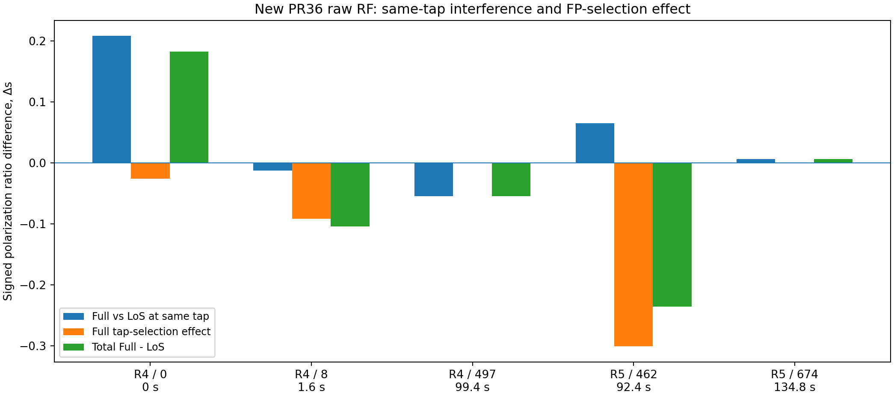
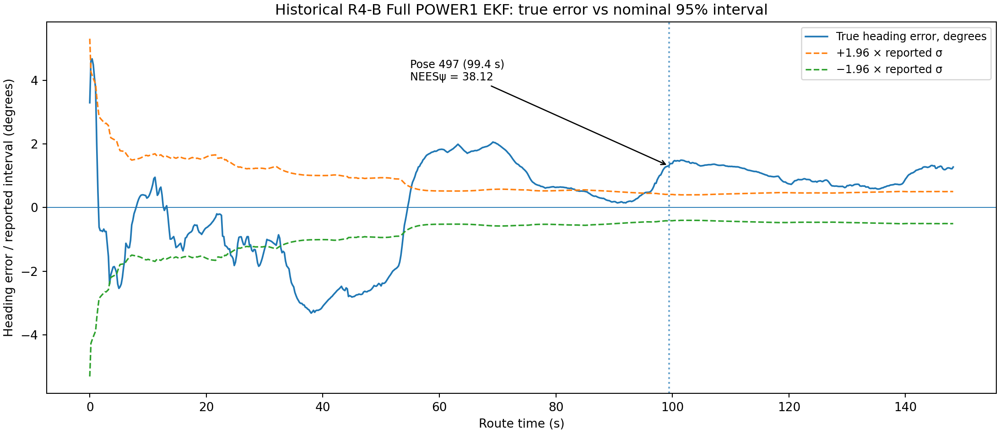
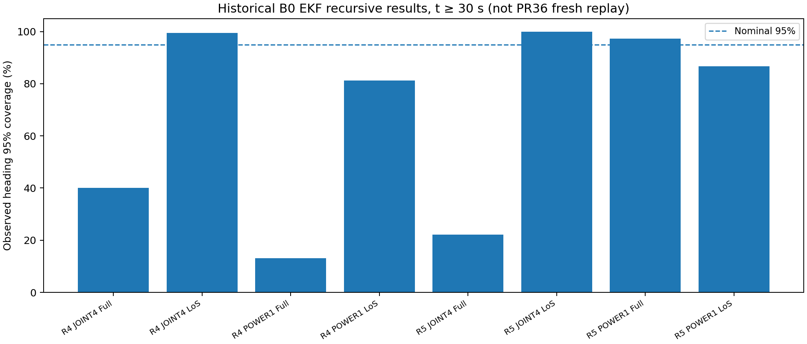

# FP 오검출·편파 왜곡과 기존 EKF 과신 메커니즘 — 실제 재계산 결과

**일자:** 2026-11-05 · **분류:** `USER_AUTHORIZED_NONINDEPENDENT_EXPLORATORY` · **판정:** `C0_PARTIAL_PASS / FROZEN_K_EXPLORATORY_PASS / NATURAL_RECURSIVE_INTERVENTION_NOT_RUN`

## 범위 및 원본

- New PR36: [Actions #41958274374](https://github.com/myoungsunk/sionna-resimulation/actions/runs/41958274374), source commit `507d7d38d2ae4159c1a401a996ccbb580dc4a961`, shard-0 artifact `13385720443`, shard-2 artifact `13385610279`. PR36 Release: [pr36-rt-41958274374-1](https://github.com/myoungsunk/sionna-resimulation/releases/tag/pr36-rt-41958274374-1). **RAW_H.npz / FIRST_PATH.npz**에서 77개 Full–Native LoS pair를 독립적으로 복원하여 검산. 전체 400개 원장 전체를 재검산한 것은 아님.
- Old C0-A [Actions #41783949902](https://github.com/myoungsunk/sionna-resimulation/actions/runs/41783949902), artifact `13300457029`, `C0A_AGGREGATE_TAP_DECOMPOSITION.csv`와 FP/Tnone pose 정합.
- Old EKF [Actions #39376076166](https://github.com/myoungsunk/sionna-resimulation/actions/runs/39376076166), R4 replay artifact `12243228864`, R5 replay artifact `12243741168`. `POWER1` B0 및 `JOINT4`, `POWER_DIAG`의 기존 기록을 읽음. **PR36로 자연 재귀 전체 필터를 다시 실행한 결과는 아니다.**
- 관측 함수: [`observation.py`](https://github.com/myoungsunk/sionna-resimulation/blob/proposal/mbvar-prr-one-shot-extract-20261105/src/qclean_uwb/drivesim/observation.py): Hann window → 257×4=1028 tap IFFT → 최대 RX port peak의 30% leading edge → 첫 tap에서 포트별 전력 → signed s. 새 ray별 객체 귀속은 이 검증에 포함하지 않았다.

## 1. 핵심 정의와 원칙

이 실험에서 **FP 오검출**이라고 부르는 것은 Full CIR의 detector FP index가 동일 pose Native LoS detector index와 다른 **FP 이동 후보**다. 참된 첫 도달시간을 외부 독립 GT로 측정한 것은 아니므로 모든 차이를 검출 실패라고 확정하지 않는다.

- 전체 Full−LoS 편파비 차: `Δs_total = s_Full(tap_Full) − s_LoS(tap_LoS)`.
- 같은 LoS tap에서 물리 채널 차: `Δs_same = s_Full(tap_LoS) − s_LoS(tap_LoS)`.
- Full 채널 내부에서 tap 선택 차: `Δs_selection = s_Full(tap_Full) − s_Full(tap_LoS)`.
- **항등식** `Δs_total = Δs_same + Δs_selection`. 같은 tap 항은 복소 간섭을 포함하고 selection 항은 detector 처리 방식의 오프라인 대조다. 서로 통계적·물리적으로 독립인 두 원인이라는 뜻이 아니다.

## 2. 새로운 PR36 RF 77쌍 재계산

| Route | Full/LoS 쌍 | FP 위치 변화 | |Δs_total| > 0.10 | 큰 왜곡 중 FP 변화 없음 | Δs RMS |
|---|---:|---:|---:|---:|---:|
| R4-B | 59 | 32 | 29 | 8 | 0.217574 |
| R5-B | 18 | 5 | 6 | 2 | 0.167364 |
| 합계 | **77** | **37** | **35** | **10** | — |

### 수치 검증 및 원본 정합

| 검증 항목 | 검산 결과 |
|---|---|
| PR36 저장된 원시 복소 CIR ↔ 독립 Hann/IFFT | max `6.2063e−17` |
| PR36 FIRST_PATH signed s ↔ 독립 FP 계산 | max `6.3838e−16` |
| FP index ↔ 기존 C0-A 비교 | **불일치 0건** |
| `total=same+selection` 산술 항등식 | max residual `5.5511e−17` |
| 신규 Full signed s ↔ 과거 원본 composite signed s | max absolute difference `4.7761e−5` |
| 신규 LoS signed s ↔ 과거 원본 LoS signed s | max absolute difference `5.5190e−8` |

본 77개는 shard 0·2에서 내려받은 **사전 선택된 pose**다. 따라서 `37/77`을 원래 복도 전체의 FP 오검출 빈도로 일반화할 수 없다.

### 대표 사례와 반례

| Case | FP Full/LoS | 전체 Δs | same tap Δs | selection Δs | 판단 |
|---|---|---:|---:|---:|---|
| R4 0.0 s | 58 / 57 | +0.182070 | +0.208148 | −0.026078 | 선택효과가 복소 오염 일부 상쇄 |
| R4 1.6 s | 57 / 56 | −0.104505 | −0.012943 | −0.091562 | 선택효과가 주된 방향의 변화 |
| R4 99.4 s | 21 / 21 | −0.054547 | −0.054547 | 0 | FP 이동 없이 편파 오염 |
| R5 92.4 s | p462 참조 | −0.235901 | +0.064859 | −0.300760 | 선택 효과와 same-tap 간섭 상쇄 |
| R5 134.8 s | 13 / 13 | +0.006383 | +0.006383 | 0 | 작은 편파 오염 대조군 |

## 3. 같은 prior / gain·gate를 고정한 EKF 단일 갱신 분석

원본 [POWER1 EKF replay](https://github.com/myoungsunk/sionna-resimulation/actions/runs/39376076166)의 B0 Full 재귀 결과에서 해당 시점의 `K_ψ,r` (deg/m), `K_ψ,s` (deg/signed s), 기존 posterior Heading 오차, NIS, 수용 여부를 얻었다. 재귀 실행 전체를 새 RF로 반복하지 않고 기존 accepted gate와 prior/gain을 고정하는 **linearized observation perturbation**을 계산했다.

`δψ_correction = K_ψ,r·(r_cf−r_Full) + K_ψ,s·(s_cf−s_Full)`.

**주의: 'tap만 고정'은 s를 계산할 때의 CIR tap만 옮기고 range 값은 Full 그대로 둔 오프라인 전처리 대조이다.** FP detector 출력을 실제로 바꾼다면 range도 동시에 바뀌므로 아래에 'tap+range' 대조도 추가했다. 고정 K의 Joseph covariance는 관측값만 바꿀 때 일정하므로 새로운 arm에서 σ가 바뀌었다고 보고하지 않는다. 게이트를 다시 판정하는 실험도 이 결과와 구분된다. `POWER1`로 나온 yaw 성분에 대해서만 검산했으며, 새 4D state 전체에 대한 자연 재귀·독립 EKF 코드 검산을 완료한 것은 아니다.

| Case | 관측과 조건 | 초기 Full Heading 실제 오차 | 대조 후 **고정 gain** Heading 실제 오차 | 비고 |
|---|---|---:|---:|---|
| R4 0.0 s | **편파비 계산 tap만** LoS 위치로 고정, 거리 Full 유지 | +3.2960° | **+3.9155°** | 오히려 악화 |
| R4 0.0 s | 편파비 tap과 FP 거리 둘 다 LoS tap 적용 | +3.2960° | **+4.9305°** | FP 거리까지 바꾸면 더 악화 |
| R4 0.0 s | Full s→LoS s | +3.2960° | −1.0287° | 편파 왜곡 큰 부분 제거 |
| R4 0.0 s | Full r,s→LoS r,s | +3.2960° | −0.0136° | Oracle, 동시에 두 관측 교체 |
| R4 1.6 s | 편파비 계산 tap만 고정, 거리 Full 유지 | −0.6133° | **−0.0345°** | 편파 전처리 개선 반례 |
| R4 1.6 s | 편파비 tap과 FP 거리 둘 다 LoS tap 적용 | −0.6133° | +0.1447° | 절대오차는 줄지만 잔여오차가 반대로 바뀜 |
| R5 92.4 s | 편파비 계산 tap만 고정, 거리 Full 유지 | −0.6014° | −0.4305° | 개선, 작음 |
| R5 92.4 s | 편파비 tap과 FP 거리 둘 다 LoS tap 적용 | −0.6014° | −0.5114° | 거리 보정과 편파 보정이 반대 방향 |
| R5 134.8 s | LoS s만 교체 | −0.5737° | −0.5654° | 미미한 변화 |

R4 0초 원본 수용 NIS `0.8759`, 편파 K `+23.753°/s`, 거리 K `−6.787°/m`; 해당 원본의 `Δs=+0.182070`, `Δr=+0.149552m`이 각각 yaw correction `−4.3247°` 및 `+1.0150°`로 전달된다. 서로 방향이 다른 correction이다.

## 4. 일반 EKF의 불확실도 성장과 공분산 과신은 서로 다른 현상

**정상적인 prior 불확실도 성장**은 `P−=F P+ Fᵀ+GQGᵀ`에서 운동·자이로/바이어스 잡음 Q가 누적되거나 측정이 거절되어 불확실도가 충분히 갱신되지 않을 때 나타난다. 기존 R4 JOINT4 Full 재귀에서는 2.2s에서 갱신이 거절(`NIS≈9.827`, threshold 9.210), Heading 1σ가 **1.082843°→1.084893°**로 증가했다. 두 값은 연속 시점 posterior 비교이므로 순수 Q 단독 기여율은 아니다. R4 POWER1은 7.4s accepted 상태에서도 1σ가 0.761911°→0.765460° 증가했으며 예측 증가가 갱신 축소보다 더 클 수 있음을 보여준다.

**과신(underreported P)**은 전혀 다른 현상이다. 

`ν = [r,s]ᵀ − h(x−) − μ`, `K=P−Hᵀ(HP−Hᵀ+R)^-1`,

`x+=x−+Kν`, `P+=(I−KH)P−(I−KH)ᵀ+KRKᵀ`.

수용된 갱신에서 P+는 일반적으로 (동일 가정 하에) 작아지지만, bias 오차는 Joseph식에 직접 들어가지 않으므로 실제 오차가 커질 수 있다. 즉 `small NIS ≠ true state error small`, `P small ≠ accurate`. Heading **NEESψ = errorψ²/Pψψ**로 검사한다.

- **R4 POWER1 p0**: 초기 yaw 실제 오차는 약 `0.461317°` (저장된 gain 성분으로 복원), 초기 yaw prior σ **5.000°** (원래 EKF 코드), Full 첫 수용 직후 실제 yaw 오차 `3.296035°`, posterior σ `2.708585°`; variance 감소 약 **70.65%**. 오차는 커졌지만 불확실도는 줄었다. 초기 prior와 posterior의 시점 비교이며 PR36 RF 자체의 신규 재귀 실행 결과는 아니다.
- **R4 POWER1 p497, 99.4s**: 기존 실제 Heading오차 `+1.31136°`, σ `0.21239°`, **Heading NEES=38.12**, NIS `0.795`로 수용. 새 PR36에서는 **FP 변화가 0 tap**, 물리 편파비 차이는 `−0.054547`. FP 오검출 없이도 과신과 오염이 동시에 나타날 수 있다.
- 반면 기존 R5 POWER1 Full은 R4보다 양호한 경로별 coverage를 보였다. 이는 LoS 관측을 oracle로 교체하면 반드시 전체 경로의 Heading RMSE가 줄 것이라는 주장을 반박한다.

### 기존 자연 재귀 결과 비교 (B0, t≥30s; 이번 PR36 신규 개입 아님)

| Route, 채널, 모형 | Heading RMSE | 평균 σ | 실측 Heading95 | 평균 Heading NEES |
|---|---:|---:|---:|---:|
| R4 Full JOINT4 | 1.323° | 0.380° | 40.0% | 10.89 |
| R4 Full POWER1 | 1.508° | 0.306° | **13.2%** | **21.44** |
| R4 LoS JOINT4 | 0.320° | 0.367° | 99.5% | 0.58 |
| R5 Full JOINT4 | 2.541° | 0.670° | 22.1% | 15.43 |
| R5 Full POWER1 | 1.056° | 0.740° | **97.2%** | 1.40 |
| R5 LoS POWER1 | 1.448° | 0.800° | 86.7% | 1.13 |

이 수치에서 R4/R5의 결론은 모형별로 달라진다. **JOINT4 Full은 R5에서도 심하게 과신**하고, POWER1은 R5에서 상대적으로 보정된 동작이다. R5 전체가 본질적으로 안전하다는 해석은 틀리다. LoS와 Full은 각각 독립 재귀이므로 시점별 차이를 특정 반사면의 단일 인과 기여율로 볼 수 없다.

## 5. 검증 수준과 필요한 마지막 실험

| 단계 | 이 보고서의 판정 | 남은 과제 |
|---|---|---|
| C0: 신규 RF Hann/FFT/FP/s 재계산 | **77 pairs PASS, self-check** | 전체 190 원본 pose·나머지 shards·독립 구현 전수 감사 |
| C0: same-tap / FP 선택효과 분리 | **PASS, 수학적 분해** | 물리 경로의 독립적 인과 기여율 아님 |
| C1: 기존 실제 EKF gain 대입 | **45개 snapshot exploratory PASS** | frozen prior의 전체 4D KF code/joseph 독립 parity 및 4-arm gate 재판정 |
| C2: 자연 재귀 개입(0–15s 또는 99–105.4s) | **미수행** | 동일 seed, 초기 x0/P0, original F/F parity, Full/LoS/hybrid 창 별 4-arm; P/NEES trajectory 비교 |
| C3: ray별 표면 제거 재합성 | **본 검증 범위 외** | 별도 per-ray causal physics 평가 |
| 논문 사용 | **원인층 확인 및 진단 그림에는 활용 가능** | R4 전기간 과신 원인 단정 및 필터 성능 개선 주장은 HOLD |

가장 중요한 추가 실험은 **R4 초기 0–15초에서 FP만 변경 / s만 교체 / r만 교체 / 모두 교체** 네 팔을, 동일 prior·모델/잡음·gate를 고정한 버전과 각 arm 재귀 gate를 다시 계산한 버전으로 나눠 실행하고 다음 20초 및 전체 경로의 오차·공분산·NIS/NEES 변화를 확인하는 것이다. 이 마지막 단계 전에는 *편파 오염이 자연 재귀 과신을 얼마나 만들었는지*를 정량적으로 단정하지 않는다.

## 6. 재현 방법

1. GitHub의 PR36 shard-0 및 shard-2 ZIP에서 각각 `output_0/`, `output_2/` raw RF entry를 추출해 `/mnt/data/selected_pr36/`에 놓는다.
2. C0A ZIP 내부 `c0a_outputs/C0A_AGGREGATE_TAP_DECOMPOSITION.csv`를 `/mnt/data/c0a/`에 놓는다.
3. 과거 R4/R5 EKF archive ZIP에서 B0 `*_TRACE.npz` 및 `*_UPDATE_ORIGINS.csv.gz`를 `/mnt/data/replay_r4`, `/mnt/data/replay_r5`에 놓는다.
4. `python verify_fp_ekf_20261105.py --data /mnt/data --out /mnt/data/fp_ekf_verification`.

실제 입력 원본은 제공된 GitHub 원격 Actions artifact를 출처로 삼고 여기에서 입력 대형 원시 RF ZIP 자체를 재배포하지 않는다. 본 ZIP에는 수행 코드, 계산 CSV, QA manifest, 학습용 그림을 넣는다. 기존 GitHub에 코드를 푸시하지 않았다.
