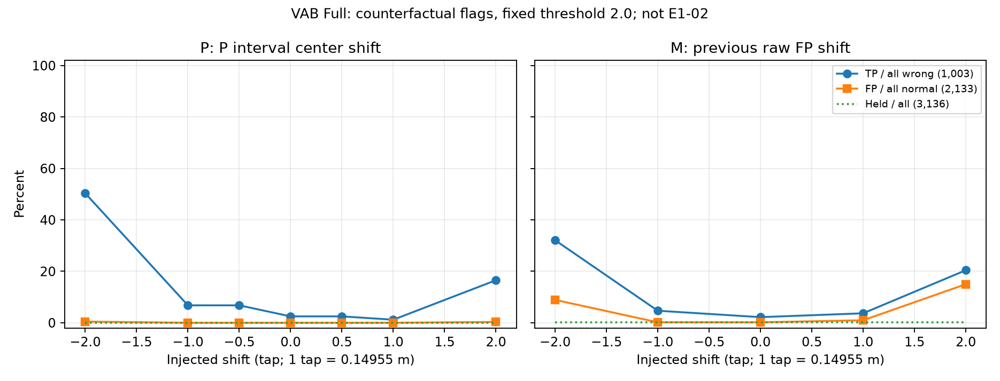

# P·M 입력 오차 민감도 진단 결과

2026-11-06 KST. 기준 94b49a5abe8443b8eacf4a1e3600ad3d52b10e9f + 영수증의 신규 모듈/script SHA.
역할 PROPOSER → IMPLEMENTER → 동일 작업자 자체검산. 독립 감사 아님.

**동적 6,272개 전체, 64대조 × C/P/M/PM = 1,605,632행의 고정 점수 진단과 검산 완료.**
VALID 생성0, 실제 detect/select/history/native model/EKF 호출 금지 상태에서 실행했다. E1-02/E2는 시작하지 않았다.
모든 선택 tap은 원본 raw tap 그대로다. 아래 TP/FP는 실제 활성화된 탐지기가 아닌 가상 점수 판정이다.

## 무개입 입력의 가상 판정 — 전체 동적

| 대조 | mode | TP / 오류 | FP / 정상 | 오류 보류 | 정상 보류 | 점수 가능률 |
|---|---|---:|---:|---:|---:|---:|
| NOMINAL | C | 0/1003 | 0/5269 | 0 | 0 | 100.00% |
| NOMINAL | P | 25/1003 | 0/5269 | 0 | 0 | 100.00% |
| NOMINAL | M | 22/1003 | 4/5269 | 3 | 3 | 99.90% |
| NOMINAL | PM | 35/1003 | 4/5269 | 3 | 3 | 99.90% |

M의 무개입 입력은 직전 raw FP와 원본 offset/이동량에서 만든 구간이다. 그 FP가 참조에 맞거나 신뢰할 만하다고 가정한 결과가 아니다.
M/PM 첫 행 및 나이 초과는 보류한다. P폭1.5m 초과 시 P/PM 보류, M에는 P폭 제한을 잘못 적용하지 않는다.
보류는 정상 판정/성공으로 세지 않았다. 전체 오류 미탐부담=(FN+오류보류)/전체오류이며 활성조건부 미탐과 별도로 저장했다.

## 사전 지정 예시 — Full만 비교

Native_LoS의 동일참조 음성대조가 정상분모를 늘리는 효과를 피하도록 Full 결과를 따로 제시한다. 아래 대조는 보고서 script에 고정한 예시이며 최적 대조를 고른 결과가 아니다.

| 대조 | mode | TP / 오류 | FP / 정상 | 오류 보류 | 정상 보류 | 점수 가능률 |
|---|---|---:|---:|---:|---:|---:|
| NOMINAL | P | 25/1003 | 0/2133 | 0 | 0 | 100.00% |
| P_CENTER_constant_-1.0 | P | 68/1003 | 0/2133 | 0 | 0 | 100.00% |
| P_CENTER_constant_1.0 | P | 12/1003 | 0/2133 | 0 | 0 | 100.00% |
| P_WIDTH_0.5 | P | 68/1003 | 0/2133 | 0 | 0 | 100.00% |
| P_WIDTH_2.0 | P | 10/1003 | 0/2133 | 0 | 0 | 100.00% |

| 대조 | mode | TP / 오류 | FP / 정상 | 오류 보류 | 정상 보류 | 점수 가능률 |
|---|---|---:|---:|---:|---:|---:|
| NOMINAL | M | 22/1003 | 4/2133 | 3 | 0 | 99.90% |
| M_FP_-1.0 | M | 47/1003 | 4/2133 | 3 | 0 | 99.90% |
| M_FP_1.0 | M | 37/1003 | 21/2133 | 3 | 0 | 99.90% |
| M_LAG_2.2 | M | 0/1003 | 0/2133 | 1003 | 2133 | 0.00% |
| reinitialize | M | 22/1003 | 4/2133 | 3 | 3 | 99.81% |

그림의 P 중심 이동과 M 과거 FP 이동은 지원구간 단계의 오차다. 실제 위치·Heading 오차가 이 크기의 이동을 만든다는 뜻은 아니다.
개입된 오차가 커질 때 탐지와 오탐이 함께 증가할 수 있다. 탐지 증가만을 provider 유효성이나 개선으로 판단하면 안 된다.
정확한 판정 변화는 SUMMARY.json의 vs_C 및 vs_nominal에 새 탐지/새 오탐/탐지소실(음성·보류)을 구분해 기록했다.

## 개입·정보 경계

P 중심·폭·결합, constant/jump/drift, M 과거 FP·offset·이동 상계, 지연/누락/재초기화, PM 공동/반대 오류와 원래 mapping stress7개를 모두 평가했다.
현재 점수 0.7*(-log support)+max(p,m)^2, wrong_cut2, 각 support scale0.15m를 그대로 사용했다. gain/margin은 선택 조건이므로 탐지에 추가하지 않았다.
원본 CIR에서 VAB 후보를 재생성하고 기존 C-only pool hash/C score/후보집합SHA를 전수 일치 확인했다.
온라인 계산기에 현재·미래 정답/LoS/현재 탐지flag를 전달하지 않았다. M은 j<k의 원래raw FP만 참조하며 새flag나선택으로이력을갱신하지않는다.
모든온라인출력의해시를저장한뒤원래mapping평가참조를결합했다. static48은제외했다.
원래stress의P지원구간은그대로재사용했으며Moffset은nominal그대로다. 새물리RF/상태mapping공동재생성이아니다.

## 기존 11,095건 보존

원본43904 stress의SHA·case/k/stress키·narrow exclusion11095를확인했다. 각행을원래stress구간으로평가하고 mode별동일11095분모를REGRESSION_11095.json에저장했다.
해당subset만튜닝하지않았고나머지정상/오류파형도모두포함했다. 이전실패와VAB주안은변경하지않았다.
R2/R4/R5모두노출개발자료다. 경로·채널·0/1/2+tap오류·개입전후·20초연속block별집계를보존했다.
연속block·개입복제를독립표본으로세지않으며실제운용오류율이나통계적안전성PASS를주장하지않는다.

## 구현·검산

- 신규 input_sensitivity.py는 가상 raw 점수·구간만 계산한다. 생산 provider/선택 경로의 동작을 수정하지 않았다.
- 합성200개지원구간에서실제prepare_candidate_set과대조, VALID spoof거부·미래raw변경불변·첫행/stale검사통과.
- 실제6272파형×4mode nominal점수를실제계산함수와대조: 최대차 0, flag일치.
- 테스트총16개통과. 별도checker가모든1,605,632 score/flag, P/M구간, 시간조건, 전체/층별/block/회귀집계를재계산했다.
- 자체검산최대score차 0; 검사집계행 23,976. 독립감사가아니다.
- 로컬CPU affinity [0, 1, 2], BLAS1, 실행 178.3초, peak working set 약221.3MB.

## 결론 범위

입력오차가고정점수의오탐·미탐·보류로전파되는관계를확인한진단이다. 올바른provider, 허용위험, VALID 적용범위는아직수용하지않았다.
1%·10%기준을동결하지않았고임계값을결과에맞춰바꾸지않았다. PM은max결합이므로두근거의독립확률결합으로해석하지않는다.
다음수정은결과와별도의새계약으로검토해야한다. E1-02/E2 미실행, Git commit/push 미수행.

산출물: CONTRACT_KO.md, RUN_001/RUN_RECEIPT.json, *_ONLINE.npz, *_EVALUATOR.npz,
SUMMARY.json, EPISODES.json, REGRESSION_11095.json, CHECK_001/CHECK.json, POOLED.csv, SENSITIVITY.png/svg.
