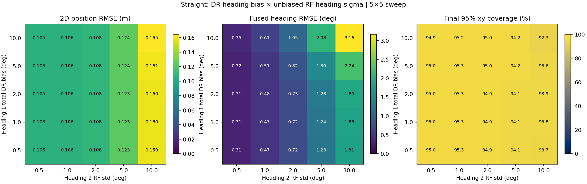
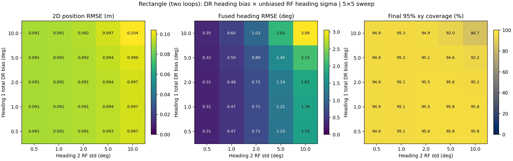
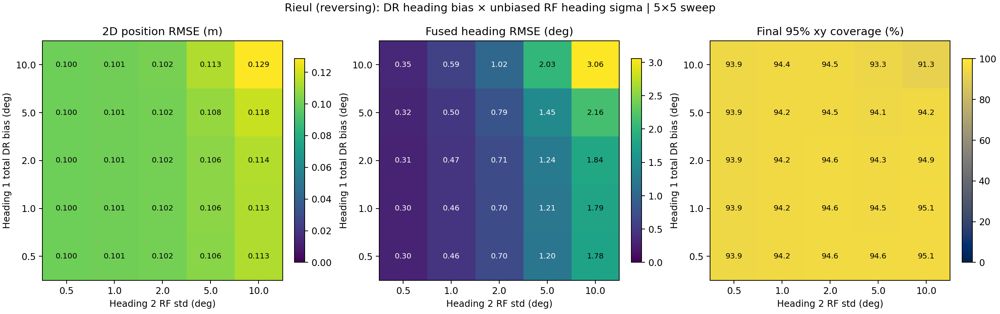

# Single-anchor Dual-Heading EKF: Heading 1 고정 Bias × Heading 2 표준편차 5×5

## 실험 정의

- **행**: Heading 1(IMU/odom 상대 회전증분)의 누적 고정 bias = +0.5°, +1°, +2°, +5°, +10° (100 step 동안 단계별 동일 오차를 추가).
- **열**: Heading 2(가정한 RF 독립 절대 Heading)의 **표준편차** = 0.5°, 1°, 2°, 5°, 10°; Heading 2 고정 bias = 0°.
- Heading 1의 무작위 오차 표준편차는 0.23°/step, UWB ranging = 0.08 m, odometry 거리증분 = 0.008 m/step으로 고정.
- EKF는 IMU/odom으로 예측하고, RF의 거리/절대 heading 두 관측으로 갱신. EKF의 Heading 1 bias는 미모델링, Heading 2는 bias 0으로 생성.
- RF angle std의 제곱을 **rad²로 변환**하여 R[1,1]에 반영, 백색잡음은 세 센서 간 독립, 동일 시점/시간 상관은 모두 0.
- GitHub 복도: 20×2.4×2.7 m, anchor(4,0,2.65) m, tag z=0.45 m, 10 m/100 step, Δt=0.5 s, 1000회 Monte Carlo, seed=20261012.
- 구형/다중 LP RF 신호처리 없음. **RF가 독립 절대 Heading을 제공한다는 것은 검증되지 않은 가정**입니다.
- 모든 비교에서 실제 ground truth, 초기 상태, 센서 난수 스트림은 같은 것을 재사용하므로 **paired Monte Carlo**입니다.

## 수학 모델

$$\Delta\psi_{1,k}=\Delta\psi_k^{GT}+\frac{b_{1,\mathrm{total}}}{N}+\epsilon_{1,k},\quad \epsilon_{1,k}\sim\mathcal N(0,(0.23\pi/180)^2).$$

$$z_{2,k}=\operatorname{wrap}(\psi_k^{GT}+\epsilon_{2,k}),\quad \epsilon_{2,k}\sim\mathcal N\left(0,(\sigma_2\pi/180)^2\right),\quad b_2=0.$$ 

$$z_{r,k}=\sqrt{(x_k-4)^2+y_k^2+2.2^2}+\epsilon_{r,k},\quad\epsilon_{r,k}\sim\mathcal N(0,0.08^2).$$

$$R_{\mathrm{RF}}=\operatorname{diag}(0.08^2,(\sigma_2\pi/180)^2),\quad P^-=FP^+F^T+GQG^T.$$ 

Final 95% 위치 포함률: 각 run의 마지막 오차 e_xy와 마지막 P_xy에 대해 $e_{xy}^TP_{xy}^{-1}e_{xy}\le\chi^2_{2,0.95}=5.9915$를 만족한 비율.

## 4개 경로 × 3 지표: 5×5 실행 결과

### 직선 (straight)

**1) 전체 10 m 2D 위치 RMSE (m)**

| H1 total bias ↓ / H2 σ → | 0.5° | 1° | 2° | 5° | 10° |
|:--|--:|--:|--:|--:|--:|
| 0.5° | 0.105 | 0.106 | 0.108 | 0.123 | 0.159 |
| 1° | 0.105 | 0.106 | 0.108 | 0.123 | 0.160 |
| 2° | 0.105 | 0.106 | 0.108 | 0.123 | 0.160 |
| 5° | 0.105 | 0.106 | 0.108 | 0.124 | 0.161 |
| 10° | 0.105 | 0.106 | 0.108 | 0.124 | 0.165 |

**2) 전체 주행 융합 Heading RMSE (°)**

| H1 total bias ↓ / H2 σ → | 0.5° | 1° | 2° | 5° | 10° |
|:--|--:|--:|--:|--:|--:|
| 0.5° | 0.31 | 0.47 | 0.72 | 1.23 | 1.81 |
| 1° | 0.31 | 0.47 | 0.72 | 1.24 | 1.83 |
| 2° | 0.31 | 0.48 | 0.73 | 1.28 | 1.89 |
| 5° | 0.32 | 0.51 | 0.82 | 1.50 | 2.24 |
| 10° | 0.35 | 0.61 | 1.05 | 2.08 | 3.16 |

**3) 최종 95% 위치 신뢰타원 포함률 (%)**

| H1 total bias ↓ / H2 σ → | 0.5° | 1° | 2° | 5° | 10° |
|:--|--:|--:|--:|--:|--:|
| 0.5° | 95.0% | 95.3% | 94.9% | 94.1% | 93.7% |
| 1° | 95.0% | 95.3% | 94.9% | 94.1% | 93.8% |
| 2° | 95.0% | 95.3% | 94.9% | 94.1% | 93.9% |
| 5° | 95.0% | 95.3% | 95.0% | 94.2% | 93.6% |
| 10° | 94.9% | 95.2% | 95.0% | 94.2% | 92.3% |



### 네모 (rectangle)

**1) 전체 10 m 2D 위치 RMSE (m)**

| H1 total bias ↓ / H2 σ → | 0.5° | 1° | 2° | 5° | 10° |
|:--|--:|--:|--:|--:|--:|
| 0.5° | 0.091 | 0.091 | 0.091 | 0.093 | 0.097 |
| 1° | 0.091 | 0.091 | 0.091 | 0.094 | 0.097 |
| 2° | 0.091 | 0.091 | 0.091 | 0.094 | 0.097 |
| 5° | 0.091 | 0.091 | 0.092 | 0.094 | 0.099 |
| 10° | 0.091 | 0.091 | 0.092 | 0.097 | 0.104 |

**2) 전체 주행 융합 Heading RMSE (°)**

| H1 total bias ↓ / H2 σ → | 0.5° | 1° | 2° | 5° | 10° |
|:--|--:|--:|--:|--:|--:|
| 0.5° | 0.31 | 0.47 | 0.71 | 1.20 | 1.75 |
| 1° | 0.31 | 0.47 | 0.71 | 1.21 | 1.76 |
| 2° | 0.31 | 0.48 | 0.72 | 1.24 | 1.82 |
| 5° | 0.32 | 0.50 | 0.80 | 1.45 | 2.15 |
| 10° | 0.35 | 0.60 | 1.03 | 2.02 | 3.06 |

**3) 최종 95% 위치 신뢰타원 포함률 (%)**

| H1 total bias ↓ / H2 σ → | 0.5° | 1° | 2° | 5° | 10° |
|:--|--:|--:|--:|--:|--:|
| 0.5° | 94.9% | 95.1% | 95.6% | 95.8% | 95.8% |
| 1° | 94.9% | 95.1% | 95.5% | 95.8% | 95.8% |
| 2° | 94.9% | 95.1% | 95.5% | 95.6% | 95.2% |
| 5° | 94.9% | 95.2% | 95.1% | 94.6% | 93.2% |
| 10° | 94.9% | 95.3% | 94.9% | 92.0% | 84.7% |



### ㄹ자 (rieul)

**1) 전체 10 m 2D 위치 RMSE (m)**

| H1 total bias ↓ / H2 σ → | 0.5° | 1° | 2° | 5° | 10° |
|:--|--:|--:|--:|--:|--:|
| 0.5° | 0.100 | 0.101 | 0.102 | 0.106 | 0.113 |
| 1° | 0.100 | 0.101 | 0.102 | 0.106 | 0.113 |
| 2° | 0.100 | 0.101 | 0.102 | 0.106 | 0.114 |
| 5° | 0.100 | 0.101 | 0.102 | 0.108 | 0.118 |
| 10° | 0.100 | 0.101 | 0.102 | 0.113 | 0.129 |

**2) 전체 주행 융합 Heading RMSE (°)**

| H1 total bias ↓ / H2 σ → | 0.5° | 1° | 2° | 5° | 10° |
|:--|--:|--:|--:|--:|--:|
| 0.5° | 0.30 | 0.46 | 0.70 | 1.20 | 1.78 |
| 1° | 0.30 | 0.46 | 0.70 | 1.21 | 1.79 |
| 2° | 0.31 | 0.47 | 0.71 | 1.24 | 1.84 |
| 5° | 0.32 | 0.50 | 0.79 | 1.45 | 2.16 |
| 10° | 0.35 | 0.59 | 1.02 | 2.03 | 3.06 |

**3) 최종 95% 위치 신뢰타원 포함률 (%)**

| H1 total bias ↓ / H2 σ → | 0.5° | 1° | 2° | 5° | 10° |
|:--|--:|--:|--:|--:|--:|
| 0.5° | 93.9% | 94.2% | 94.6% | 94.6% | 95.1% |
| 1° | 93.9% | 94.2% | 94.6% | 94.5% | 95.1% |
| 2° | 93.9% | 94.2% | 94.6% | 94.3% | 94.9% |
| 5° | 93.9% | 94.2% | 94.5% | 94.1% | 94.2% |
| 10° | 93.9% | 94.4% | 94.5% | 93.3% | 91.3% |



### 지그재그 (zigzag)

**1) 전체 10 m 2D 위치 RMSE (m)**

| H1 total bias ↓ / H2 σ → | 0.5° | 1° | 2° | 5° | 10° |
|:--|--:|--:|--:|--:|--:|
| 0.5° | 0.097 | 0.097 | 0.099 | 0.112 | 0.144 |
| 1° | 0.097 | 0.097 | 0.099 | 0.112 | 0.144 |
| 2° | 0.097 | 0.097 | 0.099 | 0.112 | 0.144 |
| 5° | 0.097 | 0.097 | 0.099 | 0.112 | 0.145 |
| 10° | 0.097 | 0.097 | 0.099 | 0.112 | 0.149 |

**2) 전체 주행 융합 Heading RMSE (°)**

| H1 total bias ↓ / H2 σ → | 0.5° | 1° | 2° | 5° | 10° |
|:--|--:|--:|--:|--:|--:|
| 0.5° | 0.31 | 0.47 | 0.71 | 1.21 | 1.78 |
| 1° | 0.31 | 0.47 | 0.71 | 1.22 | 1.79 |
| 2° | 0.31 | 0.47 | 0.72 | 1.25 | 1.84 |
| 5° | 0.32 | 0.50 | 0.80 | 1.46 | 2.16 |
| 10° | 0.35 | 0.60 | 1.03 | 2.03 | 3.06 |

**3) 최종 95% 위치 신뢰타원 포함률 (%)**

| H1 total bias ↓ / H2 σ → | 0.5° | 1° | 2° | 5° | 10° |
|:--|--:|--:|--:|--:|--:|
| 0.5° | 95.2% | 95.9% | 95.5% | 96.2% | 96.3% |
| 1° | 95.2% | 95.9% | 95.6% | 96.2% | 96.4% |
| 2° | 95.2% | 95.9% | 95.6% | 96.3% | 96.1% |
| 5° | 95.2% | 95.8% | 95.6% | 95.9% | 95.3% |
| 10° | 95.3% | 95.7% | 95.6% | 96.0% | 91.9% |


## Heading 1 bias=0° 기준선 (각 Heading 2 표준편차별)

| 경로 | H2 std | 위치 RMSE (m) | 융합 Heading RMSE (°) | 최종 95% |
|:--|--:|--:|--:|--:|
| 직선 | 0.5° | 0.105 | 0.31 | 95.0% |
| 직선 | 1° | 0.106 | 0.47 | 95.3% |
| 직선 | 2° | 0.108 | 0.72 | 94.9% |
| 직선 | 5° | 0.123 | 1.23 | 94.1% |
| 직선 | 10° | 0.159 | 1.80 | 93.8% |
| 네모 | 0.5° | 0.091 | 0.31 | 94.9% |
| 네모 | 1° | 0.091 | 0.47 | 95.2% |
| 네모 | 2° | 0.091 | 0.71 | 95.4% |
| 네모 | 5° | 0.093 | 1.20 | 95.6% |
| 네모 | 10° | 0.097 | 1.74 | 95.7% |
| ㄹ자 | 0.5° | 0.100 | 0.30 | 93.9% |
| ㄹ자 | 1° | 0.101 | 0.46 | 94.2% |
| ㄹ자 | 2° | 0.102 | 0.70 | 94.6% |
| ㄹ자 | 5° | 0.106 | 1.20 | 94.6% |
| ㄹ자 | 10° | 0.113 | 1.77 | 95.1% |
| 지그재그 | 0.5° | 0.097 | 0.31 | 95.2% |
| 지그재그 | 1° | 0.097 | 0.47 | 95.9% |
| 지그재그 | 2° | 0.099 | 0.71 | 95.5% |
| 지그재그 | 5° | 0.112 | 1.21 | 96.1% |
| 지그재그 | 10° | 0.144 | 1.77 | 96.1% |

## 공분산과 Bias 해석

Heading 1 bias는 매 step 실제 회전량과 DR 회전량 간 지속적 offset이므로 **분산 Q를 올바르게 설정해도 공분산이 실제 error의 평균을 설명하지 못할 수 있습니다**.
Heading 2가 0-bias라도 표준편차가 커지면 필터가 Heading 1 예측을 더 신뢰해 Heading 1 bias의 영향이 커질 수 있습니다. 그러나 수치는 경로, 초기 prior, RF 갱신 주기에 의존합니다.
위치 RMSE가 작은 네모 경로는 이동 구간의 cancellation이 작용할 수 있으므로 **종료 위치 95% 외에 전체 자세 95%와 융합 Heading RMSE도 검토**해야 합니다.

## 평가 경계

- σ2의 10°는 분산 10 deg²가 아니라 **표준편차 10°**를 의미하고, 실제 분산은 (10π/180)² rad²입니다.
- UWB ranging 및 Heading RF 관측 간 상관/시간 상관은 **0으로 고정**했습니다. 본 실험은 bias × variance만 격리합니다.
- 각 경로의 실제 궤적은 주행 중 모터 noise가 있는 독립 시뮬레이션이며, 물리 충돌 및 지형 map constraints는 적용하지 않았습니다.
- RF absolute world heading 획득은 가상 오라클 관측입니다. 단일 앵커 relative bearing만으로 동일 성능을 기대할 수 없습니다.

## 재현성 / 검증

```bash
pip install numpy pandas matplotlib
python run_grid.py --runs 1000 --seed 20261012
```

- QA: {"previous_unbiased_baseline_exact": true, "expected_100_sweep_rows": true, "zero_rf_fixed_bias": true, "positive_definite_covariance": true, "range_and_heading_gaussian_noise_calibration": true, "positive_std_and_covariance": true, "no_nan_outputs": true, "same_b1_input_for_all_s2": true, "previous_rf_sigma_sweep_exact": true}
